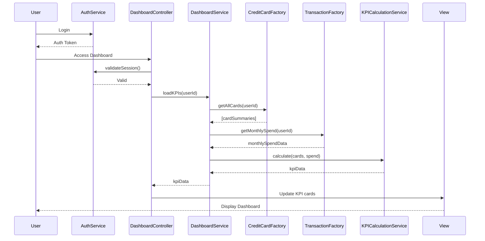

# Low-Level Design: Dashboard and KPI Management
**Epic ID:** QE-7673

## a. Architecture Mapping

- **User Interface** → AngularJS Module (`dashboardModule`) + Controller (`DashboardController`) + Directive (`kpiCardDirective`)
- **Dashboard Service** → AngularJS Service (`DashboardService`) for orchestrating KPI data retrieval
- **Credit Card Data Service** → REST API integration via Factory (`CreditCardFactory`)
- **Transaction Service** → REST API integration via Factory (`TransactionFactory`)
- **User Authentication Service** → AngularJS Service (`AuthService`) for session management
- **KPI Calculation Engine** → AngularJS Service (`KPICalculationService`) for client-side KPI computation

**Folder Structure:**
```
/app
  /modules
    /dashboard
      dashboard.module.js
      dashboard.controller.js
      dashboard.service.js
      /directives
        kpi-card.directive.js
      /factories
        credit-card.factory.js
        transaction.factory.js
      /services
        auth.service.js
        kpi-calculation.service.js
      /views
        dashboard.html
  /assets
    /css
      dashboard.css
```

## b. Component Specifications

| Component Name | Artifact Type | Responsibility | Key Dependencies |
|----------------|---------------|----------------|------------------|
| dashboardModule | Module | Root module for dashboard feature | ngRoute, ngResource |
| DashboardController | Controller | Manages dashboard state and KPI display | DashboardService, AuthService, $scope |
| DashboardService | Service | Orchestrates data retrieval from card and transaction services | CreditCardFactory, TransactionFactory, KPICalculationService, $q |
| kpiCardDirective | Directive | Renders individual KPI cards with responsive layout | $window (for responsive behavior) |
| CreditCardFactory | Factory | REST API calls to fetch card details, limits, and balances | $resource, API_ENDPOINTS |
| TransactionFactory | Factory | REST API calls to fetch spending data | $resource, API_ENDPOINTS |
| AuthService | Service | Manages user authentication state and session | $http, $window (localStorage) |
| KPICalculationService | Service | Computes Monthly Spend, Total Credit Limit, Available Credit, Outstanding Amount | None (pure computation) |

## c. Data Model

**KPIData Object:**
```javascript
{
  monthlySpend: Number,
  totalCreditLimit: Number,
  availableCredit: Number,
  outstandingAmount: Number,
  lastUpdated: Date
}
```

**CardSummary Object:**
```javascript
{
  cardId: String,
  creditLimit: Number,
  currentBalance: Number,
  availableCredit: Number
}
```

## d. Data Flow

User authenticates via AuthService, then DashboardController invokes DashboardService to load KPI data. DashboardService calls CreditCardFactory to retrieve all user cards (limits, balances) and TransactionFactory to fetch monthly spending data. KPICalculationService aggregates data across cards to compute Total Credit Limit, Available Credit (sum of per-card available credit), Outstanding Amount (sum of balances), and Monthly Spend. Computed KPIs are returned to DashboardController, which updates $scope, triggering kpiCardDirective to render responsive KPI cards in the view with near-real-time updates.

## e. Primary Sequence Diagram



## f. Implementation Notes

- Use AngularJS $interval or $timeout for periodic KPI refresh (e.g., every 60 seconds) to maintain near-real-time data.
- Implement responsive design using Bootstrap grid (col-lg-3, col-md-6, col-sm-12) for KPI cards to adapt across devices.
- Use $resource with caching strategy for CreditCardFactory to reduce redundant API calls during session.
- Apply ES6 Promise.all pattern via $q.all for parallel data fetching from CreditCardFactory and TransactionFactory.
- Leverage CSS3 flexbox and media queries for mobile-first responsive layout in dashboard.html.

## g. Error Handling

HTTP interceptor-based error handling with user notification via modal dialog; automatic retry on transient failures.

## h. Security Notes

Requires token-based auth via existing SSO; all API calls include Authorization header with JWT token from AuthService.