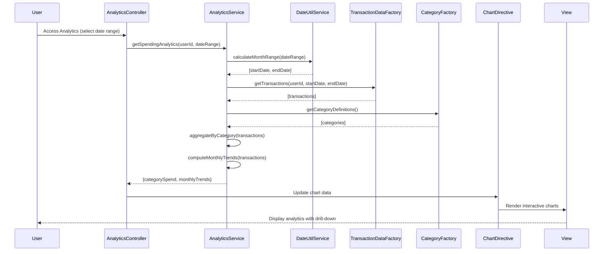

# Low-Level Design: Spending Analytics and Category Insights
**Epic ID:** QE-7674

## a. Architecture Mapping

- **User Interface** → AngularJS Module (`analyticsModule`) + Controller (`AnalyticsController`) + Directive (`categoryChartDirective`, `trendChartDirective`)
- **Analytics Engine** → AngularJS Service (`AnalyticsService`) for data aggregation and processing
- **Transaction Data Service** → REST API integration via Factory (`TransactionDataFactory`)
- **Category Classification Engine** → REST API integration via Factory (`CategoryFactory`)
- **Visualization Library** → External library (Chart.js or D3.js) wrapped in AngularJS directives
- **Date/Time Service** → AngularJS Service (`DateUtilService`) for temporal calculations

**Folder Structure:**
```
/app
  /modules
    /analytics
      analytics.module.js
      analytics.controller.js
      analytics.service.js
      /directives
        category-chart.directive.js
        trend-chart.directive.js
      /factories
        transaction-data.factory.js
        category.factory.js
      /services
        date-util.service.js
      /views
        analytics.html
  /assets
    /css
      analytics.css
    /js
      /vendor
        chart.min.js
```

## b. Component Specifications

| Component Name | Artifact Type | Responsibility | Key Dependencies |
|----------------|---------------|----------------|------------------|
| analyticsModule | Module | Root module for spending analytics feature | ngRoute, ngResource, chart.js |
| AnalyticsController | Controller | Manages analytics view state, category selection, and time range | AnalyticsService, DateUtilService, $scope |
| AnalyticsService | Service | Aggregates transaction data by category and time period | TransactionDataFactory, CategoryFactory, DateUtilService, $q |
| categoryChartDirective | Directive | Renders interactive pie/bar chart for category-wise spending | Chart.js, $window |
| trendChartDirective | Directive | Renders line chart for monthly spend trends | Chart.js, $window |
| TransactionDataFactory | Factory | REST API calls to fetch categorized transaction records | $resource, API_ENDPOINTS |
| CategoryFactory | Factory | REST API calls to retrieve category definitions and mappings | $resource, API_ENDPOINTS |
| DateUtilService | Service | Provides date manipulation and month range calculations | moment.js or native Date |

## c. Data Model

**Transaction Object:**
```javascript
{
  transactionId: String,
  cardId: String,
  amount: Number,
  category: String,        // one of 9 categories
  transactionDate: Date,
  merchantName: String,
  description: String
}
```

**CategorySpend Object:**
```javascript
{
  category: String,
  totalAmount: Number,
  transactionCount: Number,
  percentage: Number       // of total spend
}
```

**MonthlyTrend Object:**
```javascript
{
  month: String,           // e.g., "2024-01"
  totalSpend: Number,
  categoryBreakdown: [CategorySpend]
}
```

## d. Data Flow

User accesses analytics view, triggering AnalyticsController to call AnalyticsService with selected time range (default: last 6 months). AnalyticsService uses DateUtilService to compute date range, then fetches categorized transactions via TransactionDataFactory and category definitions via CategoryFactory. Service aggregates transactions by category and month, computing totals and percentages. Processed data is returned to AnalyticsController, which updates $scope. categoryChartDirective and trendChartDirective watch scope changes and render interactive Chart.js visualizations. User interactions (category drill-down, date range change) trigger new data requests through AnalyticsService.

## e. Primary Sequence Diagram



## f. Implementation Notes

- Use Chart.js wrapped in AngularJS directives for responsive, touch-enabled interactive charts with drill-down support.
- Implement lazy loading for TransactionDataFactory to fetch only date-range-specific data, reducing payload size.
- Use ES6 Map and reduce functions in AnalyticsService for efficient category aggregation and trend computation.
- Apply $watch in chart directives to re-render visualizations when scope data changes (category selection, date range).
- Leverage CSS3 media queries and Bootstrap responsive utilities for mobile-optimized chart display.

## g. Error Handling

Try/catch blocks in AnalyticsService with fallback to cached data; user notification via toastr on API failures.

## h. Security Notes

Standard input validation and secure API calls assumed; transaction data filtered server-side by authenticated userId.