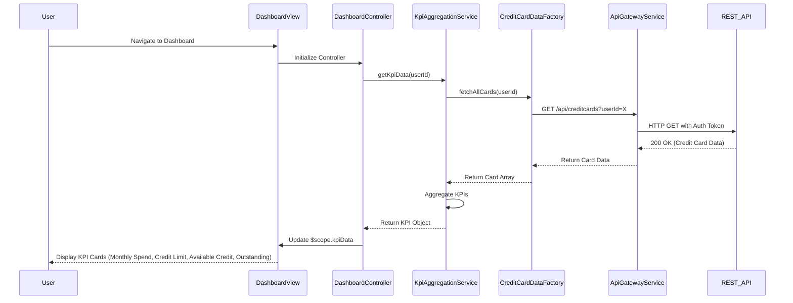

# Low-Level Design: QE-7675 - Credit Card Dashboard and KPI Management

## a. Architecture Mapping

**HLD Component → AngularJS Artifact:**
- User Interface - Dashboard → Module: `dashboard.module.js`, Controller: `DashboardController`, View: `dashboard.html`
- API Gateway → Service: `ApiGatewayService` (HTTP interceptor and routing)
- KPI Aggregation Service → Service: `KpiAggregationService` (business logic for KPI calculations)
- User Authentication Service → Service: `AuthService` (token management and session validation)
- Credit Card Data Repository → Factory: `CreditCardDataFactory` (data access layer)

**Recommended Folder Structure:**
```
app/
├── modules/
│   └── dashboard/
│       ├── dashboard.module.js
│       ├── controllers/
│       │   └── DashboardController.js
│       ├── services/
│       │   ├── KpiAggregationService.js
│       │   └── CreditCardDataFactory.js
│       └── views/
│           └── dashboard.html
├── shared/
│   └── services/
│       ├── ApiGatewayService.js
│       └── AuthService.js
└── assets/
    ├── css/
    └── js/
```

## b. Component Specifications

| Component Name | Artifact Type | Responsibility | Key Dependencies |
|----------------|---------------|----------------|------------------|
| dashboard.module | Module | Defines dashboard module and configures routing | angular, angular-route |
| DashboardController | Controller | Manages dashboard view state, fetches KPI data, handles user interactions | KpiAggregationService, $scope, $timeout |
| KpiAggregationService | Service | Fetches and aggregates KPI data (monthly spend, credit limit, available credit, outstanding) | CreditCardDataFactory, $http, $q |
| CreditCardDataFactory | Factory | Provides data access methods for credit card data from REST API | ApiGatewayService, $http |
| ApiGatewayService | Service | Centralized HTTP request handler with interceptors for auth and error handling | $http, AuthService |
| AuthService | Service | Manages user authentication tokens and session validation | $http, $window |
| dashboard.html | View | Renders KPI cards with Bootstrap grid, responsive layout, real-time data binding | Bootstrap CSS, AngularJS directives |

## c. Data Model

**CreditCardKpi (JavaScript Object):**
```javascript
{
  userId: String,
  monthlySpend: Number,
  totalCreditLimit: Number,
  availableCredit: Number,
  outstandingAmount: Number,
  lastUpdated: Date,
  cards: Array<CreditCard>
}
```

**CreditCard (JavaScript Object):**
```javascript
{
  cardId: String,
  cardNumber: String (masked),
  cardType: String,
  creditLimit: Number,
  availableCredit: Number,
  outstandingAmount: Number,
  monthlySpend: Number
}
```

## d. Data Flow

User navigates to the dashboard view → `DashboardController` initializes and invokes `KpiAggregationService.getKpiData()` → Service calls `CreditCardDataFactory.fetchAllCards()` which sends GET request via `ApiGatewayService` to `/api/creditcards` endpoint → API returns aggregated credit card data → Service computes KPIs (monthly spend, total credit limit, available credit, outstanding amount) → Controller updates `$scope.kpiData` → View re-renders KPI cards with two-way data binding, displaying real-time metrics in responsive Bootstrap layout.

## e. Primary Sequence Diagram



## f. Implementation Notes

- Use AngularJS 1.x module pattern with dependency injection for all services and controllers.
- Implement `$http` interceptors in `ApiGatewayService` for centralized auth token injection and error handling.
- Use `$q` promises for asynchronous KPI aggregation; handle success/error callbacks in controller.
- Apply Bootstrap 4 grid system (col-md-3) for responsive KPI card layout; use CSS3 media queries for mobile optimization.
- Leverage `ng-repeat` for rendering multiple credit card summaries; use `ng-if` to conditionally display loading spinners during data fetch.

## g. Error Handling

HTTP interceptor-based error handling in `ApiGatewayService` with user notifications via Bootstrap alerts and retry logic for transient failures.

## h. Security Notes

Requires token-based authentication via existing SSO; all API calls include Authorization header with JWT token validated by `AuthService`.