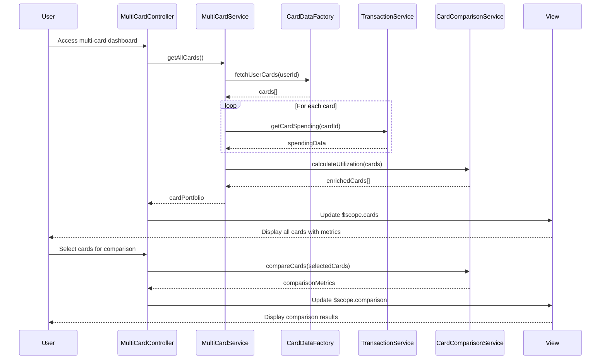

# Low-Level Design: QE-7676 - Multi-Card Management and Monitoring

## a. Architecture Mapping

- **Multi-Card Management Service** → AngularJS Module (`creditCard.multiCard`) + Controller (`MultiCardController`) + Service (`MultiCardService`)
- **User Authentication Service** → AngularJS Service (`AuthService`) with token management
- **Credit Card Data Repository** → REST API integration via AngularJS Factory (`CardDataFactory`)
- **Transaction Service** → REST API integration via AngularJS Service (`TransactionService`)
- **Card Comparison Engine** → AngularJS Service (`CardComparisonService`) with client-side comparison logic
- **User Interface** → AngularJS Views with Directives (`cardListDirective`, `cardDetailDirective`)

**Recommended Folder Structure:**
```
/app
  /modules
    /multi-card
      /controllers (MultiCardController.js)
      /services (MultiCardService.js, CardComparisonService.js)
      /factories (CardDataFactory.js)
      /directives (cardListDirective.js, cardDetailDirective.js)
      /views (multi-card-view.html, card-detail-view.html)
  /shared
    /services (AuthService.js, TransactionService.js)
```

## b. Component Specifications

| Name | Artifact Type | Responsibility | Key Dependencies |
|------|---------------|----------------|------------------|
| MultiCardController | Controller | Orchestrates multi-card view, handles user interactions, manages card selection and comparison | MultiCardService, CardComparisonService, $scope |
| MultiCardService | Service | Fetches all user cards, aggregates card data, manages card refresh logic | CardDataFactory, TransactionService, $http, $q |
| CardDataFactory | Factory | REST API calls to Credit Card Data Repository for card information | $http, AuthService |
| TransactionService | Service | Fetches card-wise spending data from Transaction API | $http, AuthService |
| CardComparisonService | Service | Calculates utilization rates, performs card-to-card comparisons, generates comparison metrics | None |
| AuthService | Service | Manages user authentication, token storage, secure API call headers | $http, $window (localStorage) |
| cardListDirective | Directive | Renders list of all user cards with key metrics | None |
| cardDetailDirective | Directive | Displays detailed view of individual card with spending breakdown | None |

## c. Data Model

**CardModel (JavaScript Object):**
```javascript
{
  cardId: String,
  cardNumber: String (masked),
  cardType: String,
  creditLimit: Number,
  outstandingBalance: Number,
  availableCredit: Number,
  utilizationRate: Number (calculated),
  lastRefreshTime: Date
}
```

**CardSpendingModel (JavaScript Object):**
```javascript
{
  cardId: String,
  monthlySpend: Number,
  categoryBreakdown: Array<{category: String, amount: Number}>,
  transactionCount: Number
}
```

**UserCardPortfolio (JavaScript Object):**
```javascript
{
  userId: String,
  cards: Array<CardModel>,
  totalCards: Number
}
```

## d. Data Flow

User authenticates and accesses multi-card view → MultiCardController initializes and calls MultiCardService.getAllCards() → MultiCardService requests card list from CardDataFactory (REST API call to Credit Card Data Repository) → For each card, TransactionService.getCardSpending(cardId) fetches spending data → CardComparisonService calculates utilization rates and comparison metrics → Controller updates $scope with aggregated card data → View renders card list using cardListDirective → User selects a card for details → cardDetailDirective displays detailed card view with spending breakdown → User triggers comparison → CardComparisonService processes selected cards and returns comparison data → UI updates with comparison visualization.

## e. Primary Sequence Diagram



## f. Implementation Notes

- Use AngularJS Dependency Injection for all services, factories, and controllers; register module as `angular.module('creditCard.multiCard', [])`.
- Implement promise-based async handling with `$q` for parallel card data fetching to meet 3-second refresh NFR.
- Use `$http` interceptor pattern for attaching auth tokens to all API requests via AuthService.
- Implement one-way data binding where possible; use `ng-repeat` with `track by cardId` for performance with 10+ cards.
- CardComparisonService uses pure JavaScript ES6 array methods (map, filter, reduce) for client-side calculations; no external dependencies.

## g. Error Handling

HTTP interceptor captures API errors; user-friendly notifications displayed via AngularJS `$rootScope.$broadcast` and toast directive; retry logic for failed card data fetches with exponential backoff.

## h. Security Notes

Requires token-based auth via existing SSO; AuthService manages JWT tokens stored in localStorage; all API calls include Authorization header.