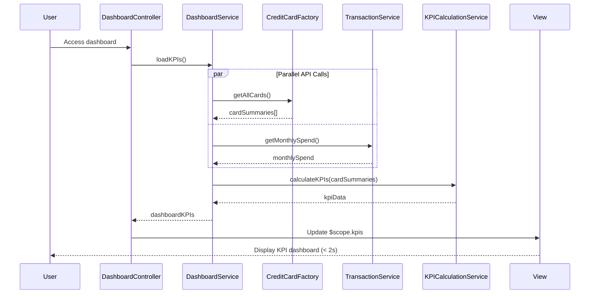

# Low-Level Design: QE-7677 - Dashboard and KPI Management

## a. Architecture Mapping

- **Dashboard Service** → AngularJS Module (`creditCard.dashboard`) + Controller (`DashboardController`) + Service (`DashboardService`)
- **Credit Card Data Service** → REST API integration via AngularJS Factory (`CreditCardFactory`)
- **Transaction Service** → REST API integration via AngularJS Service (`TransactionService`)
- **KPI Calculation Engine** → AngularJS Service (`KPICalculationService`) with client-side aggregation logic
- **User Interface** → AngularJS View with Directives (`kpiWidgetDirective`, `dashboardLayoutDirective`)

**Recommended Folder Structure:**
```
/app
  /modules
    /dashboard
      /controllers (DashboardController.js)
      /services (DashboardService.js, KPICalculationService.js)
      /factories (CreditCardFactory.js)
      /directives (kpiWidgetDirective.js, dashboardLayoutDirective.js)
      /views (dashboard-view.html)
  /shared
    /services (TransactionService.js, AuthService.js)
```

## b. Component Specifications

| Name | Artifact Type | Responsibility | Key Dependencies |
|------|---------------|----------------|------------------|
| DashboardController | Controller | Orchestrates dashboard view, initializes KPI data load, handles refresh actions | DashboardService, $scope, $interval |
| DashboardService | Service | Aggregates data from multiple sources, coordinates KPI calculation, manages dashboard state | CreditCardFactory, TransactionService, KPICalculationService, $q |
| CreditCardFactory | Factory | REST API calls to Credit Card Data Service for card details and balances | $http, AuthService |
| TransactionService | Service | Fetches monthly spend data from Transaction API | $http, AuthService |
| KPICalculationService | Service | Calculates total credit limit, available credit, outstanding amounts in real-time | None |
| kpiWidgetDirective | Directive | Renders individual KPI metric with value, label, and visual indicator | None |
| dashboardLayoutDirective | Directive | Manages responsive dashboard grid layout using Bootstrap classes | None |

## c. Data Model

**DashboardKPIModel (JavaScript Object):**
```javascript
{
  monthlySpend: Number,
  totalCreditLimit: Number,
  availableCredit: Number,
  outstandingAmount: Number,
  utilizationPercentage: Number (calculated),
  lastUpdated: Date
}
```

**CreditCardSummary (JavaScript Object):**
```javascript
{
  cardId: String,
  creditLimit: Number,
  currentBalance: Number
}
```

## d. Data Flow

User accesses dashboard → DashboardController calls DashboardService.loadKPIs() → DashboardService makes parallel API calls via CreditCardFactory.getAllCards() and TransactionService.getMonthlySpend() using $q.all() → CreditCardFactory returns array of CreditCardSummary objects → TransactionService returns current month's total spend → KPICalculationService.calculateKPIs() aggregates total credit limit (sum of all card limits), calculates available credit (total limit minus total outstanding), computes outstanding amount (sum of all card balances) → DashboardService returns DashboardKPIModel → DashboardController updates $scope.kpis → View renders KPIs using kpiWidgetDirective with responsive layout via dashboardLayoutDirective → User sees consolidated financial health metrics within 2 seconds.

## e. Primary Sequence Diagram



## f. Implementation Notes

- Use AngularJS module `angular.module('creditCard.dashboard', [])` with DI for all components.
- Implement `$q.all()` for parallel API calls to meet 2-second load time NFR; use promise chaining for sequential processing.
- KPICalculationService uses ES6 reduce() for aggregation; pure functions for testability.
- Use Bootstrap grid (col-md-3, col-sm-6, col-xs-12) in dashboardLayoutDirective for responsive design across devices.
- Implement `$interval` in DashboardController for optional periodic refresh (configurable, default disabled).

## g. Error Handling

HTTP interceptor-based error capture; fallback to cached KPI data if API fails; user notification via toast service with retry option.

## h. Security Notes

Requires token-based auth via existing SSO; all API calls secured with JWT tokens managed by AuthService.