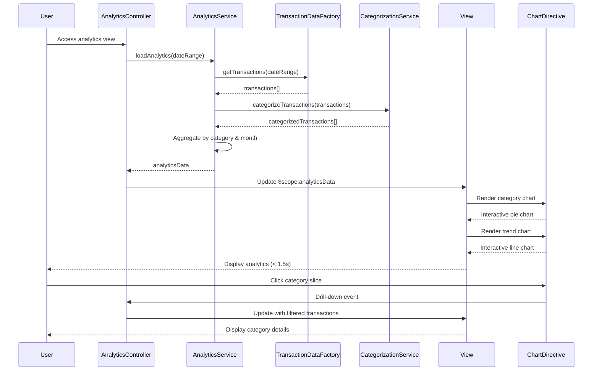

# Low-Level Design: QE-7678 - Transaction Analytics and Category Insights

## a. Architecture Mapping

- **Analytics Service** → AngularJS Module (`creditCard.analytics`) + Controller (`AnalyticsController`) + Service (`AnalyticsService`)
- **Transaction Data Service** → REST API integration via AngularJS Factory (`TransactionDataFactory`)
- **Categorization Engine** → REST API integration via AngularJS Service (`CategorizationService`)
- **Visualization Library** → AngularJS Directive (`chartDirective`) wrapping Chart.js or D3.js
- **User Interface** → AngularJS View with Directives (`categoryChartDirective`, `trendChartDirective`, `analyticsFilterDirective`)

**Recommended Folder Structure:**
```
/app
  /modules
    /analytics
      /controllers (AnalyticsController.js)
      /services (AnalyticsService.js, CategorizationService.js)
      /factories (TransactionDataFactory.js)
      /directives (categoryChartDirective.js, trendChartDirective.js, analyticsFilterDirective.js)
      /views (analytics-view.html)
  /shared
    /directives (chartDirective.js)
    /services (AuthService.js)
```

## b. Component Specifications

| Name | Artifact Type | Responsibility | Key Dependencies |
|------|---------------|----------------|------------------|
| AnalyticsController | Controller | Orchestrates analytics view, manages filter state, handles chart interactions and drill-down | AnalyticsService, $scope, $filter |
| AnalyticsService | Service | Fetches transaction data, coordinates categorization, aggregates spending by category and month | TransactionDataFactory, CategorizationService, $q |
| TransactionDataFactory | Factory | REST API calls to Transaction Data Service for historical transaction records | $http, AuthService |
| CategorizationService | Service | Calls Categorization Engine API to classify transactions into 9 predefined categories | $http, AuthService |
| categoryChartDirective | Directive | Renders interactive pie/bar chart for category-wise spending using chartDirective | chartDirective |
| trendChartDirective | Directive | Renders interactive line chart for monthly spend trends using chartDirective | chartDirective |
| chartDirective | Directive | Generic wrapper for Chart.js library, handles chart initialization and data updates | Chart.js library |
| analyticsFilterDirective | Directive | Provides date range and category filter controls | None |

## c. Data Model

**TransactionModel (JavaScript Object):**
```javascript
{
  transactionId: String,
  cardId: String,
  amount: Number,
  date: Date,
  merchant: String,
  category: String (one of 9 predefined),
  description: String
}
```

**CategorySpendingModel (JavaScript Object):**
```javascript
{
  category: String,
  totalAmount: Number,
  transactionCount: Number,
  percentage: Number (calculated)
}
```

**MonthlyTrendModel (JavaScript Object):**
```javascript
{
  month: String (YYYY-MM),
  totalSpend: Number,
  categoryBreakdown: Array<{category: String, amount: Number}>
}
```

**AnalyticsDataModel (JavaScript Object):**
```javascript
{
  categorySpending: Array<CategorySpendingModel>,
  monthlyTrends: Array<MonthlyTrendModel>,
  totalTransactions: Number,
  dateRange: {start: Date, end: Date}
}
```

## d. Data Flow

User accesses analytics view → AnalyticsController calls AnalyticsService.loadAnalytics(dateRange) → AnalyticsService requests historical transactions via TransactionDataFactory.getTransactions(dateRange) → TransactionDataFactory returns raw transaction array → AnalyticsService sends transactions to CategorizationService.categorizeTransactions() for classification into 9 categories → CategorizationService returns categorized transactions → AnalyticsService aggregates data: calculates category-wise spending totals using ES6 reduce(), computes monthly trends by grouping transactions by month, calculates percentages → AnalyticsService returns AnalyticsDataModel → AnalyticsController updates $scope.analyticsData → View renders categoryChartDirective (pie chart showing 9 categories) and trendChartDirective (line chart showing monthly trends) → Charts render within 1.5 seconds using Chart.js → User interacts with chart (clicks category) → AnalyticsController handles drill-down, filters transactions by selected category, updates view with detailed transaction list.

## e. Primary Sequence Diagram



## f. Implementation Notes

- Use AngularJS module `angular.module('creditCard.analytics', [])` with DI; include Chart.js via CDN or npm.
- chartDirective uses `link` function to initialize Chart.js instance; watches data changes via `$scope.$watch` for dynamic updates.
- AnalyticsService uses ES6 Map for efficient category aggregation; array reduce() for monthly trend calculation.
- Implement lazy loading for transaction data: fetch only date range requested to optimize performance and meet 1.5s render NFR.
- Use AngularJS `$filter('date')` for consistent date formatting across charts and filters.

## g. Error Handling

HTTP interceptor captures API errors; display user-friendly message if categorization fails; fallback to "Miscellaneous" category for uncategorized transactions; retry logic with user notification.

## h. Security Notes

Requires token-based auth via existing SSO; all transaction API calls secured with JWT tokens; no sensitive transaction details exposed in client-side logs.