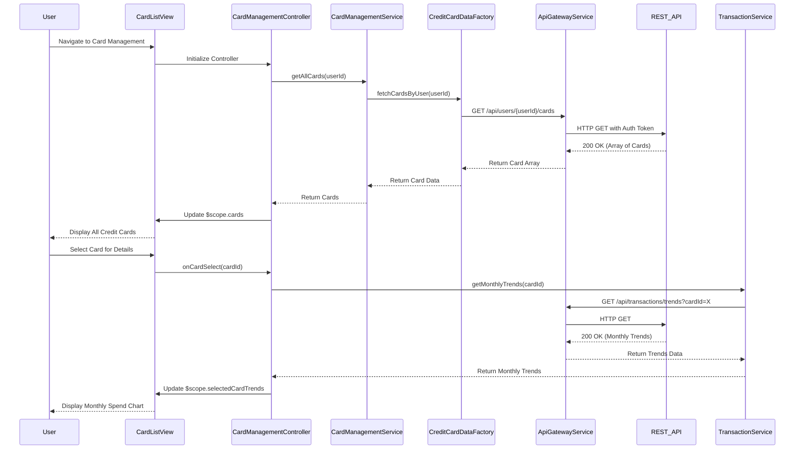

# Low-Level Design: QE-7679 - Multiple Credit Card Management and Monitoring

## a. Architecture Mapping

**HLD Component → AngularJS Artifact:**
- User Interface - Card Management → Module: `cardManagement.module.js`, Controller: `CardManagementController`, View: `card-list.html`
- API Gateway → Service: `ApiGatewayService` (shared HTTP service)
- Card Management Service → Service: `CardManagementService` (card CRUD and spend analysis logic)
- Credit Card Data Repository → Factory: `CreditCardDataFactory` (data access layer)
- User Profile Service → Service: `UserProfileService` (user-card association management)
- Transaction Processing System → Service: `TransactionService` (transaction data retrieval for spend analysis)

**Recommended Folder Structure:**
```
app/
├── modules/
│   └── cardManagement/
│       ├── cardManagement.module.js
│       ├── controllers/
│       │   └── CardManagementController.js
│       ├── services/
│       │   ├── CardManagementService.js
│       │   └── TransactionService.js
│       └── views/
│           ├── card-list.html
│           └── card-detail.html
├── shared/
│   └── services/
│       ├── CreditCardDataFactory.js
│       ├── UserProfileService.js
│       └── ApiGatewayService.js
└── assets/
```

## b. Component Specifications

| Component Name | Artifact Type | Responsibility | Key Dependencies |
|----------------|---------------|----------------|------------------|
| cardManagement.module | Module | Defines card management module and routing for card list/detail views | angular, angular-route |
| CardManagementController | Controller | Manages card list view, handles card selection, initiates spend analysis | CardManagementService, TransactionService, $scope |
| CardManagementService | Service | Provides methods to fetch, register, and compare multiple credit cards | CreditCardDataFactory, UserProfileService, $http, $q |
| TransactionService | Service | Fetches transaction data for card-wise spend analysis and monthly trends | ApiGatewayService, $http |
| CreditCardDataFactory | Factory | Data access layer for credit card CRUD operations via REST API | ApiGatewayService, $http |
| UserProfileService | Service | Manages user profile and card associations (links cards to user accounts) | $http, $localStorage |
| card-list.html | View | Displays all registered credit cards in responsive grid with card-wise spend summaries | Bootstrap CSS, ng-repeat |
| card-detail.html | View | Shows individual card details, monthly spend trends, and comparison charts | Chart.js, AngularJS directives |

## c. Data Model

**CreditCard (JavaScript Object):**
```javascript
{
  cardId: String,
  userId: String,
  cardNumber: String (masked),
  cardType: String,
  bankName: String,
  creditLimit: Number,
  availableCredit: Number,
  outstandingAmount: Number,
  monthlySpend: Number,
  registeredDate: Date,
  isActive: Boolean
}
```

**CardSpendAnalysis (JavaScript Object):**
```javascript
{
  cardId: String,
  monthlyTrends: Array<MonthlySpend>,
  totalSpend: Number,
  averageMonthlySpend: Number
}
```

**MonthlySpend (JavaScript Object):**
```javascript
{
  month: String (YYYY-MM),
  spendAmount: Number,
  transactionCount: Number
}
```

## d. Data Flow

User navigates to card management view → `CardManagementController` initializes and calls `CardManagementService.getAllCards(userId)` → Service invokes `CreditCardDataFactory.fetchCardsByUser(userId)` which sends GET request to `/api/users/{userId}/cards` → API returns array of credit cards → Controller updates `$scope.cards` → View renders card list using `ng-repeat` with Bootstrap cards → User selects a card for detailed analysis → Controller calls `TransactionService.getMonthlyTrends(cardId)` → Service fetches transaction data from `/api/transactions/trends?cardId=X` → Controller updates `$scope.selectedCardTrends` → View displays monthly spend chart using Chart.js directive.

## e. Primary Sequence Diagram



## f. Implementation Notes

- Use AngularJS module pattern with dependency injection for all services; configure routing for card-list and card-detail views.
- Implement lazy loading for card details to optimize performance when displaying 10+ cards.
- Use `$q.all()` to fetch multiple cards in parallel if API supports batch requests; otherwise iterate with promise chaining.
- Integrate Chart.js as AngularJS directive for monthly spend trend visualization; bind data with `ng-model` for dynamic updates.
- Apply Bootstrap grid (col-md-4) for responsive card layout; use CSS3 transitions for smooth card selection animations.

## g. Error Handling

Centralized error handling via HTTP interceptor with try/catch blocks in service methods; display user-friendly error messages using Bootstrap modals.

## h. Security Notes

Standard input validation and secure API calls assumed; all card data masked (e.g., card numbers) before rendering in view.