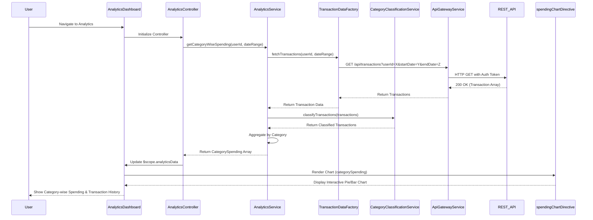

# Low-Level Design: QE-7680 - Transaction Analytics and Category-wise Spending Insights

## a. Architecture Mapping

**HLD Component → AngularJS Artifact:**
- User Interface - Analytics Dashboard → Module: `analytics.module.js`, Controller: `AnalyticsController`, View: `analytics-dashboard.html`
- API Gateway → Service: `ApiGatewayService` (shared HTTP service)
- Analytics Service → Service: `AnalyticsService` (business logic for spending insights and aggregation)
- Category Classification Engine → Service: `CategoryClassificationService` (categorizes transactions into 9 predefined categories)
- Transaction Data Service → Factory: `TransactionDataFactory` (data access layer for transaction retrieval)
- Visualization Library → Directive: `spendingChartDirective` (wraps Chart.js for interactive visualizations)

**Recommended Folder Structure:**
```
app/
├── modules/
│   └── analytics/
│       ├── analytics.module.js
│       ├── controllers/
│       │   └── AnalyticsController.js
│       ├── services/
│       │   ├── AnalyticsService.js
│       │   └── CategoryClassificationService.js
│       ├── directives/
│       │   └── spendingChartDirective.js
│       └── views/
│           └── analytics-dashboard.html
├── shared/
│   └── services/
│       ├── TransactionDataFactory.js
│       └── ApiGatewayService.js
└── assets/
    └── js/
        └── chart.min.js
```

## b. Component Specifications

| Component Name | Artifact Type | Responsibility | Key Dependencies |
|----------------|---------------|----------------|------------------|
| analytics.module | Module | Defines analytics module and configures routing for analytics dashboard | angular, angular-route, chart.js |
| AnalyticsController | Controller | Manages analytics view state, fetches transaction data, triggers category-wise analysis | AnalyticsService, $scope, $filter |
| AnalyticsService | Service | Aggregates transaction data, computes category-wise spending, provides filtering/drill-down logic | TransactionDataFactory, CategoryClassificationService, $q |
| CategoryClassificationService | Service | Classifies transactions into 9 categories (Food & Dining, Fuel, Shopping, Travel, Entertainment, Utilities, Healthcare, Education, Miscellaneous) | $http (optional for ML-based classification API) |
| TransactionDataFactory | Factory | Fetches transaction history (12+ months) from REST API | ApiGatewayService, $http |
| spendingChartDirective | Directive | Renders interactive pie/bar charts for category-wise spending using Chart.js | Chart.js library |
| analytics-dashboard.html | View | Displays category-wise spending visualizations, transaction history table, and filter controls | Bootstrap CSS, AngularJS directives |

## c. Data Model

**Transaction (JavaScript Object):**
```javascript
{
  transactionId: String,
  userId: String,
  cardId: String,
  amount: Number,
  category: String,
  merchantName: String,
  transactionDate: Date,
  description: String
}
```

**CategorySpending (JavaScript Object):**
```javascript
{
  category: String,
  totalSpend: Number,
  transactionCount: Number,
  percentage: Number
}
```

**AnalyticsData (JavaScript Object):**
```javascript
{
  userId: String,
  dateRange: { startDate: Date, endDate: Date },
  categorySpending: Array<CategorySpending>,
  totalSpend: Number,
  transactions: Array<Transaction>
}
```

## d. Data Flow

User navigates to analytics dashboard → `AnalyticsController` initializes and calls `AnalyticsService.getCategoryWiseSpending(userId, dateRange)` → Service invokes `TransactionDataFactory.fetchTransactions(userId, dateRange)` which sends GET request to `/api/transactions?userId=X&startDate=Y&endDate=Z` → API returns transaction array → Service passes transactions to `CategoryClassificationService.classifyTransactions(transactions)` → Classification service assigns category to each transaction → Service aggregates spending by category and computes percentages → Controller updates `$scope.analyticsData` → View renders category-wise spending chart via `spendingChartDirective` and transaction history table with `ng-repeat` → User applies filters (date range, category) → Controller re-fetches data and updates view with filtered results.

## e. Primary Sequence Diagram



## f. Implementation Notes

- Use AngularJS module pattern with dependency injection; configure Chart.js as a reusable directive for pie and bar charts.
- Implement `$filter` service for client-side filtering by date range and category; use `ng-change` on filter controls to trigger re-rendering.
- Leverage `$q` promises for asynchronous transaction fetching; handle large datasets (12+ months) with pagination or lazy loading.
- Apply Bootstrap grid for responsive layout; use CSS3 for smooth chart animations and transitions.
- Cache classified transactions in `$localStorage` to reduce redundant API calls and improve performance.

## g. Error Handling

HTTP interceptor-based error handling with try/catch in service methods; display user notifications via Bootstrap alerts for API failures.

## h. Security Notes

Standard input validation and secure API calls assumed; transaction data filtered by authenticated userId to prevent unauthorized access.