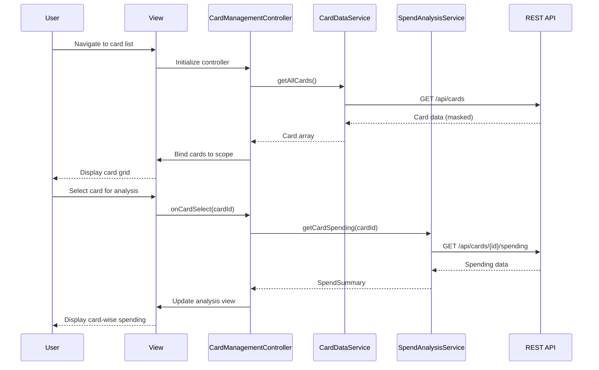

# Low-Level Design: Multi-Card Management and Monitoring
**Epic ID:** QE-7681

## a. Architecture Mapping

| HLD Component | AngularJS Artifact | Mapping |
|---------------|-------------------|----------|
| User Interface | View + Directive | `app/cards/views/card-list.html` + `cardListDirective` for card display grid |
| Multi-Card Controller | Controller | `CardManagementController` - orchestrates card retrieval, selection, and comparison |
| Card Data Repository | Service/Factory | `CardDataService` - REST API wrapper for card CRUD operations |
| User Authentication Service | Service | `AuthService` - token-based authentication and session management |
| Spend Analysis Module | Service | `SpendAnalysisService` - calculates card-wise spending metrics |
| Card Comparison Engine | Factory | `CardComparisonFactory` - side-by-side card comparison logic |

**Recommended Folder Structure:**
```
app/
├── cards/
│   ├── controllers/
│   │   └── CardManagementController.js
│   ├── services/
│   │   ├── CardDataService.js
│   │   └── SpendAnalysisService.js
│   ├── factories/
│   │   └── CardComparisonFactory.js
│   ├── directives/
│   │   └── cardListDirective.js
│   └── views/
│       ├── card-list.html
│       └── card-detail.html
├── auth/
│   └── services/
│       └── AuthService.js
└── shared/
    └── interceptors/
        └── authInterceptor.js
```

## b. Component Specifications

| Component Name | Artifact Type | Responsibility | Key Dependencies |
|----------------|---------------|----------------|------------------|
| CardManagementController | Controller | Manages card list display, selection, and triggers analysis/comparison | CardDataService, SpendAnalysisService, CardComparisonFactory, $scope |
| CardDataService | Service | Fetches card data from REST API, handles card refresh | $http, $q, AuthService |
| SpendAnalysisService | Service | Computes card-specific spending totals and trends | $http, $filter |
| CardComparisonFactory | Factory | Provides comparison logic for multiple cards | None |
| cardListDirective | Directive | Renders card grid with masking, handles card selection events | CardManagementController |
| AuthService | Service | Manages authentication tokens and user session | $http, $window |
| authInterceptor | Interceptor | Injects auth token into HTTP requests | $q, $window |

## c. Data Model

```javascript
// Card Model
const Card = {
  cardId: String,              // Unique identifier
  userId: String,              // Owner user ID
  cardNumber: String,          // Masked format: "**** **** **** 1234"
  cardType: String,            // e.g., "Visa", "MasterCard"
  cardName: String,            // User-defined card name
  creditLimit: Number,         // Total credit limit
  availableCredit: Number,     // Remaining credit
  outstandingAmount: Number,   // Current balance
  lastUpdated: Date            // Last refresh timestamp
};

// Spend Summary Model
const SpendSummary = {
  cardId: String,
  monthlySpend: Number,
  categoryBreakdown: Object,   // { "Food": 500, "Fuel": 200, ... }
  lastTransactionDate: Date
};

// Comparison Result Model
const ComparisonResult = {
  cards: Array,                // Array of Card objects
  metrics: Object              // { utilization: [], spend: [], ... }
};
```

## d. Data Flow

User logs in via AuthService which stores JWT token → User navigates to card list view → CardManagementController calls CardDataService.getAllCards() → Service makes authenticated GET request to `/api/cards` → Card data returned with masked card numbers → Controller binds cards to $scope → cardListDirective renders grid → User selects card for analysis → Controller invokes SpendAnalysisService.getCardSpending(cardId) → Service fetches from `/api/cards/{id}/spending` → Spending data displayed → User initiates comparison → CardComparisonFactory processes selected cards → Comparison view updated with side-by-side metrics.

## e. Primary Sequence Diagram



## f. Implementation Notes

- Use AngularJS module pattern with dependency injection: `angular.module('creditCard.cards', []).controller('CardManagementController', ['CardDataService', 'SpendAnalysisService', function(...) {}])`
- Implement card number masking via `$filter` custom filter: `{{ card.cardNumber | maskCard }}`
- Use `$http` interceptor (authInterceptor) to inject Bearer token into all API requests automatically
- Leverage `$q` promises for async operations; chain service calls using `.then()` for sequential operations
- Implement polling for near real-time refresh using `$interval` service with configurable interval (default 30s)

## g. Error Handling

HTTP interceptor captures API errors (4xx/5xx), displays user-friendly notifications via toastr/ngToast, and logs errors to console; service-level try/catch for synchronous operations.

## h. Security Notes

Requires JWT token-based authentication via existing SSO; all card data transmitted over HTTPS; sensitive card numbers masked client-side before display.