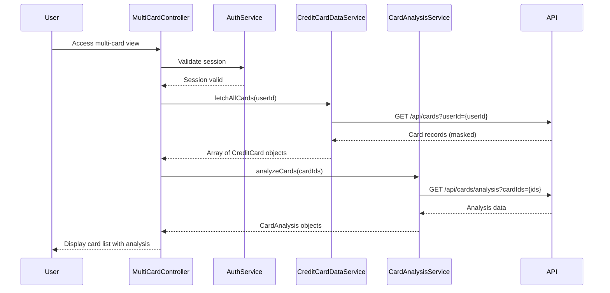

# Low-Level Design: Multi-Card Management and Monitoring
**Epic ID:** QE-7681

## a. Architecture Mapping

- **Module:** `creditCardApp.multiCard` - Root module for multi-card management
- **Controller:** `MultiCardController` - Manages card list, selection, and comparison UI logic
- **Service:** `CreditCardDataService` - Retrieves and caches card records from repository
- **Service:** `AuthService` - Validates user identity and manages secure access
- **Service:** `CardAnalysisService` - Processes card-wise spend analysis and comparison logic
- **Directive:** `cardMaskDirective` - Masks sensitive card information (displays last 4 digits)
- **Filter:** `cardNumberMaskFilter` - Formats card numbers for secure display

**Folder Structure:**
```
/app
  /modules
    /multi-card
      multi-card.module.js
      multi-card.controller.js
      multi-card.html
  /services
    credit-card-data.service.js
    auth.service.js
    card-analysis.service.js
  /directives
    card-mask.directive.js
  /filters
    card-number-mask.filter.js
```

## b. Component Specifications

| Component Name | Artifact Type | Responsibility | Key Dependencies |
|----------------|---------------|----------------|------------------|
| MultiCardController | Controller | Orchestrates card list display, selection, and comparison views | CreditCardDataService, CardAnalysisService, $scope |
| CreditCardDataService | Factory | Fetches and caches multiple card records; handles near-real-time refresh | $http, $q, $interval |
| AuthService | Service | Validates user authentication and authorization for card access | $http, $window |
| CardAnalysisService | Service | Aggregates card-wise spending, utilization, and comparison metrics | $http, $q |
| cardMaskDirective | Directive | Applies masking to card numbers in DOM (shows last 4 digits) | None |
| cardNumberMaskFilter | Filter | Transforms full card number to masked format (e.g., **** **** **** 1234) | None |

## c. Data Model

**CreditCard Object:**
```javascript
{
  cardId: String,
  userId: String,
  cardNumber: String,          // Full number (backend only)
  maskedCardNumber: String,    // e.g., "**** **** **** 1234"
  cardType: String,            // e.g., "Visa", "MasterCard"
  creditLimit: Number,
  availableCredit: Number,
  outstandingAmount: Number,
  lastFourDigits: String,
  expiryDate: String,          // Format: "MM/YY"
  isActive: Boolean
}
```

**CardAnalysis Object:**
```javascript
{
  cardId: String,
  monthlySpend: Number,
  utilizationRate: Number,     // Percentage
  categoryBreakdown: Array     // [{category: String, amount: Number}]
}
```

## d. Data Flow

User logs in and navigates to multi-card view → AuthService validates session token → MultiCardController calls CreditCardDataService to fetch all user cards → Service retrieves card records from REST API and caches locally → CardAnalysisService is invoked to compute card-wise spending and utilization → Controller receives masked card data and analysis results → View renders card list with masked numbers, allowing user to select individual cards, compare metrics, or switch between cards → Near-real-time updates are achieved via $interval polling every 30 seconds.

## e. Primary Sequence Diagram



## f. Implementation Notes

- Use AngularJS dependency injection to inject services into MultiCardController
- Implement card data caching in CreditCardDataService using $cacheFactory to minimize API calls
- Apply cardMaskDirective to all card number fields to ensure consistent masking across views
- Use $interval for near-real-time polling (30s intervals) with cleanup on $scope.$destroy
- REST API endpoints follow pattern: `/api/cards`, `/api/cards/analysis`, `/api/cards/{cardId}`

## g. Error Handling

HTTP interceptor captures API errors; user-friendly notifications displayed via toastr; retry logic for transient failures.

## h. Security Notes

Requires token-based auth via existing SSO; card numbers masked client-side; sensitive data never logged.