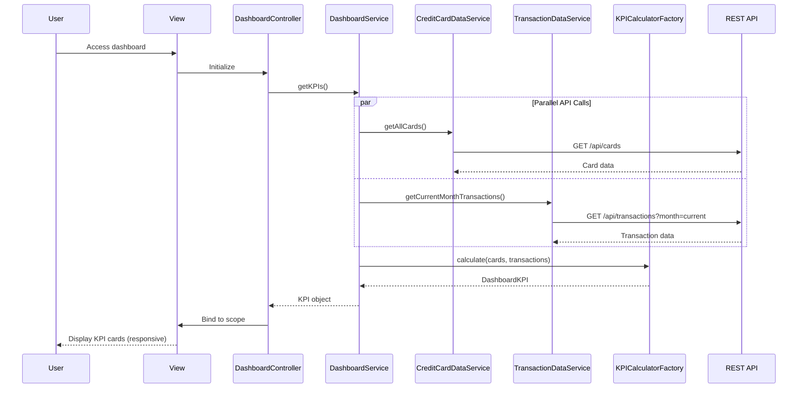

# Low-Level Design: Credit Card Dashboard and KPI Management
**Epic ID:** QE-7682

## a. Architecture Mapping

| HLD Component | AngularJS Artifact | Mapping |
|---------------|-------------------|----------|
| Responsive UI | View + CSS | `app/dashboard/views/dashboard.html` with Bootstrap responsive grid |
| Dashboard Service | Service | `DashboardService` - aggregates KPI data from multiple sources |
| Credit Card Data Service | Service | `CreditCardDataService` - fetches card details and balances |
| Transaction Data Service | Service | `TransactionDataService` - retrieves transaction data for calculations |
| KPI Calculator | Factory | `KPICalculatorFactory` - computes consolidated metrics |

**Recommended Folder Structure:**
```
app/
├── dashboard/
│   ├── controllers/
│   │   └── DashboardController.js
│   ├── services/
│   │   ├── DashboardService.js
│   │   ├── CreditCardDataService.js
│   │   └── TransactionDataService.js
│   ├── factories/
│   │   └── KPICalculatorFactory.js
│   ├── views/
│   │   └── dashboard.html
│   └── styles/
│       └── dashboard.css
└── shared/
    └── directives/
        └── kpiCardDirective.js
```

## b. Component Specifications

| Component Name | Artifact Type | Responsibility | Key Dependencies |
|----------------|---------------|----------------|------------------|
| DashboardController | Controller | Orchestrates dashboard initialization and KPI display | DashboardService, $scope, $timeout |
| DashboardService | Service | Aggregates data from card and transaction services | CreditCardDataService, TransactionDataService, KPICalculatorFactory, $q |
| CreditCardDataService | Service | Retrieves card details and balances from API | $http, $q |
| TransactionDataService | Service | Fetches transaction data for monthly spend calculation | $http, $q |
| KPICalculatorFactory | Factory | Computes monthly spend, total limit, available credit, outstanding amount | None |
| kpiCardDirective | Directive | Renders individual KPI cards with responsive layout | None |

## c. Data Model

```javascript
// Dashboard KPI Model
const DashboardKPI = {
  monthlySpend: Number,          // Total spend for current month
  totalCreditLimit: Number,      // Sum of all card limits
  availableCredit: Number,       // Sum of available credit across cards
  outstandingAmount: Number,     // Total outstanding balance
  lastRefreshed: Date            // Last data refresh timestamp
};

// Card Summary Model
const CardSummary = {
  cardId: String,
  creditLimit: Number,
  availableCredit: Number,
  currentBalance: Number
};

// Transaction Summary Model
const TransactionSummary = {
  currentMonthTotal: Number,
  transactionCount: Number
};
```

## d. Data Flow

User accesses dashboard URL → AngularJS routes to DashboardController → Controller calls DashboardService.getKPIs() → Service makes parallel calls to CreditCardDataService.getAllCards() and TransactionDataService.getCurrentMonthTransactions() using $q.all() → Card service fetches from `/api/cards`, transaction service fetches from `/api/transactions?month=current` → KPICalculatorFactory.calculate(cards, transactions) computes consolidated metrics → DashboardService returns DashboardKPI object → Controller binds to $scope → kpiCardDirective renders responsive KPI cards → User sees monthly spend, total limit, available credit, outstanding amount within 2 seconds.

## e. Primary Sequence Diagram



## f. Implementation Notes

- Use Bootstrap grid system (col-xs-*, col-sm-*, col-md-*, col-lg-*) for responsive KPI card layout across devices
- Implement parallel API calls using `$q.all([promise1, promise2])` to minimize load time and meet 2-second NFR
- Use AngularJS `$timeout` for auto-refresh every 60 seconds to maintain near real-time KPI updates
- Apply WCAG 2.1 Level AA compliance: semantic HTML5, ARIA labels, sufficient color contrast (4.5:1 minimum)
- Cache KPI data in DashboardService for 30 seconds to reduce redundant API calls on rapid navigation

## g. Error Handling

HTTP interceptor-based error handling with fallback to cached data if available; user notified via toast message on API failure.

## h. Security Notes

Requires token-based auth via existing SSO; all API endpoints secured with JWT validation.