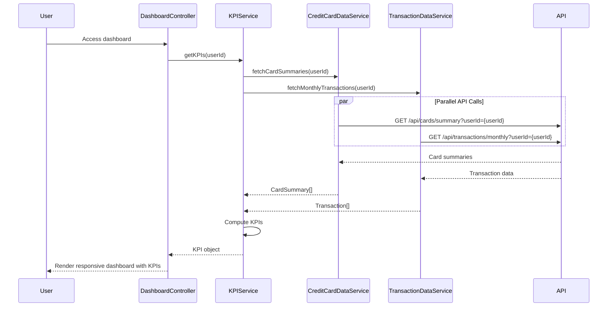

# Low-Level Design: Credit Card Dashboard and KPI Management
**Epic ID:** QE-7682

## a. Architecture Mapping

- **Module:** `creditCardApp.dashboard` - Root module for dashboard and KPI display
- **Controller:** `DashboardController` - Manages KPI display and responsive layout logic
- **Service:** `KPIService` - Aggregates and computes financial KPIs from multiple sources
- **Service:** `CreditCardDataService` - Retrieves card details and balances
- **Service:** `TransactionDataService` - Fetches transaction data for monthly spend calculation
- **Directive:** `kpiCardDirective` - Reusable component for displaying individual KPI metrics
- **Directive:** `responsiveGridDirective` - Handles responsive grid layout across devices

**Folder Structure:**
```
/app
  /modules
    /dashboard
      dashboard.module.js
      dashboard.controller.js
      dashboard.html
  /services
    kpi.service.js
    credit-card-data.service.js
    transaction-data.service.js
  /directives
    kpi-card.directive.js
    responsive-grid.directive.js
```

## b. Component Specifications

| Component Name | Artifact Type | Responsibility | Key Dependencies |
|----------------|---------------|----------------|------------------|
| DashboardController | Controller | Orchestrates KPI retrieval and dashboard rendering | KPIService, $scope, $timeout |
| KPIService | Factory | Aggregates card and transaction data to compute KPIs | CreditCardDataService, TransactionDataService, $q |
| CreditCardDataService | Factory | Fetches card details, balances, and limits | $http, $q |
| TransactionDataService | Factory | Retrieves transaction data for monthly spend and outstanding calculations | $http, $q |
| kpiCardDirective | Directive | Displays individual KPI with value, label, and icon | None |
| responsiveGridDirective | Directive | Applies responsive grid layout using Bootstrap classes | None |

## c. Data Model

**KPI Object:**
```javascript
{
  monthlySpend: Number,
  totalCreditLimit: Number,
  availableCredit: Number,
  outstandingAmount: Number,
  utilizationRate: Number,      // Calculated: (totalCreditLimit - availableCredit) / totalCreditLimit * 100
  lastUpdated: Date
}
```

**CardSummary Object:**
```javascript
{
  cardId: String,
  maskedNumber: String,
  creditLimit: Number,
  availableCredit: Number,
  outstandingAmount: Number
}
```

## d. Data Flow

User accesses dashboard from desktop or mobile → DashboardController initializes and calls KPIService.getKPIs() → KPIService invokes CreditCardDataService to fetch all card summaries and TransactionDataService to retrieve current month transactions → Services make parallel REST API calls using $q.all → KPIService aggregates data to compute monthly spend, total credit limit, available credit, and outstanding amount → Computed KPIs returned to DashboardController → Controller updates $scope with KPI data → View renders responsive dashboard using kpiCardDirective and responsiveGridDirective → Dashboard displays within 2 seconds with accessibility compliance.

## e. Primary Sequence Diagram



## f. Implementation Notes

- Use $q.all for parallel API calls in KPIService to minimize load time
- Implement responsive grid using Bootstrap 3 grid classes (col-xs, col-sm, col-md, col-lg)
- Apply WCAG 2.1 AA standards: ARIA labels, keyboard navigation, sufficient color contrast
- Cache KPI data for 5 minutes using $cacheFactory to reduce redundant API calls
- REST API endpoints: `/api/cards/summary`, `/api/transactions/monthly`

## g. Error Handling

HTTP interceptor-based error handling with user-friendly toast notifications; fallback to cached data on API failure.

## h. Security Notes

Standard input validation and secure API calls assumed; token-based authentication enforced.