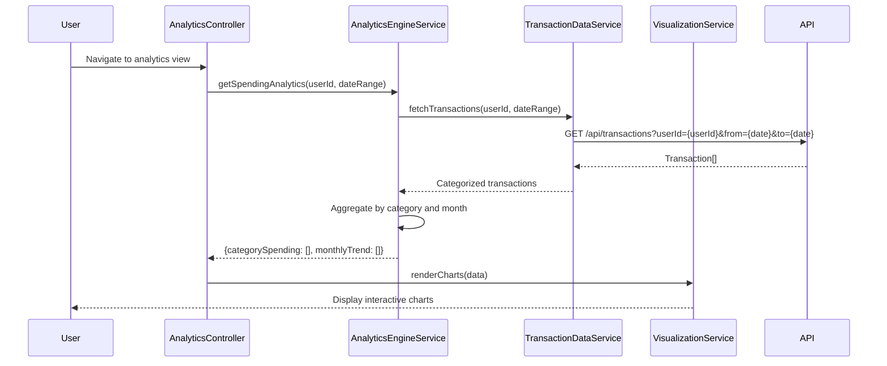

# Low-Level Design: Spending Analytics and Transaction Insights
**Epic ID:** QE-7683

## a. Architecture Mapping

- **Module:** `creditCardApp.analytics` - Root module for spending analytics
- **Controller:** `AnalyticsController` - Manages analytics view, filters, and chart interactions
- **Service:** `TransactionDataService` - Retrieves and categorizes transaction records
- **Service:** `AnalyticsEngineService` - Aggregates spending data by category and time period
- **Service:** `VisualizationService` - Interfaces with chart library (Chart.js/D3.js)
- **Directive:** `spendingChartDirective` - Renders interactive category-wise spending charts
- **Directive:** `trendChartDirective` - Renders monthly spend trend line charts

**Folder Structure:**
```
/app
  /modules
    /analytics
      analytics.module.js
      analytics.controller.js
      analytics.html
  /services
    transaction-data.service.js
    analytics-engine.service.js
    visualization.service.js
  /directives
    spending-chart.directive.js
    trend-chart.directive.js
```

## b. Component Specifications

| Component Name | Artifact Type | Responsibility | Key Dependencies |
|----------------|---------------|----------------|------------------|
| AnalyticsController | Controller | Manages analytics view, user filters, and chart data binding | AnalyticsEngineService, VisualizationService, $scope |
| TransactionDataService | Factory | Fetches transaction records with category pre-assigned | $http, $q |
| AnalyticsEngineService | Service | Aggregates transactions by category and time; calculates trends | TransactionDataService, $q |
| VisualizationService | Service | Wraps Chart.js library; provides chart configuration and rendering | Chart.js |
| spendingChartDirective | Directive | Renders category-wise spending as bar/pie chart | VisualizationService |
| trendChartDirective | Directive | Renders monthly spend trend as line chart | VisualizationService |

## c. Data Model

**Transaction Object:**
```javascript
{
  transactionId: String,
  cardId: String,
  amount: Number,
  category: String,            // One of 9 predefined categories
  date: Date,
  merchantName: String,
  description: String
}
```

**CategorySpending Object:**
```javascript
{
  category: String,            // e.g., "Food & Dining", "Fuel", etc.
  totalAmount: Number,
  transactionCount: Number,
  percentageOfTotal: Number
}
```

**MonthlyTrend Object:**
```javascript
{
  month: String,               // Format: "YYYY-MM"
  totalSpend: Number
}
```

## d. Data Flow

User navigates to analytics view → AnalyticsController calls AnalyticsEngineService.getSpendingAnalytics() → Service invokes TransactionDataService to fetch categorized transactions → Transactions are aggregated by category and month in AnalyticsEngineService → Aggregated data (CategorySpending[] and MonthlyTrend[]) returned to Controller → Controller passes data to VisualizationService → spendingChartDirective and trendChartDirective render interactive charts using Chart.js → User can filter by date range or category, triggering re-aggregation and chart update.

## e. Primary Sequence Diagram



## f. Implementation Notes

- Use Chart.js for visualization with responsive configuration enabled
- Implement lazy loading for historical data to optimize initial load time
- Apply ES6 Array methods (map, reduce, filter) in AnalyticsEngineService for data aggregation
- Use AngularJS $watch on filter inputs to trigger chart updates reactively
- REST API endpoint: `/api/transactions` with query params for userId, date range, and category filter

## g. Error Handling

Interceptor-based error handling; display user-friendly messages on API failure; graceful degradation with empty state UI.

## h. Security Notes

Standard input validation and secure API calls assumed; token-based authentication enforced.