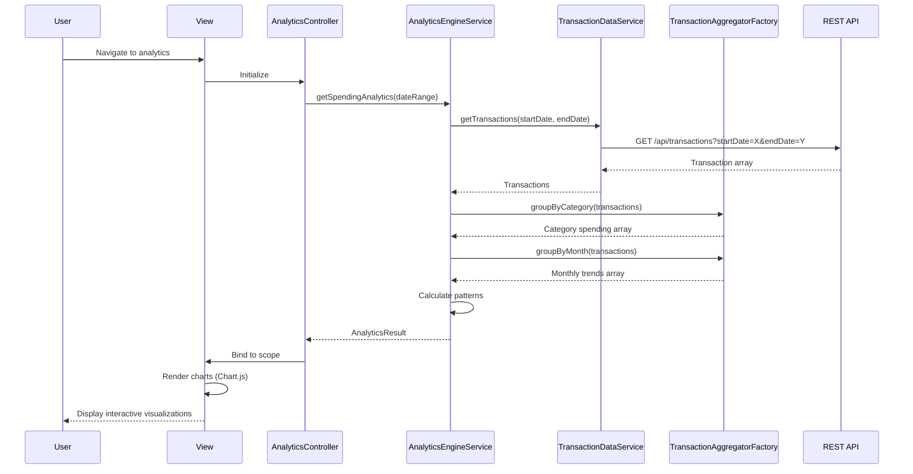

# Low-Level Design: Spending Analytics and Transaction Insights
**Epic ID:** QE-7683

## a. Architecture Mapping

| HLD Component | AngularJS Artifact | Mapping |
|---------------|-------------------|----------|
| User Interface | View + Directive | `app/analytics/views/spending-analytics.html` + `chartDirective` for visualizations |
| Analytics Controller | Controller | `AnalyticsController` - manages analytics view and user interactions |
| Transaction Data Service | Service | `TransactionDataService` - fetches categorized transaction records |
| Analytics Engine | Service | `AnalyticsEngineService` - processes and aggregates spending data |
| Visualization Library | Directive + Library | `chartDirective` wrapping Chart.js or D3.js for interactive charts |
| Transaction Aggregator | Factory | `TransactionAggregatorFactory` - groups transactions by category and time |

**Recommended Folder Structure:**
```
app/
├── analytics/
│   ├── controllers/
│   │   └── AnalyticsController.js
│   ├── services/
│   │   ├── TransactionDataService.js
│   │   └── AnalyticsEngineService.js
│   ├── factories/
│   │   └── TransactionAggregatorFactory.js
│   ├── directives/
│   │   └── chartDirective.js
│   └── views/
│       └── spending-analytics.html
└── shared/
    └── constants/
        └── categories.js
```

## b. Component Specifications

| Component Name | Artifact Type | Responsibility | Key Dependencies |
|----------------|---------------|----------------|------------------|
| AnalyticsController | Controller | Manages analytics view, handles filter selections, triggers data refresh | AnalyticsEngineService, $scope, $filter |
| TransactionDataService | Service | Fetches transaction records from API with category and date filters | $http, $q |
| AnalyticsEngineService | Service | Processes transaction data, calculates trends and patterns | TransactionAggregatorFactory, $q |
| TransactionAggregatorFactory | Factory | Groups transactions by category (9 categories) and time period (monthly) | None |
| chartDirective | Directive | Renders interactive charts using Chart.js, handles user interactions | Chart.js library |
| CATEGORY_CONSTANTS | Constant | Defines nine spending categories as immutable array | None |

## c. Data Model

```javascript
// Transaction Model
const Transaction = {
  transactionId: String,
  cardId: String,
  amount: Number,
  category: String,           // One of 9 categories
  merchant: String,
  transactionDate: Date,
  description: String
};

// Category Spending Model
const CategorySpending = {
  category: String,
  totalAmount: Number,
  transactionCount: Number,
  percentage: Number          // % of total spend
};

// Monthly Trend Model
const MonthlyTrend = {
  month: String,              // "2026-01", "2026-02", etc.
  totalSpend: Number,
  categoryBreakdown: Array    // Array of CategorySpending
};

// Analytics Result Model
const AnalyticsResult = {
  categorySpending: Array,    // Array of CategorySpending
  monthlyTrends: Array,       // Array of MonthlyTrend
  topCategory: String,
  averageMonthlySpend: Number
};
```

## d. Data Flow

User navigates to analytics view → AnalyticsController initializes and calls AnalyticsEngineService.getSpendingAnalytics() → Service calls TransactionDataService.getTransactions() with date range filter → Service fetches from `/api/transactions?startDate=X&endDate=Y` → Transaction array returned → TransactionAggregatorFactory.groupByCategory(transactions) groups data into nine categories → TransactionAggregatorFactory.groupByMonth(transactions) creates monthly trends → AnalyticsEngineService calculates percentages and patterns → AnalyticsResult bound to $scope → chartDirective renders pie chart for category breakdown and line chart for monthly trends → User interacts with charts (hover, click) for drill-down.

## e. Primary Sequence Diagram



## f. Implementation Notes

- Use Chart.js library wrapped in AngularJS directive for responsive, interactive charts (pie for categories, line for trends)
- Define nine categories as AngularJS constant: `angular.module('app').constant('CATEGORIES', ['Food & Dining', 'Fuel', 'Shopping', 'Travel', 'Entertainment', 'Utilities', 'Healthcare', 'Education', 'Miscellaneous'])`
- Implement date range picker using angular-daterangepicker for flexible historical analysis
- Use `$filter('currency')` for consistent amount formatting across visualizations
- Optimize large dataset rendering by implementing pagination or virtual scrolling for transaction detail view

## g. Error Handling

Interceptor-based error handling with user notification; graceful degradation to show partial data if some API calls fail.

## h. Security Notes

Standard input validation and secure API calls assumed; transaction data requires authenticated user context.