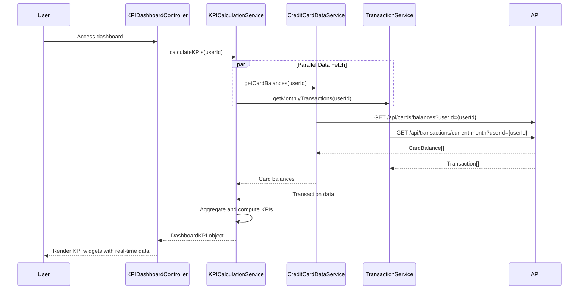

# Low-Level Design: Dashboard and KPI Management
**Epic ID:** QE-7684

## a. Architecture Mapping

- **Module:** `creditCardApp.kpiDashboard` - Root module for centralized dashboard
- **Controller:** `KPIDashboardController` - Manages KPI display and real-time refresh logic
- **Service:** `CreditCardDataService` - Retrieves card balances and limits
- **Service:** `TransactionService` - Fetches transaction data for spend calculations
- **Service:** `KPICalculationService` - Computes KPIs in real-time
- **Directive:** `kpiWidgetDirective` - Reusable widget for displaying KPI metrics
- **Factory:** `RealtimeRefreshFactory` - Manages periodic data refresh using $interval

**Folder Structure:**
```
/app
  /modules
    /kpi-dashboard
      kpi-dashboard.module.js
      kpi-dashboard.controller.js
      kpi-dashboard.html
  /services
    credit-card-data.service.js
    transaction.service.js
    kpi-calculation.service.js
  /directives
    kpi-widget.directive.js
  /factories
    realtime-refresh.factory.js
```

## b. Component Specifications

| Component Name | Artifact Type | Responsibility | Key Dependencies |
|----------------|---------------|----------------|------------------|
| KPIDashboardController | Controller | Orchestrates KPI display and manages real-time refresh | KPICalculationService, RealtimeRefreshFactory, $scope |
| CreditCardDataService | Factory | Fetches card balances and credit limits | $http, $q |
| TransactionService | Factory | Retrieves transaction data for monthly spend and outstanding calculations | $http, $q |
| KPICalculationService | Service | Aggregates data and computes KPIs (monthly spend, credit limit, available credit, outstanding) | CreditCardDataService, TransactionService, $q |
| kpiWidgetDirective | Directive | Displays individual KPI with animated value updates | None |
| RealtimeRefreshFactory | Factory | Manages $interval-based polling for real-time data refresh | $interval |

## c. Data Model

**DashboardKPI Object:**
```javascript
{
  monthlySpend: Number,
  totalCreditLimit: Number,
  availableCredit: Number,
  outstandingAmount: Number,
  creditUtilization: Number,    // Percentage
  timestamp: Date
}
```

**CardBalance Object:**
```javascript
{
  cardId: String,
  creditLimit: Number,
  currentBalance: Number,
  availableCredit: Number
}
```

## d. Data Flow

User accesses dashboard → KPIDashboardController initializes and calls KPICalculationService.calculateKPIs() → Service invokes CreditCardDataService and TransactionService in parallel using $q.all → Services fetch card balances and transaction data from REST APIs → KPICalculationService aggregates data to compute monthly spend, total credit limit, available credit, and outstanding amount → Computed KPIs returned to Controller within 2 seconds → Controller updates $scope and triggers kpiWidgetDirective to render KPIs → RealtimeRefreshFactory polls for updates every 60 seconds, refreshing KPIs automatically.

## e. Primary Sequence Diagram



## f. Implementation Notes

- Use $q.all for parallel API calls to meet 2-second load time requirement
- Implement RealtimeRefreshFactory with $interval (60s) and cleanup on $scope.$destroy
- Apply CSS3 animations in kpiWidgetDirective for smooth value transitions
- Use Bootstrap responsive grid for cross-device compatibility
- REST API endpoints: `/api/cards/balances`, `/api/transactions/current-month`

## g. Error Handling

HTTP interceptor captures errors; fallback to cached KPI data; user notification via toast.

## h. Security Notes

Requires token-based auth via existing SSO; secure API calls with HTTPS enforced.