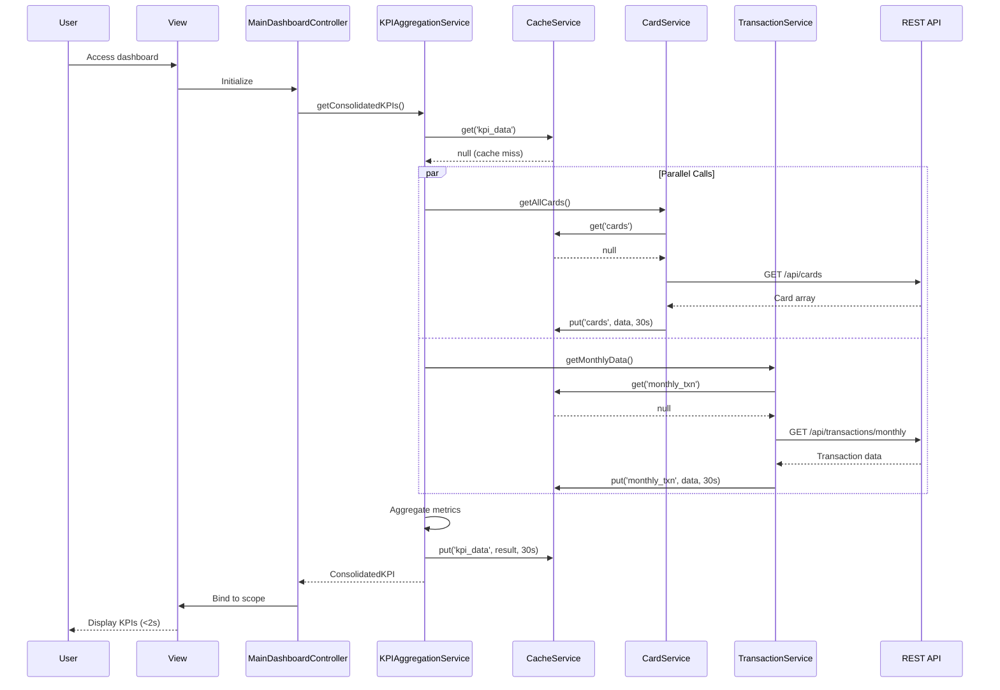

# Low-Level Design: Dashboard and KPI Management
**Epic ID:** QE-7684

## a. Architecture Mapping

| HLD Component | AngularJS Artifact | Mapping |
|---------------|-------------------|----------|
| User Dashboard UI | View + Directive | `app/dashboard/views/main-dashboard.html` + `kpiWidgetDirective` |
| Dashboard Controller | Controller | `MainDashboardController` - orchestrates dashboard data flow |
| Credit Card Data Service | Service | `CardService` - retrieves card balances and limits |
| Transaction Service | Service | `TransactionService` - calculates monthly spend and outstanding amounts |
| KPI Aggregation Engine | Service | `KPIAggregationService` - consolidates multi-card metrics |
| Data Cache Layer | Service | `CacheService` - implements caching strategy for performance |

**Recommended Folder Structure:**
```
app/
├── dashboard/
│   ├── controllers/
│   │   └── MainDashboardController.js
│   ├── services/
│   │   ├── CardService.js
│   │   ├── TransactionService.js
│   │   ├── KPIAggregationService.js
│   │   └── CacheService.js
│   ├── directives/
│   │   └── kpiWidgetDirective.js
│   └── views/
│       └── main-dashboard.html
```

## b. Component Specifications

| Component Name | Artifact Type | Responsibility | Key Dependencies |
|----------------|---------------|----------------|------------------|
| MainDashboardController | Controller | Initializes dashboard, manages KPI display and refresh | KPIAggregationService, CacheService, $scope, $interval |
| CardService | Service | Fetches card data (balances, limits) from REST API | $http, $q, CacheService |
| TransactionService | Service | Retrieves transaction data for monthly spend calculation | $http, $q, CacheService |
| KPIAggregationService | Service | Aggregates data from card and transaction services into consolidated KPIs | CardService, TransactionService, $q |
| CacheService | Service | Implements in-memory caching with TTL for API responses | $cacheFactory |
| kpiWidgetDirective | Directive | Renders individual KPI widgets with real-time updates | None |

## c. Data Model

```javascript
// Consolidated KPI Model
const ConsolidatedKPI = {
  monthlySpend: Number,
  totalCreditLimit: Number,
  availableCredit: Number,
  outstandingAmount: Number,
  utilizationRate: Number,      // Calculated: (totalLimit - availableCredit) / totalLimit
  lastUpdated: Date
};

// Card Data Model
const CardData = {
  cardId: String,
  creditLimit: Number,
  availableCredit: Number,
  currentBalance: Number
};

// Transaction Data Model
const TransactionData = {
  monthlyTotal: Number,
  transactionCount: Number,
  lastTransactionDate: Date
};
```

## d. Data Flow

User accesses dashboard → MainDashboardController initializes → Controller calls KPIAggregationService.getConsolidatedKPIs() → Service checks CacheService for cached data → If cache miss, service makes parallel calls to CardService.getAllCards() and TransactionService.getMonthlyData() → CardService fetches from `/api/cards` (checks cache first), TransactionService fetches from `/api/transactions/monthly` (checks cache first) → Both services cache responses with 30-second TTL → KPIAggregationService aggregates data: sums credit limits, available credit, outstanding amounts, calculates monthly spend → ConsolidatedKPI object returned → Controller binds to $scope → kpiWidgetDirective renders four KPI widgets → Dashboard loads within 2 seconds due to caching → $interval triggers refresh every 60 seconds for real-time updates.

## e. Primary Sequence Diagram



## f. Implementation Notes

- Implement CacheService using AngularJS `$cacheFactory` with 30-second TTL to meet 2-second load time NFR
- Use `$q.all()` for parallel API calls in KPIAggregationService to minimize latency
- Set up auto-refresh using `$interval(refreshKPIs, 60000)` for real-time data updates
- Apply responsive design with Bootstrap grid: 4 KPI widgets in row on desktop (col-md-3), 2 per row on tablet (col-sm-6), stacked on mobile (col-xs-12)
- Use AngularJS `$watch` in kpiWidgetDirective to animate KPI value changes for better UX

## g. Error Handling

HTTP interceptor captures errors; CacheService returns stale cached data if API fails; user notified via toastr with retry option.

## h. Security Notes

Requires token-based auth via existing SSO; all endpoints require valid JWT in Authorization header.