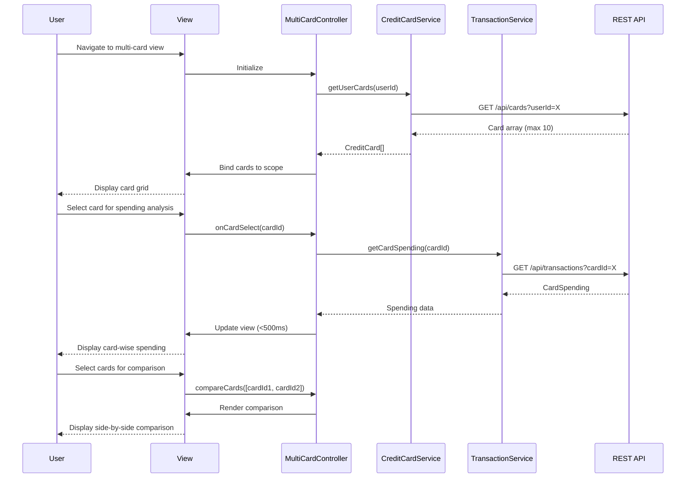

# Low-Level Design: Multiple Credit Card Management
**Epic ID:** QE-7685

## a. Architecture Mapping

| HLD Component | AngularJS Artifact | Mapping |
|---------------|-------------------|----------|
| User Interface | View + Directive | `app/cards/views/multi-card-view.html` + `cardGridDirective` |
| Card Management Controller | Controller | `MultiCardController` - manages card list, selection, and comparison |
| Credit Card Data Service | Service | `CreditCardService` - fetches card details and balances |
| Transaction Service | Service | `TransactionService` - retrieves card-specific spending data |
| Card Repository | Service (Backend) | REST API endpoint `/api/cards` |
| Transaction Repository | Service (Backend) | REST API endpoint `/api/transactions` |

**Recommended Folder Structure:**
```
app/
├── cards/
│   ├── controllers/
│   │   └── MultiCardController.js
│   ├── services/
│   │   ├── CreditCardService.js
│   │   └── TransactionService.js
│   ├── directives/
│   │   ├── cardGridDirective.js
│   │   └── cardCompareDirective.js
│   ├── views/
│   │   ├── multi-card-view.html
│   │   └── card-comparison.html
│   └── filters/
│       └── cardFilterPipe.js
```

## b. Component Specifications

| Component Name | Artifact Type | Responsibility | Key Dependencies |
|----------------|---------------|----------------|------------------|
| MultiCardController | Controller | Manages card list display, filtering, selection, and comparison triggering | CreditCardService, TransactionService, $scope, $filter |
| CreditCardService | Service | Fetches card details (balances, limits) from API | $http, $q |
| TransactionService | Service | Retrieves card-specific transaction data for spending analysis | $http, $q |
| cardGridDirective | Directive | Renders card grid with card details, handles card selection | MultiCardController |
| cardCompareDirective | Directive | Displays side-by-side card comparison view | None |
| cardFilterPipe | Filter | Filters cards by type, status, or utilization rate | None |

## c. Data Model

```javascript
// Credit Card Model
const CreditCard = {
  cardId: String,
  userId: String,
  cardNumber: String,          // Last 4 digits only
  cardType: String,            // "Visa", "MasterCard", "Amex"
  cardName: String,
  creditLimit: Number,
  availableCredit: Number,
  currentBalance: Number,
  utilizationRate: Number,     // (creditLimit - availableCredit) / creditLimit * 100
  status: String,              // "Active", "Inactive"
  expiryDate: String           // "MM/YY"
};

// Card Spending Model
const CardSpending = {
  cardId: String,
  monthlySpend: Number,
  yearlySpend: Number,
  lastTransactionDate: Date,
  topCategory: String
};

// Card Comparison Model
const CardComparison = {
  cards: Array,                // Array of CreditCard
  spendingData: Array,         // Array of CardSpending
  comparisonMetrics: Object    // { avgUtilization: X, totalSpend: Y, ... }
};
```

## d. Data Flow

User navigates to multi-card view → MultiCardController initializes and calls CreditCardService.getUserCards() → Service makes GET request to `/api/cards?userId=X` → Card array returned → Controller binds to $scope.cards → cardGridDirective renders grid with up to 10 cards → User applies filter (e.g., high utilization) → cardFilterPipe filters $scope.cards → Filtered cards displayed → User selects card for details → Controller calls TransactionService.getCardSpending(cardId) → Service fetches from `/api/transactions?cardId=X` → CardSpending data returned → Controller updates $scope.selectedCardSpending → Spending details displayed → User selects multiple cards for comparison → Controller prepares CardComparison object → cardCompareDirective renders side-by-side comparison → All operations complete within 500ms due to optimized API calls.

## e. Primary Sequence Diagram



## f. Implementation Notes

- Support up to 10 cards per user as per NFR; implement pagination or "load more" if user has >10 cards
- Use AngularJS `$filter` service for client-side card filtering to meet <500ms switching/filtering NFR
- Implement card selection using ng-click with $scope.selectedCards array for multi-select comparison
- Use Bootstrap grid (col-md-4) for responsive card grid layout
- Cache card data in CreditCardService for 60 seconds to optimize repeated access during filtering/switching

## g. Error Handling

Interceptor-based error handling with retry logic for transient failures; user notified via toast on persistent errors.

## h. Security Notes

Requires token-based auth via existing SSO; card data filtered by authenticated userId to prevent unauthorized access.