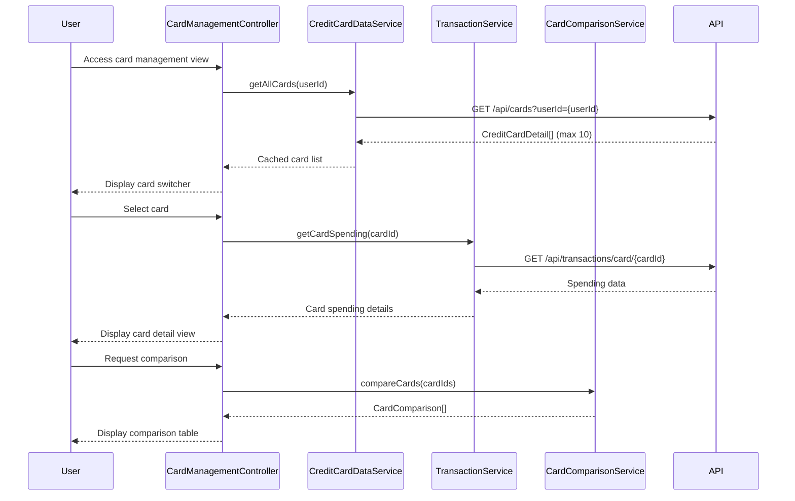

# Low-Level Design: Multiple Credit Card Management
**Epic ID:** QE-7685

## a. Architecture Mapping

- **Module:** `creditCardApp.cardManagement` - Root module for multi-card management
- **Controller:** `CardManagementController` - Manages card list, switching, and detail views
- **Service:** `CreditCardDataService` - Fetches card details, balances, and limits
- **Service:** `TransactionService` - Retrieves card-specific spending data
- **Service:** `CardComparisonService` - Performs card-wise comparison analytics
- **Directive:** `cardSwitcherDirective` - Provides UI for fast card switching (<500ms)
- **Directive:** `cardDetailDirective` - Displays individual card details

**Folder Structure:**
```
/app
  /modules
    /card-management
      card-management.module.js
      card-management.controller.js
      card-management.html
  /services
    credit-card-data.service.js
    transaction.service.js
    card-comparison.service.js
  /directives
    card-switcher.directive.js
    card-detail.directive.js
```

## b. Component Specifications

| Component Name | Artifact Type | Responsibility | Key Dependencies |
|----------------|---------------|----------------|------------------|
| CardManagementController | Controller | Manages card list display, selection, and switching logic | CreditCardDataService, CardComparisonService, $scope |
| CreditCardDataService | Factory | Fetches and caches up to 10 cards per user with balances and limits | $http, $q, $cacheFactory |
| TransactionService | Factory | Retrieves card-specific transaction and spending data | $http, $q |
| CardComparisonService | Service | Compares multiple cards on utilization, spend, and limits | CreditCardDataService, TransactionService |
| cardSwitcherDirective | Directive | Provides dropdown/tab UI for switching between cards (<500ms) | None |
| cardDetailDirective | Directive | Displays detailed view of selected card with spend analysis | None |

## c. Data Model

**CreditCardDetail Object:**
```javascript
{
  cardId: String,
  userId: String,
  maskedNumber: String,
  cardType: String,
  creditLimit: Number,
  availableCredit: Number,
  currentBalance: Number,
  outstandingAmount: Number,
  monthlySpend: Number,
  utilizationRate: Number
}
```

**CardComparison Object:**
```javascript
{
  cardId: String,
  cardName: String,
  utilizationRate: Number,
  monthlySpend: Number,
  availableCredit: Number
}
```

## d. Data Flow

User accesses card management view → CardManagementController calls CreditCardDataService.getAllCards() → Service fetches all user cards (max 10) from REST API and caches locally → Controller displays card list using cardSwitcherDirective → User selects a card → Controller retrieves cached card details and invokes TransactionService for card-specific spending → cardDetailDirective renders selected card details → User can switch to another card, triggering cached data retrieval (<500ms) → CardComparisonService is invoked when user requests comparison view, aggregating data across selected cards.

## e. Primary Sequence Diagram



## f. Implementation Notes

- Use $cacheFactory in CreditCardDataService to cache card data for 500ms switching performance
- Implement cardSwitcherDirective with ng-click and ng-repeat for fast card selection
- Apply ES6 Promises ($q) for asynchronous data fetching and chaining
- REST API endpoints: `/api/cards`, `/api/transactions/card/{cardId}`
- Limit card count to 10 per user with validation in backend and frontend

## g. Error Handling

HTTP interceptor-based error handling; fallback to cached data on transient failures; user notification via toast.

## h. Security Notes

Requires token-based auth via existing SSO; card data masked client-side for security.