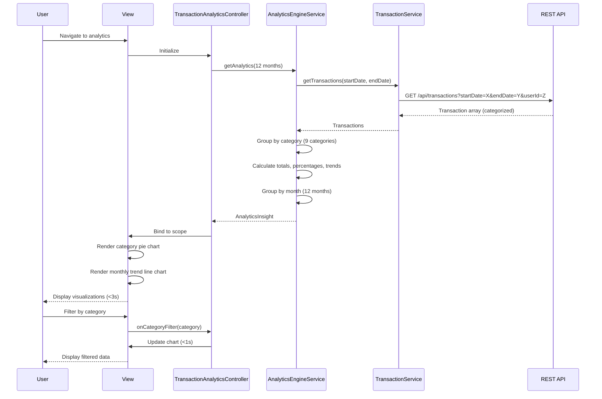

# Low-Level Design: Transaction Analytics and Category Insights
**Epic ID:** QE-7686

## a. Architecture Mapping

| HLD Component | AngularJS Artifact | Mapping |
|---------------|-------------------|----------|
| User Interface | View + Directive | `app/analytics/views/transaction-analytics.html` + `categoryChartDirective` |
| Analytics Controller | Controller | `TransactionAnalyticsController` - manages analytics view and interactions |
| Transaction Service | Service | `TransactionService` - fetches categorized transaction data |
| Analytics Engine | Service | `AnalyticsEngineService` - performs trend calculations and pattern recognition |
| Visualization Renderer | Directive | `categoryChartDirective` - renders interactive charts using Chart.js |
| Transaction Database | Service (Backend) | REST API endpoint `/api/transactions` |

**Recommended Folder Structure:**
```
app/
├── analytics/
│   ├── controllers/
│   │   └── TransactionAnalyticsController.js
│   ├── services/
│   │   ├── TransactionService.js
│   │   └── AnalyticsEngineService.js
│   ├── directives/
│   │   ├── categoryChartDirective.js
│   │   └── trendChartDirective.js
│   ├── views/
│   │   └── transaction-analytics.html
│   └── constants/
│       └── spendingCategories.js
```

## b. Component Specifications

| Component Name | Artifact Type | Responsibility | Key Dependencies |
|----------------|---------------|----------------|------------------|
| TransactionAnalyticsController | Controller | Manages analytics view, handles date range selection, triggers data refresh | AnalyticsEngineService, $scope, $timeout |
| TransactionService | Service | Fetches categorized transactions from API with date and category filters | $http, $q |
| AnalyticsEngineService | Service | Processes transaction data, calculates trends, identifies spending patterns | TransactionService, $q |
| categoryChartDirective | Directive | Renders pie/donut chart for category-wise spending distribution | Chart.js |
| trendChartDirective | Directive | Renders line chart for monthly spend trends over time | Chart.js |
| SPENDING_CATEGORIES | Constant | Defines nine spending categories as immutable constant | None |

## c. Data Model

```javascript
// Transaction Model
const Transaction = {
  transactionId: String,
  cardId: String,
  userId: String,
  amount: Number,
  category: String,            // One of 9 predefined categories
  merchant: String,
  transactionDate: Date,
  description: String
};

// Category Insight Model
const CategoryInsight = {
  category: String,
  totalAmount: Number,
  transactionCount: Number,
  percentage: Number,          // % of total spend
  trend: String                // "increasing", "decreasing", "stable"
};

// Monthly Trend Model
const MonthlyTrend = {
  month: String,               // "2026-01"
  totalSpend: Number,
  categoryBreakdown: Object    // { "Food & Dining": 500, "Fuel": 200, ... }
};

// Analytics Insight Model
const AnalyticsInsight = {
  categoryInsights: Array,     // Array of CategoryInsight (9 categories)
  monthlyTrends: Array,        // Array of MonthlyTrend (12 months)
  topSpendingCategory: String,
  averageMonthlySpend: Number,
  spendingPattern: String      // "consistent", "variable", "seasonal"
};
```

## d. Data Flow

User navigates to transaction analytics view → TransactionAnalyticsController initializes → Controller calls AnalyticsEngineService.getAnalytics(dateRange) with default 12-month range → Service calls TransactionService.getTransactions(startDate, endDate) → Service fetches from `/api/transactions?startDate=X&endDate=Y&userId=Z` → Transaction array (pre-categorized) returned → AnalyticsEngineService processes data: groups by category, calculates totals and percentages, identifies trends, groups by month → AnalyticsInsight object created → Controller binds to $scope → categoryChartDirective renders pie chart showing nine categories with percentages → trendChartDirective renders line chart showing 12-month spending trend → Visualizations render within 3 seconds → User filters by category or drills down → Controller updates data and re-renders charts in sub-second time.

## e. Primary Sequence Diagram



## f. Implementation Notes

- Define nine categories as AngularJS constant: `angular.module('app').constant('SPENDING_CATEGORIES', ['Food & Dining', 'Fuel', 'Shopping', 'Travel', 'Entertainment', 'Utilities', 'Healthcare', 'Education', 'Miscellaneous'])`
- Use Chart.js library (v2.9+) wrapped in AngularJS directives for responsive, interactive visualizations
- Implement drill-down using Chart.js onClick event handler to filter transactions by selected category
- Optimize rendering for 12 months of data using Chart.js decimation plugin for large datasets
- Use AngularJS `$filter('currency')` for consistent amount formatting in tooltips and labels

## g. Error Handling

Interceptor-based error handling with fallback message displayed if API fails; partial data rendered if some months are missing.

## h. Security Notes

Standard input validation and secure API calls assumed; transactions filtered by authenticated userId to ensure data privacy.