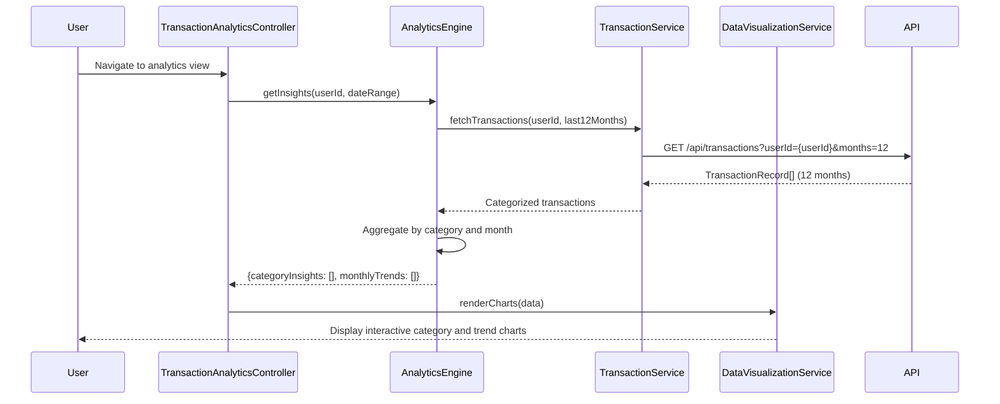

# Low-Level Design: Transaction Analytics and Category Insights
**Epic ID:** QE-7686

## a. Architecture Mapping

- **Module:** `creditCardApp.transactionAnalytics` - Root module for transaction insights
- **Controller:** `TransactionAnalyticsController` - Manages analytics view and user interactions
- **Service:** `TransactionService` - Retrieves categorized transaction records
- **Service:** `AnalyticsEngine` - Performs trend calculations and pattern recognition
- **Service:** `DataVisualizationService` - Interfaces with Chart.js for rendering charts
- **Directive:** `categoryChartDirective` - Renders category-wise spending chart
- **Directive:** `trendAnalysisDirective` - Renders monthly spend trend chart

**Folder Structure:**
```
/app
  /modules
    /transaction-analytics
      transaction-analytics.module.js
      transaction-analytics.controller.js
      transaction-analytics.html
  /services
    transaction.service.js
    analytics-engine.service.js
    data-visualization.service.js
  /directives
    category-chart.directive.js
    trend-analysis.directive.js
```

## b. Component Specifications

| Component Name | Artifact Type | Responsibility | Key Dependencies |
|----------------|---------------|----------------|------------------|
| TransactionAnalyticsController | Controller | Manages analytics view, filters, and chart data binding | AnalyticsEngine, DataVisualizationService, $scope |
| TransactionService | Factory | Fetches categorized transaction records (9 categories) | $http, $q |
| AnalyticsEngine | Service | Aggregates transactions by category and calculates 12-month trends | TransactionService, $q |
| DataVisualizationService | Service | Wraps Chart.js; provides chart configuration and rendering | Chart.js |
| categoryChartDirective | Directive | Renders interactive category-wise spending chart (bar/pie) | DataVisualizationService |
| trendAnalysisDirective | Directive | Renders 12-month spend trend line chart | DataVisualizationService |

## c. Data Model

**TransactionRecord Object:**
```javascript
{
  transactionId: String,
  cardId: String,
  amount: Number,
  category: String,            // One of 9: Food & Dining, Fuel, Shopping, Travel, Entertainment, Utilities, Healthcare, Education, Miscellaneous
  transactionDate: Date,
  merchantName: String
}
```

**CategoryInsight Object:**
```javascript
{
  category: String,
  totalSpend: Number,
  transactionCount: Number,
  percentageOfTotal: Number
}
```

**MonthlyTrendData Object:**
```javascript
{
  month: String,               // Format: "YYYY-MM"
  totalSpend: Number,
  categoryBreakdown: Array     // [{category: String, amount: Number}]
}
```

## d. Data Flow

User navigates to transaction analytics view → TransactionAnalyticsController calls AnalyticsEngine.getInsights() → Engine invokes TransactionService to fetch 12 months of categorized transactions → Transactions are aggregated by category and month in AnalyticsEngine → CategoryInsight[] and MonthlyTrendData[] are computed → Results returned to Controller → Controller passes data to DataVisualizationService → categoryChartDirective and trendAnalysisDirective render interactive charts using Chart.js → User can filter by date range or drill down into specific categories, triggering re-aggregation and chart refresh.

## e. Primary Sequence Diagram



## f. Implementation Notes

- Use Chart.js with responsive and interactive configurations for smooth rendering
- Implement pagination or lazy loading for large transaction datasets (>1000 records)
- Apply ES6 Array methods (reduce, filter, map) in AnalyticsEngine for efficient aggregation
- Use AngularJS $watch on filter controls to trigger reactive chart updates
- REST API endpoint: `/api/transactions` with query params for userId, date range, and months

## g. Error Handling

HTTP interceptor-based error handling; display user-friendly messages; graceful degradation with empty state UI.

## h. Security Notes

Standard input validation and secure API calls assumed; token-based authentication enforced.