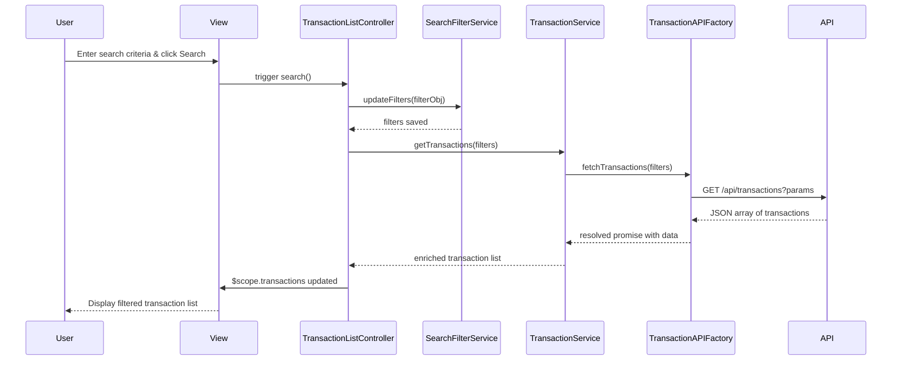

# Low-Level Design: Transaction Management and Visibility
**Epic ID:** QE-7687  
**Epic Title:** PERFTEST20261109161748-Transaction Management and Visibility

---

## a. Architecture Mapping

| HLD Component | AngularJS Artifact | Mapping |
|---------------|-------------------|----------|
| User Interface | Module | `transactionManagementModule` - root module for transaction features |
| Transaction Management Service | Service | `TransactionService` - handles transaction data retrieval and business logic |
| Search and Filter Engine | Service + Controller | `SearchFilterService` + `TransactionListController` - manages search/filter state and UI binding |
| Transaction Processing System | Factory | `TransactionAPIFactory` - REST API integration for transaction data |
| Credit Card Data Service | Service | `CreditCardService` - retrieves card metadata and mappings |

**Recommended Folder Structure:**
```
app/
├── modules/
│   └── transactions/
│       ├── controllers/
│       │   └── transactionListController.js
│       ├── services/
│       │   ├── transactionService.js
│       │   ├── searchFilterService.js
│       │   └── creditCardService.js
│       ├── factories/
│       │   └── transactionAPIFactory.js
│       ├── views/
│       │   ├── transaction-list.html
│       │   └── transaction-detail.html
│       └── transactionModule.js
```

---

## b. Component Specifications

| Component Name | Artifact Type | Responsibility | Key Dependencies |
|----------------|---------------|----------------|------------------|
| `transactionManagementModule` | Module | Root module registration and routing configuration | `ngRoute`, `transactionListController` |
| `TransactionListController` | Controller | Manages transaction list view, search/filter UI state, pagination | `TransactionService`, `SearchFilterService`, `$scope` |
| `TransactionDetailController` | Controller | Displays single transaction details | `TransactionService`, `$routeParams`, `$scope` |
| `TransactionService` | Service | Orchestrates transaction retrieval, caching, and business logic | `TransactionAPIFactory`, `CreditCardService` |
| `SearchFilterService` | Service | Maintains search/filter criteria state across views | None |
| `CreditCardService` | Service | Provides card metadata and card-to-transaction mapping | `CreditCardAPIFactory` |
| `TransactionAPIFactory` | Factory | REST API calls for transaction data (GET /api/transactions) | `$http`, `$q` |
| `CreditCardAPIFactory` | Factory | REST API calls for card data (GET /api/cards) | `$http`, `$q` |

---

## c. Data Model

**Transaction Object:**
```javascript
{
  transactionId: String,
  cardId: String,
  merchantName: String,
  amount: Number,
  currency: String,
  category: String,
  transactionDate: Date,
  transactionType: String, // 'debit' | 'credit'
  status: String // 'posted' | 'pending'
}
```

**SearchFilter Object:**
```javascript
{
  cardId: String,
  startDate: Date,
  endDate: Date,
  transactionType: String,
  category: String,
  searchText: String
}
```

**Card Object (minimal):**
```javascript
{
  cardId: String,
  cardNumber: String, // masked
  cardName: String
}
```

---

## d. Data Flow

User enters search criteria or selects filters in the transaction list view → `TransactionListController` captures input and updates `SearchFilterService` state → Controller invokes `TransactionService.getTransactions(filters)` → Service calls `TransactionAPIFactory` which sends GET request to `/api/transactions?cardId=X&startDate=Y&endDate=Z` → API returns filtered transaction array → Service maps cardId to card names via `CreditCardService` → Controller receives enriched transaction list and binds to `$scope.transactions` → View renders paginated transaction table with card names, amounts, dates, and categories → User clicks transaction row → Controller navigates to detail view passing `transactionId` → `TransactionDetailController` fetches full transaction details and displays.

---

## e. Primary Sequence Diagram



---

## f. Implementation Notes

- Use AngularJS Dependency Injection to inject services and factories into controllers; register all artifacts in `transactionManagementModule`.
- Implement `TransactionAPIFactory` using `$http` service with promise-based error handling; leverage `$q` for chaining.
- Apply ES6 arrow functions and `const`/`let` for cleaner service and factory code; use template literals for API URL construction.
- Use `ng-repeat` with `track by transactionId` in views for optimal rendering performance; implement pagination via `limitTo` filter or custom directive.
- Cache card metadata in `CreditCardService` using a simple in-memory object to avoid redundant API calls during transaction list enrichment.

---

## g. Error Handling

HTTP interceptor captures API errors (4xx/5xx) and displays user-friendly notifications via a global `NotificationService`; controllers use try/catch for synchronous errors.

---

## h. Security Notes

Requires token-based authentication via existing SSO; all API calls include auth token in headers; card numbers are masked on client-side display.