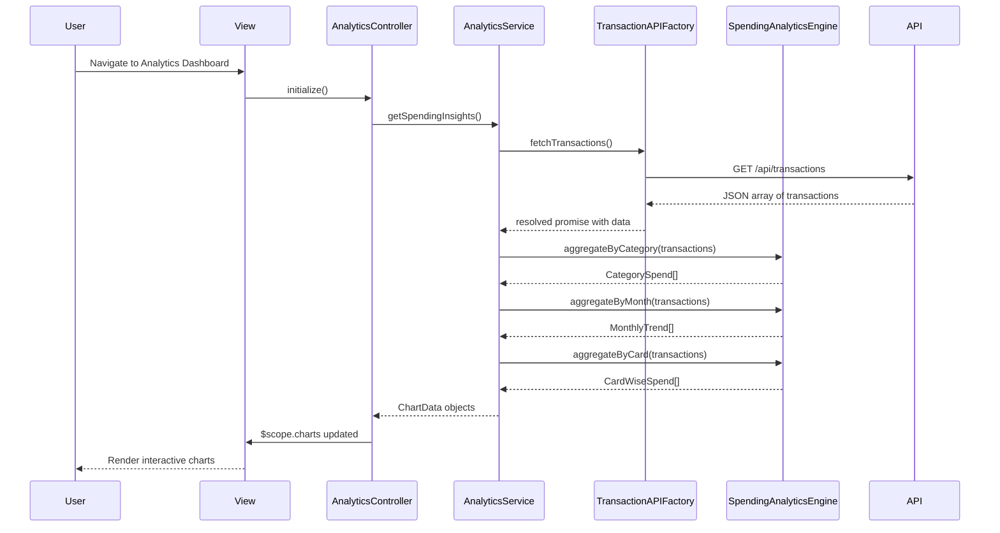

# Low-Level Design: Spending Analytics and Insights
**Epic ID:** QE-7688  
**Epic Title:** PERFTEST20261109161748-Spending Analytics and Insights

---

## a. Architecture Mapping

| HLD Component | AngularJS Artifact | Mapping |
|---------------|-------------------|----------|
| User Interface | Module | `analyticsModule` - root module for analytics features |
| Analytics Service | Service | `AnalyticsService` - orchestrates data aggregation and analytics logic |
| Analytics Engine | Service | `SpendingAnalyticsEngine` - calculates category totals, trends, and card-wise breakdowns |
| Transaction Processing System | Factory | `TransactionAPIFactory` - REST API integration for transaction data |
| Credit Card Data Service | Service | `CreditCardService` - provides card metadata |
| Visualization Layer | Directive | `chartDirective` - wraps Chart.js or D3.js for rendering interactive charts |

**Recommended Folder Structure:**
```
app/
├── modules/
│   └── analytics/
│       ├── controllers/
│       │   └── analyticsController.js
│       ├── services/
│       │   ├── analyticsService.js
│       │   ├── spendingAnalyticsEngine.js
│       │   └── creditCardService.js
│       ├── factories/
│       │   └── transactionAPIFactory.js
│       ├── directives/
│       │   └── chartDirective.js
│       ├── views/
│       │   └── analytics-dashboard.html
│       └── analyticsModule.js
```

---

## b. Component Specifications

| Component Name | Artifact Type | Responsibility | Key Dependencies |
|----------------|---------------|----------------|------------------|
| `analyticsModule` | Module | Root module registration and routing for analytics | `ngRoute`, `analyticsController` |
| `AnalyticsController` | Controller | Manages analytics dashboard view, user interactions, chart data binding | `AnalyticsService`, `$scope` |
| `AnalyticsService` | Service | Fetches transaction data, invokes analytics engine, prepares chart datasets | `TransactionAPIFactory`, `SpendingAnalyticsEngine`, `CreditCardService` |
| `SpendingAnalyticsEngine` | Service | Aggregates transactions by category, month, and card; calculates totals and trends | None |
| `CreditCardService` | Service | Provides card metadata for card-wise analysis | `CreditCardAPIFactory` |
| `TransactionAPIFactory` | Factory | REST API calls for transaction data (GET /api/transactions) | `$http`, `$q` |
| `CreditCardAPIFactory` | Factory | REST API calls for card data (GET /api/cards) | `$http`, `$q` |
| `chartDirective` | Directive | Renders interactive charts using Chart.js; supports filtering and drill-down | Chart.js library |

---

## c. Data Model

**Transaction Object:**
```javascript
{
  transactionId: String,
  cardId: String,
  amount: Number,
  category: String, // 'Food & Dining', 'Fuel', 'Shopping', etc.
  transactionDate: Date,
  transactionType: String
}
```

**CategorySpend Object:**
```javascript
{
  category: String,
  totalAmount: Number,
  transactionCount: Number
}
```

**MonthlyTrend Object:**
```javascript
{
  month: String, // 'YYYY-MM'
  totalSpend: Number
}
```

**CardWiseSpend Object:**
```javascript
{
  cardId: String,
  cardName: String,
  totalSpend: Number,
  categoryBreakdown: Array<CategorySpend>
}
```

**ChartData Object:**
```javascript
{
  labels: Array<String>,
  datasets: Array<{ label: String, data: Array<Number>, backgroundColor: Array<String> }>
}
```

---

## d. Data Flow

User navigates to analytics dashboard → `AnalyticsController` initializes and calls `AnalyticsService.getSpendingInsights()` → Service fetches all transactions via `TransactionAPIFactory` (GET /api/transactions) → Service passes transaction array to `SpendingAnalyticsEngine.aggregateByCategory()`, `.aggregateByMonth()`, and `.aggregateByCard()` → Engine returns aggregated objects (CategorySpend[], MonthlyTrend[], CardWiseSpend[]) → Service transforms aggregated data into ChartData format → Controller binds ChartData to `$scope.categoryChart`, `$scope.trendChart`, `$scope.cardChart` → `chartDirective` receives data and renders interactive charts (pie for categories, line for trends, bar for cards) → User interacts with chart (e.g., clicks category slice) → Directive emits event → Controller filters and updates related charts.

---

## e. Primary Sequence Diagram



---

## f. Implementation Notes

- Use AngularJS Dependency Injection to inject all services and factories; register `chartDirective` in `analyticsModule` with isolated scope.
- Implement `SpendingAnalyticsEngine` using ES6 `Array.reduce()` and `Map` for efficient aggregation; use `moment.js` for date manipulation.
- Integrate Chart.js via `chartDirective` with two-way data binding; configure responsive options and enable onClick events for drill-down.
- Cache transaction data in `AnalyticsService` for 5 minutes to avoid redundant API calls when user toggles between chart views.
- Use `$timeout` to defer chart rendering until DOM is ready; apply `track by` in `ng-repeat` for category lists.

---

## g. Error Handling

HTTP interceptor captures API errors and displays user-friendly notifications; analytics engine validates data completeness before aggregation.

---

## h. Security Notes

Requires token-based authentication via existing SSO; all API calls include auth token in headers.