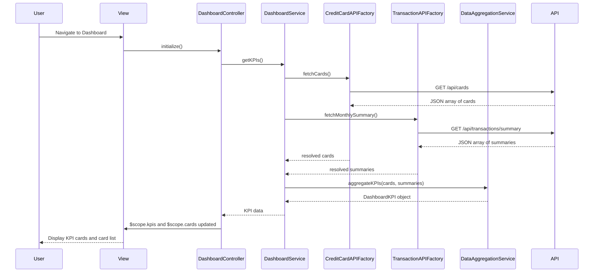

# Low-Level Design: Dashboard KPIs and Credit Card Overview
**Epic ID:** QE-7689  
**Epic Title:** PERFTEST20261109161748-Dashboard KPIs and Credit Card Overview

---

## a. Architecture Mapping

| HLD Component | AngularJS Artifact | Mapping |
|---------------|-------------------|----------|
| User Interface | Module | `dashboardModule` - root module for dashboard features |
| Dashboard Service | Service | `DashboardService` - orchestrates KPI data retrieval and aggregation logic |
| Data Aggregation Layer | Service | `DataAggregationService` - aggregates data from multiple sources |
| Credit Card Data Service | Factory | `CreditCardAPIFactory` - REST API integration for card details and balances |
| Transaction Processing System | Factory | `TransactionAPIFactory` - REST API integration for monthly spend and outstanding amounts |

**Recommended Folder Structure:**
```
app/
├── modules/
│   └── dashboard/
│       ├── controllers/
│       │   └── dashboardController.js
│       ├── services/
│       │   ├── dashboardService.js
│       │   └── dataAggregationService.js
│       ├── factories/
│       │   ├── creditCardAPIFactory.js
│       │   └── transactionAPIFactory.js
│       ├── views/
│       │   └── dashboard.html
│       └── dashboardModule.js
```

---

## b. Component Specifications

| Component Name | Artifact Type | Responsibility | Key Dependencies |
|----------------|---------------|----------------|------------------|
| `dashboardModule` | Module | Root module registration and routing for dashboard | `ngRoute`, `dashboardController` |
| `DashboardController` | Controller | Manages dashboard view, binds KPI data to UI, handles refresh actions | `DashboardService`, `$scope`, `$interval` |
| `DashboardService` | Service | Fetches and prepares KPI data for display; coordinates data aggregation | `DataAggregationService`, `CreditCardAPIFactory`, `TransactionAPIFactory` |
| `DataAggregationService` | Service | Aggregates card data and transaction data to compute KPIs (total credit limit, available credit, outstanding, monthly spend) | None |
| `CreditCardAPIFactory` | Factory | REST API calls for card details (GET /api/cards) | `$http`, `$q` |
| `TransactionAPIFactory` | Factory | REST API calls for transaction summaries (GET /api/transactions/summary) | `$http`, `$q` |

---

## c. Data Model

**CreditCard Object:**
```javascript
{
  cardId: String,
  cardNumber: String, // masked
  cardName: String,
  creditLimit: Number,
  availableCredit: Number,
  outstandingAmount: Number
}
```

**TransactionSummary Object:**
```javascript
{
  cardId: String,
  monthlySpend: Number,
  month: String // 'YYYY-MM'
}
```

**DashboardKPI Object:**
```javascript
{
  totalCreditLimit: Number,
  totalAvailableCredit: Number,
  totalOutstanding: Number,
  totalMonthlySpend: Number,
  cards: Array<CreditCard>
}
```

---

## d. Data Flow

User navigates to dashboard → `DashboardController` initializes and calls `DashboardService.getKPIs()` → Service invokes `CreditCardAPIFactory.fetchCards()` (GET /api/cards) and `TransactionAPIFactory.fetchMonthlySummary()` (GET /api/transactions/summary) in parallel using `$q.all()` → Both API calls return data → Service passes card array and transaction summary array to `DataAggregationService.aggregateKPIs()` → Aggregation service computes total credit limit (sum of all card limits), total available credit (sum of all available credit), total outstanding (sum of all outstanding amounts), and total monthly spend (sum of monthly spend across all cards) → Service returns `DashboardKPI` object → Controller binds KPI data to `$scope.kpis` and `$scope.cards` → View renders KPI cards (monthly spend, total credit limit, available credit, outstanding) and card list with individual card details → Auto-refresh triggered every 5 minutes via `$interval` re-invokes `DashboardService.getKPIs()`.

---

## e. Primary Sequence Diagram



---

## f. Implementation Notes

- Use AngularJS Dependency Injection to inject services and factories into controllers; register all artifacts in `dashboardModule`.
- Implement parallel API calls using `$q.all([promise1, promise2])` to meet 2-second load time requirement.
- Apply ES6 `Array.reduce()` in `DataAggregationService` for efficient KPI calculation; use `const` and `let` for variable declarations.
- Use `$interval` service to auto-refresh dashboard data every 5 minutes; cancel interval on `$scope.$on('$destroy')` to prevent memory leaks.
- Cache API responses in `DashboardService` for 5 minutes using a simple timestamp-based cache object to avoid redundant calls during manual refresh.

---

## g. Error Handling

HTTP interceptor captures API errors and displays user-friendly notifications; service uses `$q.reject()` for promise-based error propagation.

---

## h. Security Notes

Requires token-based authentication via existing SSO; all API calls include auth token in headers; card numbers are masked on client-side display.