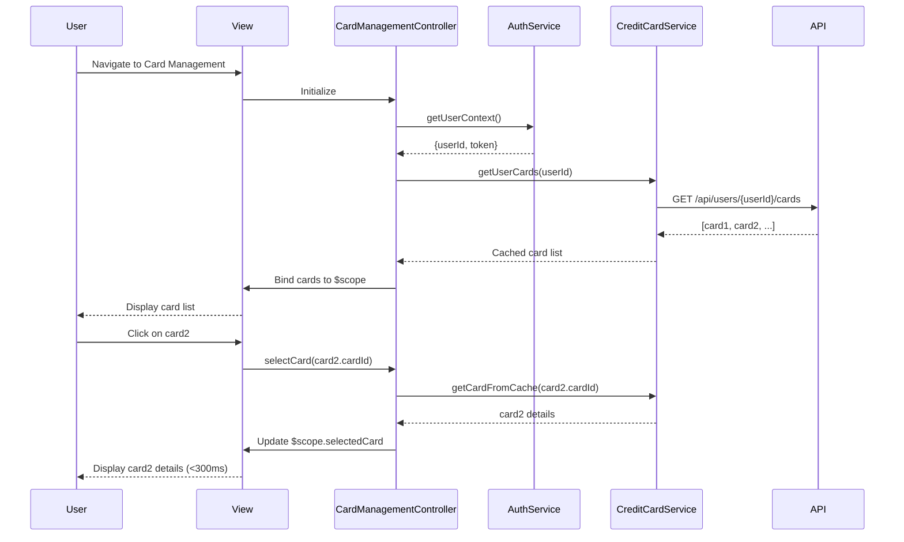

# Low-Level Design: Multiple Credit Card Management
**Epic ID:** QE-7690  
**Technology Stack:** AngularJS 1.x, JavaScript ES6, HTML5, CSS3, Bootstrap, REST APIs, MVC Architecture

---

## a. Architecture Mapping

- **User Interface - Card Management** → AngularJS Module (`creditCardModule`) + View Template (`card-list.html`)
- **Card Selection Controller** → AngularJS Controller (`CardManagementController`)
- **Credit Card Data Service** → AngularJS Service (`CreditCardService`) calling REST API
- **User Authentication Service** → AngularJS Service (`AuthService`) for user context
- **Data Storage** → Backend REST API endpoints

**Recommended Folder Structure:**
```
app/
├── modules/
│   └── creditCard/
│       ├── controllers/
│       │   └── cardManagementController.js
│       ├── services/
│       │   ├── creditCardService.js
│       │   └── authService.js
│       ├── views/
│       │   └── card-list.html
│       └── creditCardModule.js
├── assets/
│   └── css/
│       └── card-management.css
└── app.js
```

---

## b. Component Specifications

| Name | Artifact Type | Responsibility | Key Dependencies |
|------|---------------|----------------|------------------|
| `creditCardModule` | AngularJS Module | Encapsulates all credit card management functionality | `ngRoute`, `ngResource` |
| `CardManagementController` | Controller | Manages card list display, selection, switching, and comparison logic | `CreditCardService`, `AuthService`, `$scope` |
| `CreditCardService` | Service | Fetches card data from REST API, caches cards for fast switching | `$http`, `$q`, `$cacheFactory` |
| `AuthService` | Service | Provides authenticated user context and card associations | `$http`, `$window` (for token storage) |
| `card-list.html` | View Template | Renders multiple credit cards with selection and comparison UI | Bootstrap grid, `ng-repeat`, `ng-click` |
| `cardFilterDirective` | Directive | Custom directive for card filtering and sorting | `CreditCardService` |

---

## c. Data Model

**CreditCard Object:**
```javascript
{
  cardId: String,
  cardNumber: String,        // masked, e.g., "**** **** **** 1234"
  cardHolderName: String,
  cardType: String,          // "Visa", "MasterCard", "Amex"
  creditLimit: Number,
  availableCredit: Number,
  outstandingAmount: Number,
  expiryDate: String,        // "MM/YY"
  isActive: Boolean,
  lastUsedDate: Date
}
```

**User Object:**
```javascript
{
  userId: String,
  userName: String,
  email: String,
  cardIds: Array<String>     // List of associated card IDs
}
```

---

## d. Data Flow

User logs in and navigates to the card management page. The `CardManagementController` initializes and calls `AuthService` to retrieve the authenticated user context. It then invokes `CreditCardService.getUserCards()`, which makes a GET request to `/api/users/{userId}/cards`. The service caches the response using `$cacheFactory` for sub-300ms switching. The controller binds the card array to `$scope.cards`, and the view renders the list using `ng-repeat`. When the user clicks a card, `ng-click` triggers `selectCard(cardId)` in the controller, which updates `$scope.selectedCard` instantly from cache, and the UI reflects the selected card details without additional API calls.

---

## e. Primary Sequence Diagram



---

## f. Implementation Notes

- Use AngularJS Dependency Injection to inject `CreditCardService` and `AuthService` into `CardManagementController`.
- Implement `$cacheFactory` in `CreditCardService` to cache card data for fast switching (target <300ms latency).
- Use `$http` interceptor to attach authentication token to all API requests automatically.
- Leverage Bootstrap responsive grid (`col-xs-12 col-sm-6 col-md-4`) for card layout to ensure responsiveness across devices.
- Use `ng-repeat` with `track by cardId` for optimal rendering performance when displaying 10+ cards.

---

## g. Error Handling

HTTP interceptor captures API errors; controller displays user-friendly messages via Bootstrap alerts and logs errors to console.

---

## h. Security Notes

Requires token-based authentication via existing SSO; tokens stored in sessionStorage and attached to API calls via $http interceptor.

---

**End of LLD Document**