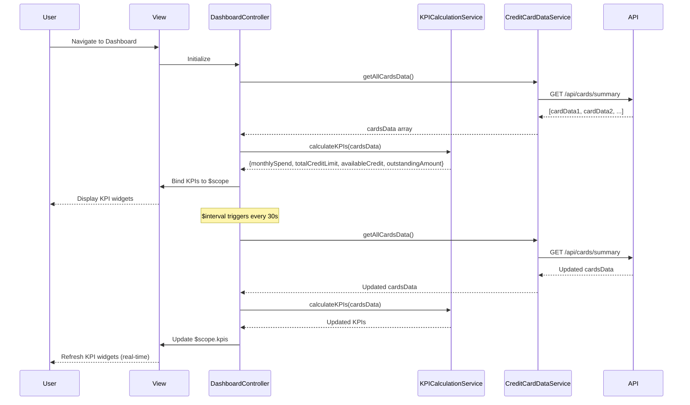

# Low-Level Design: Credit Card Dashboard and KPI Management
**Epic ID:** QE-7691  
**Technology Stack:** AngularJS 1.x, JavaScript ES6, HTML5, CSS3, Bootstrap, REST APIs, MVC Architecture

---

## a. Architecture Mapping

- **User Interface - Dashboard** → AngularJS Module (`dashboardModule`) + View Template (`dashboard.html`)
- **KPI Calculation Engine** → AngularJS Service (`KPICalculationService`) with business logic
- **Credit Card Data Service** → AngularJS Service (`CreditCardDataService`) calling REST API
- **Data Storage** → Backend REST API endpoints

**Recommended Folder Structure:**
```
app/
├── modules/
│   └── dashboard/
│       ├── controllers/
│       │   └── dashboardController.js
│       ├── services/
│       │   ├── kpiCalculationService.js
│       │   └── creditCardDataService.js
│       ├── views/
│       │   └── dashboard.html
│       └── dashboardModule.js
├── assets/
│   └── css/
│       └── dashboard.css
└── app.js
```

---

## b. Component Specifications

| Name | Artifact Type | Responsibility | Key Dependencies |
|------|---------------|----------------|------------------|
| `dashboardModule` | AngularJS Module | Encapsulates dashboard and KPI functionality | `ngRoute`, `ngResource` |
| `DashboardController` | Controller | Orchestrates KPI display and real-time updates | `KPICalculationService`, `CreditCardDataService`, `$scope`, `$interval` |
| `KPICalculationService` | Service | Aggregates and calculates KPIs (monthly spend, credit limit, available credit, outstanding) | `CreditCardDataService` |
| `CreditCardDataService` | Service | Fetches card details and transaction data from REST API | `$http`, `$q` |
| `dashboard.html` | View Template | Displays KPI widgets in responsive Bootstrap grid | Bootstrap, `ng-bind`, `ng-repeat` |
| `kpiWidgetDirective` | Directive | Reusable directive for rendering individual KPI cards | None |

---

## c. Data Model

**KPI Object:**
```javascript
{
  monthlySpend: Number,
  totalCreditLimit: Number,
  availableCredit: Number,
  outstandingAmount: Number,
  lastUpdated: Date
}
```

**CardData Object:**
```javascript
{
  cardId: String,
  creditLimit: Number,
  availableCredit: Number,
  outstandingAmount: Number,
  currentMonthSpend: Number
}
```

---

## d. Data Flow

User navigates to the dashboard page. `DashboardController` initializes and calls `CreditCardDataService.getAllCardsData()`, which makes a GET request to `/api/cards/summary`. The service returns an array of `CardData` objects. The controller passes this data to `KPICalculationService.calculateKPIs(cardsData)`, which aggregates values across all cards (sum of credit limits, available credit, outstanding amounts, and monthly spend). The calculated KPI object is bound to `$scope.kpis`, and the view renders four KPI widgets using `kpiWidgetDirective`. `$interval` polls the API every 30 seconds to refresh KPIs in real-time, updating the UI automatically via two-way data binding.

---

## e. Primary Sequence Diagram



---

## f. Implementation Notes

- Use AngularJS `$interval` service to poll API every 30 seconds for real-time KPI updates; cancel interval on `$scope.$destroy` to prevent memory leaks.
- Implement `KPICalculationService` as a stateless factory with pure functions for aggregation (e.g., `Array.reduce()` for summing values).
- Use Bootstrap responsive grid (`col-xs-12 col-sm-6 col-md-3`) to display four KPI widgets side-by-side on desktop, stacked on mobile.
- Leverage AngularJS two-way data binding to automatically update UI when `$scope.kpis` changes.
- Use custom `kpiWidgetDirective` with isolated scope for reusability across different KPI types.

---

## g. Error Handling

HTTP interceptor captures API failures; controller displays error banner using Bootstrap alert and retries after 10 seconds.

---

## h. Security Notes

Requires token-based auth via existing SSO; API endpoints validate user session before returning card data.

---

**End of LLD Document**