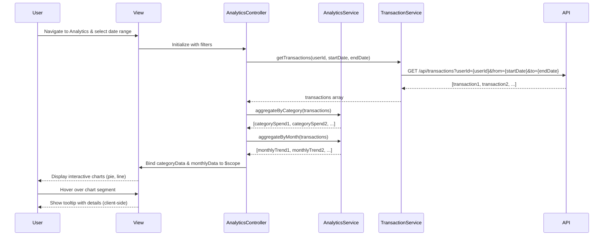

# Low-Level Design: Spending Analytics and Insights
**Epic ID:** QE-7692  
**Technology Stack:** AngularJS 1.x, JavaScript ES6, HTML5, CSS3, Bootstrap, REST APIs, MVC Architecture

---

## a. Architecture Mapping

- **User Interface - Analytics Dashboard** → AngularJS Module (`analyticsModule`) + View Template (`analytics.html`)
- **Analytics Engine** → AngularJS Service (`AnalyticsService`) with aggregation logic
- **Transaction Data Service** → AngularJS Service (`TransactionService`) calling REST API
- **Categorization Engine** → Backend REST API (pre-categorized transactions)
- **Dashboard KPI Service** → AngularJS Service (`KPIService`) for consistent data presentation
- **Data Storage** → Backend REST API endpoints

**Recommended Folder Structure:**
```
app/
├── modules/
│   └── analytics/
│       ├── controllers/
│       │   └── analyticsController.js
│       ├── services/
│       │   ├── analyticsService.js
│       │   ├── transactionService.js
│       │   └── kpiService.js
│       ├── views/
│       │   └── analytics.html
│       ├── directives/
│       │   └── chartDirective.js
│       └── analyticsModule.js
├── assets/
│   └── css/
│       └── analytics.css
└── app.js
```

---

## b. Component Specifications

| Name | Artifact Type | Responsibility | Key Dependencies |
|------|---------------|----------------|------------------|
| `analyticsModule` | AngularJS Module | Encapsulates spending analytics and visualization functionality | `ngRoute`, `ngResource`, `chart.js` (via angular-chart.js) |
| `AnalyticsController` | Controller | Manages analytics view, filters, and chart data binding | `AnalyticsService`, `TransactionService`, `KPIService`, `$scope` |
| `AnalyticsService` | Service | Aggregates transaction data by category, month, and card | `TransactionService` |
| `TransactionService` | Service | Fetches transaction data from REST API (up to 12 months) | `$http`, `$q` |
| `KPIService` | Service | Provides consistent KPI data formatting for analytics | None |
| `analytics.html` | View Template | Displays interactive charts for category-wise and monthly spend | Bootstrap, `ng-repeat`, `chart.js` directives |
| `chartDirective` | Directive | Custom directive wrapping Chart.js for interactive visualizations | `chart.js` library |

---

## c. Data Model

**Transaction Object:**
```javascript
{
  transactionId: String,
  cardId: String,
  amount: Number,
  category: String,          // "Food & Dining", "Fuel", "Shopping", etc.
  transactionDate: Date,
  merchantName: String,
  description: String
}
```

**CategorySpend Object:**
```javascript
{
  category: String,
  totalSpend: Number,
  transactionCount: Number,
  percentage: Number         // % of total monthly spend
}
```

**MonthlyTrend Object:**
```javascript
{
  month: String,             // "Jan 2024"
  totalSpend: Number,
  categoryBreakdown: Array<CategorySpend>
}
```

---

## d. Data Flow

User navigates to the analytics page and selects a date range (default: last 12 months). `AnalyticsController` calls `TransactionService.getTransactions(userId, startDate, endDate)`, which makes a GET request to `/api/transactions?userId={userId}&from={startDate}&to={endDate}`. The API returns pre-categorized transactions. The controller passes the transaction array to `AnalyticsService.aggregateByCategory(transactions)` and `AnalyticsService.aggregateByMonth(transactions)`, which use `Array.reduce()` to compute category-wise and monthly totals. The aggregated data is bound to `$scope.categoryData` and `$scope.monthlyData`. The view renders interactive pie and line charts using `chartDirective` (wrapping Chart.js). User interactions (hover, click) trigger chart animations and tooltips, all handled client-side with no additional API calls.

---

## e. Primary Sequence Diagram



---

## f. Implementation Notes

- Use `angular-chart.js` (AngularJS wrapper for Chart.js) to render interactive pie charts (category-wise) and line charts (monthly trends).
- Implement `AnalyticsService` aggregation functions using ES6 `Array.reduce()` and `Map` for efficient grouping by category and month.
- Lazy-load transaction data on demand; cache results in `TransactionService` using `$cacheFactory` to avoid redundant API calls when switching views.
- Use AngularJS `$filter` for date formatting and currency display in chart labels and tooltips.
- Ensure charts are responsive using Chart.js `maintainAspectRatio: true` and Bootstrap grid for layout.

---

## g. Error Handling

HTTP interceptor captures API errors; controller displays user-friendly error message and provides retry button.

---

## h. Security Notes

Requires token-based auth via existing SSO; API validates user ownership of transactions before returning data.

---

**End of LLD Document**