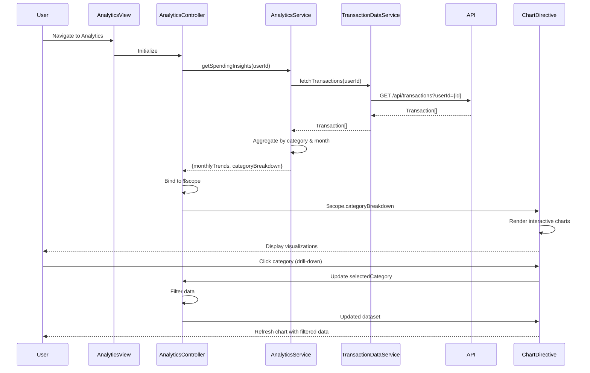

# Low-Level Design: QE-7693 - Analytics and Spending Insights

## a. Architecture Mapping

- **AnalyticsModule** (ng-module): Root module for analytics feature with routing and dependency injection
- **AnalyticsController** (ng-controller): Manages analytics view state, user interactions, and filter selections
- **AnalyticsService** (ng-service): Orchestrates data retrieval and aggregation for analytics
- **TransactionDataService** (ng-factory): REST API integration for categorized transaction data
- **CategoryClassificationService** (ng-factory): Provides category mapping and validation logic
- **ChartDirective** (ng-directive): Renders interactive charts using D3.js or Chart.js
- **SpendingCategoryFilter** (ng-filter): Formats and filters spending data by category

**Recommended Folder Structure:**
```
/app
  /modules
    /analytics
      analytics.module.js
      analytics.controller.js
      analytics.service.js
      analytics.html
      /directives
        chart.directive.js
      /services
        transaction-data.service.js
        category-classification.service.js
      /filters
        spending-category.filter.js
```

## b. Component Specifications

| Name | Artifact Type | Responsibility | Key Dependencies |
|------|---------------|----------------|------------------|
| AnalyticsModule | Module | Configures analytics feature routing, DI container, and module dependencies | ngRoute, AnalyticsController, AnalyticsService |
| AnalyticsController | Controller | Manages view state, handles user interactions (filter, drill-down), binds data to scope | $scope, AnalyticsService, $filter |
| AnalyticsService | Service | Aggregates transaction data, calculates monthly trends, prepares chart datasets | TransactionDataService, CategoryClassificationService |
| TransactionDataService | Factory | Fetches categorized transactions via REST API (/api/transactions) | $http, $q |
| CategoryClassificationService | Factory | Validates and maps transactions to 9 predefined categories | None |
| ChartDirective | Directive | Renders interactive category and trend charts with drill-down capability | D3.js or Chart.js library |
| SpendingCategoryFilter | Filter | Formats currency and filters data by selected category | None |

## c. Data Model

**AnalyticsViewModel (Controller scope object):**
```javascript
{
  monthlyTrends: Array<{month: String, totalSpend: Number}>,
  categoryBreakdown: Array<{category: String, amount: Number, percentage: Number}>,
  selectedCategory: String,
  selectedMonth: String,
  isLoading: Boolean
}
```

**Transaction (from API):**
```javascript
{
  id: String,
  amount: Number,
  category: String, // One of 9 predefined categories
  date: Date,
  cardId: String,
  description: String
}
```

**ChartConfig (for directive):**
```javascript
{
  type: String, // 'pie', 'bar', 'line'
  data: Array,
  options: Object
}
```

## d. Data Flow

User navigates to analytics view → AnalyticsController initializes and calls AnalyticsService.getSpendingInsights() → Service fetches categorized transactions via TransactionDataService REST call to /api/transactions?userId={id} → CategoryClassificationService validates categories → Service aggregates data by category and month, calculates trends and percentages → Controller receives aggregated data and binds to $scope → ChartDirective watches scope data and renders interactive visualizations → User applies filters or drills down → Controller updates scope, triggering directive re-render with filtered dataset.

## e. Primary Sequence Diagram



## f. Implementation Notes

- Use AngularJS $http service with interceptors for REST API calls; implement promise chaining with $q for async operations
- Apply AngularJS dependency injection pattern throughout; register all services/factories in module config
- Leverage ES6 classes for service definitions; use arrow functions for callbacks to maintain lexical scope
- Implement directive with isolated scope and two-way binding for chart data; use $watch for reactive updates
- Cache aggregated analytics data in AnalyticsService using simple object store to avoid redundant API calls on filter changes

## g. Error Handling

HTTP interceptor captures API errors; controller displays user-friendly notifications using toast/alert service; try/catch blocks wrap aggregation logic.

## h. Security Notes

Standard input validation and secure API calls assumed; requires token-based auth via existing SSO passed in API request headers.