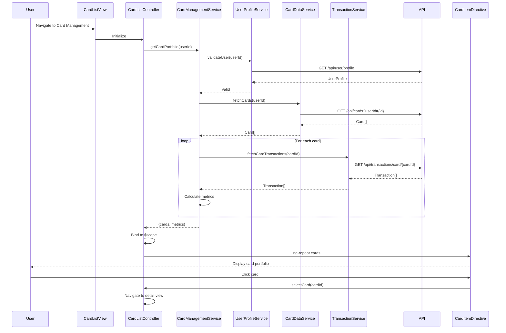

# Low-Level Design: QE-7694 - Multiple Credit Card Management

## a. Architecture Mapping

- **CardManagementModule** (ng-module): Root module for card management feature with routing and state management
- **CardListController** (ng-controller): Manages card portfolio view, comparison logic, and user interactions
- **CardDetailController** (ng-controller): Manages individual card detail view and card-specific metrics
- **CardManagementService** (ng-service): Orchestrates card portfolio operations and data aggregation
- **CardDataService** (ng-factory): REST API integration for credit card data repository
- **TransactionService** (ng-factory): REST API integration for card-specific transaction data
- **UserProfileService** (ng-factory): Validates card ownership and retrieves user context
- **CardItemDirective** (ng-directive): Renders individual card with visual differentiation

**Recommended Folder Structure:**
```
/app
  /modules
    /card-management
      card-management.module.js
      card-list.controller.js
      card-detail.controller.js
      card-management.service.js
      card-list.html
      card-detail.html
      /directives
        card-item.directive.js
      /services
        card-data.service.js
        transaction.service.js
        user-profile.service.js
```

## b. Component Specifications

| Name | Artifact Type | Responsibility | Key Dependencies |
|------|---------------|----------------|------------------|
| CardManagementModule | Module | Configures card management routing, DI container, and module dependencies | ngRoute, CardListController, CardDetailController, CardManagementService |
| CardListController | Controller | Manages card portfolio view, handles card selection and comparison | $scope, CardManagementService, $location |
| CardDetailController | Controller | Manages individual card detail view, displays card-specific metrics and transactions | $scope, $routeParams, CardManagementService |
| CardManagementService | Service | Aggregates card portfolio data, calculates card-specific metrics (spend, balance, limit) | CardDataService, TransactionService, UserProfileService |
| CardDataService | Factory | Fetches credit card data via REST API (/api/cards) | $http, $q |
| TransactionService | Factory | Fetches card-specific transactions via REST API (/api/transactions/card/{id}) | $http, $q |
| UserProfileService | Factory | Validates card ownership via REST API (/api/user/profile) | $http, $q |
| CardItemDirective | Directive | Renders card with brand-specific styling, displays key metrics, handles click events | None |

## c. Data Model

**CardPortfolio (Controller scope object):**
```javascript
{
  cards: Array<Card>,
  selectedCard: Card,
  totalCreditLimit: Number,
  totalOutstanding: Number,
  isLoading: Boolean
}
```

**Card (from API):**
```javascript
{
  id: String,
  cardNumber: String, // Masked
  cardType: String, // Visa, Mastercard, Amex
  bankName: String,
  creditLimit: Number,
  outstandingBalance: Number,
  availableCredit: Number,
  cardHolderName: String,
  expiryDate: String
}
```

**CardMetrics (calculated):**
```javascript
{
  cardId: String,
  monthlySpend: Number,
  utilizationPercentage: Number,
  transactionCount: Number
}
```

## d. Data Flow

User navigates to card management view → CardListController initializes and calls CardManagementService.getCardPortfolio() → Service validates user via UserProfileService REST call to /api/user/profile → Service fetches all user cards via CardDataService REST call to /api/cards?userId={id} → For each card, TransactionService fetches card-specific data via /api/transactions/card/{cardId} → Service aggregates card metrics (spend, utilization, balance) → Controller receives card portfolio and binds to $scope → CardItemDirective renders each card with visual differentiation → User clicks card → Controller navigates to CardDetailController with cardId → Detail view displays card-specific metrics and transaction list.

## e. Primary Sequence Diagram



## f. Implementation Notes

- Use AngularJS $http service with promise chaining for sequential API calls; implement $q.all() for parallel card data fetching
- Apply AngularJS DI pattern; register all services in module and inject via constructor
- Leverage ES6 classes for service layer; use template literals for dynamic API endpoint construction
- Implement CardItemDirective with isolated scope and attribute binding for card data; use ng-class for brand-specific styling
- Cache card portfolio in CardManagementService using sessionStorage to minimize API calls on view re-entry

## g. Error Handling

HTTP interceptor handles API failures; controller displays error messages via notification service; fallback to cached data if available.

## h. Security Notes

Requires token-based auth via existing SSO; card numbers masked on client; ownership validation enforced via UserProfileService before data access.