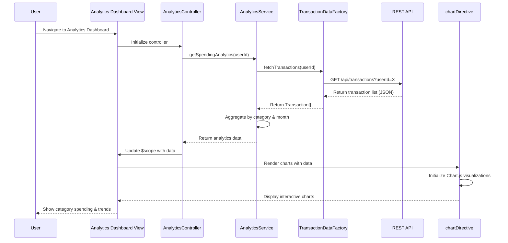

# Low-Level Design: QE-7695 - Spending Analytics and Transaction Insights

## a. Architecture Mapping

**HLD Component → AngularJS Artifact Mapping:**
- User Interface - Analytics Dashboard → AngularJS Module (`analyticsModule`) + Controller (`AnalyticsController`) + HTML5 View
- Analytics Service → AngularJS Service (`AnalyticsService`) for business logic and data aggregation
- Transaction Data Service → AngularJS Factory (`TransactionDataFactory`) for REST API calls
- Category Classification Engine → AngularJS Service (`CategoryService`) for category mapping logic
- Data Visualization Library → Directive (`chartDirective`) wrapping Chart.js/D3.js for rendering
- Dashboard KPI Service → AngularJS Service (`KPIService`) for aggregated spend metrics

**Recommended Folder Structure:**
```
app/
├── modules/
│   └── analytics/
│       ├── controllers/
│       │   └── analytics.controller.js
│       ├── services/
│       │   ├── analytics.service.js
│       │   ├── category.service.js
│       │   └── kpi.service.js
│       ├── factories/
│       │   └── transaction-data.factory.js
│       ├── directives/
│       │   └── chart.directive.js
│       ├── views/
│       │   └── analytics-dashboard.html
│       └── analytics.module.js
├── shared/
│   └── services/
└── assets/
    ├── css/
    └── js/
```

## b. Component Specifications

| Component Name | Artifact Type | Responsibility | Key Dependencies |
|----------------|---------------|----------------|------------------|
| `analyticsModule` | Module | Root module for analytics feature, registers all controllers/services/directives | `ngRoute`, `ui.bootstrap`, Chart.js |
| `AnalyticsController` | Controller | Manages analytics dashboard view state, user interactions, and data binding | `AnalyticsService`, `TransactionDataFactory`, `CategoryService`, `$scope` |
| `AnalyticsService` | Service | Aggregates transaction data, computes category-wise spending, calculates monthly trends | `TransactionDataFactory`, `CategoryService`, `KPIService` |
| `TransactionDataFactory` | Factory | Fetches transaction records from REST API, handles HTTP requests/responses | `$http`, `$q`, API endpoint configuration |
| `CategoryService` | Service | Maps transactions to predefined categories (Food, Fuel, Shopping, Travel, Entertainment, Utilities, Healthcare, Education, Miscellaneous) | None |
| `KPIService` | Service | Provides aggregated spend data and KPI metrics for analytics calculations | `$http`, API endpoint configuration |
| `chartDirective` | Directive | Encapsulates Chart.js/D3.js rendering logic, creates interactive visualizations | Chart.js library, `$window` |

## c. Data Model

**Transaction Model:**
```javascript
class Transaction {
  id: String              // Unique transaction identifier
  cardId: String          // Associated credit card ID
  amount: Number          // Transaction amount
  date: Date              // Transaction date
  merchant: String        // Merchant name
  category: String        // One of: Food & Dining, Fuel, Shopping, Travel, Entertainment, Utilities, Healthcare, Education, Miscellaneous
  description: String     // Transaction description
  status: String          // posted, pending
}
```

**CategorySpending Model:**
```javascript
class CategorySpending {
  category: String        // Category name
  totalAmount: Number     // Total spent in category
  transactionCount: Number // Number of transactions
  percentage: Number      // Percentage of total spending
}
```

**MonthlyTrend Model:**
```javascript
class MonthlyTrend {
  month: String           // YYYY-MM format
  totalSpend: Number      // Total spending for the month
  categoryBreakdown: Array<CategorySpending> // Category-wise breakdown
}
```

## d. Data Flow

User navigates to the Analytics Dashboard view, triggering `AnalyticsController` initialization. The controller invokes `AnalyticsService.getSpendingAnalytics()`, which calls `TransactionDataFactory.fetchTransactions()` to retrieve transaction data via REST API (`GET /api/transactions`). The service uses `CategoryService` to ensure proper categorization, then aggregates data into category-wise spending and monthly trends. `KPIService` provides supplementary aggregated metrics. The processed data is returned to the controller, which updates `$scope` variables bound to the view. The view renders interactive charts via `chartDirective`, which uses Chart.js to create responsive visualizations. User interactions (e.g., filtering by date range) trigger controller methods that repeat the data flow with updated parameters, refreshing the UI.

## e. Primary Sequence Diagram



## f. Implementation Notes

- Use AngularJS 1.x MVC pattern with controller-as syntax for cleaner scope management and ES6 classes for services/factories.
- Implement dependency injection for all services, factories, and directives to ensure testability and modularity.
- Use `$http` service with promise-based API calls; handle responses with `.then()` and errors with `.catch()`.
- Integrate Chart.js via custom directive that watches data changes and re-renders charts; ensure responsive configuration for mobile/desktop.
- Apply Bootstrap grid system for responsive layout; use CSS3 for animations and transitions on chart interactions.

## g. Error Handling

Use HTTP interceptor for global error handling; wrap service calls in try/catch blocks and display user-friendly notifications via Bootstrap modals or toast messages.

## h. Security Notes

Requires token-based authentication via existing SSO; validate user authorization for transaction data access on both client and API levels.