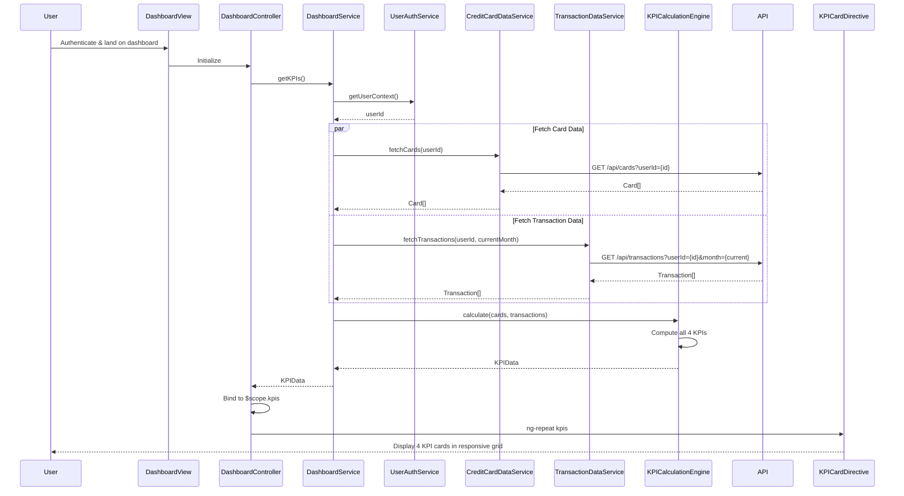

# Low-Level Design: QE-7696 - Dashboard and KPI Management

## a. Architecture Mapping

- **DashboardModule** (ng-module): Root module for dashboard feature with routing and module dependencies
- **DashboardController** (ng-controller): Manages dashboard view state, KPI display, and refresh logic
- **DashboardService** (ng-service): Orchestrates KPI calculation and data aggregation
- **KPICalculationEngine** (ng-factory): Computes Monthly Spend, Total Credit Limit, Available Credit, Outstanding Amount
- **CreditCardDataService** (ng-factory): REST API integration for credit card data repository
- **TransactionDataService** (ng-factory): REST API integration for transaction data
- **UserAuthService** (ng-factory): Manages user authentication and session context
- **KPICardDirective** (ng-directive): Renders individual KPI card with responsive layout

**Recommended Folder Structure:**
```
/app
  /modules
    /dashboard
      dashboard.module.js
      dashboard.controller.js
      dashboard.service.js
      dashboard.html
      /directives
        kpi-card.directive.js
      /services
        kpi-calculation-engine.service.js
        credit-card-data.service.js
        transaction-data.service.js
        user-auth.service.js
```

## b. Component Specifications

| Name | Artifact Type | Responsibility | Key Dependencies |
|------|---------------|----------------|------------------|
| DashboardModule | Module | Configures dashboard routing, DI container, and module dependencies | ngRoute, DashboardController, DashboardService |
| DashboardController | Controller | Manages dashboard view state, handles KPI refresh, binds KPI data to scope | $scope, DashboardService, $interval |
| DashboardService | Service | Orchestrates KPI data retrieval and aggregation from multiple sources | KPICalculationEngine, CreditCardDataService, TransactionDataService |
| KPICalculationEngine | Factory | Computes all four KPIs with 100% financial accuracy using card and transaction data | None |
| CreditCardDataService | Factory | Fetches credit card details and limits via REST API (/api/cards) | $http, $q |
| TransactionDataService | Factory | Fetches transaction data for spend calculations via REST API (/api/transactions) | $http, $q |
| UserAuthService | Factory | Provides user authentication context and session management | $http, $window |
| KPICardDirective | Directive | Renders individual KPI with icon, value, label, and responsive styling | None |

## c. Data Model

**DashboardViewModel (Controller scope object):**
```javascript
{
  kpis: {
    monthlySpend: Number,
    totalCreditLimit: Number,
    availableCredit: Number,
    outstandingAmount: Number
  },
  lastUpdated: Date,
  isLoading: Boolean,
  userId: String
}
```

**KPIData (from calculation engine):**
```javascript
{
  monthlySpend: Number,
  totalCreditLimit: Number,
  availableCredit: Number,
  outstandingAmount: Number
}
```

**CreditCard (from API):**
```javascript
{
  id: String,
  creditLimit: Number,
  outstandingBalance: Number,
  availableCredit: Number
}
```

**Transaction (from API):**
```javascript
{
  id: String,
  amount: Number,
  date: Date,
  cardId: String
}
```

## d. Data Flow

User authenticates and lands on dashboard → DashboardController initializes and calls DashboardService.getKPIs() → Service retrieves user context from UserAuthService → Service fetches card details via CreditCardDataService REST call to /api/cards?userId={id} → Service fetches current month transactions via TransactionDataService REST call to /api/transactions?userId={id}&month={current} → KPICalculationEngine receives card and transaction data, computes Monthly Spend (sum of current month transactions), Total Credit Limit (sum of all card limits), Available Credit (sum of all available credit), Outstanding Amount (sum of all outstanding balances) → Service returns KPIData to Controller → Controller binds KPIs to $scope → KPICardDirective renders each KPI in responsive grid → User views consolidated financial health metrics.

## e. Primary Sequence Diagram



## f. Implementation Notes

- Use AngularJS $http service with $q.all() for parallel API calls to meet sub-2-second load requirement
- Apply AngularJS DI pattern; inject all dependencies via constructor in controllers and services
- Leverage ES6 classes for service definitions; use const/let for variable declarations
- Implement KPICardDirective with isolated scope and one-way binding for KPI data; use Bootstrap grid for responsive layout
- Cache KPI data in DashboardService with 30-second TTL to support real-time updates without excessive API calls

## g. Error Handling

HTTP interceptor captures API errors; controller displays error banner with retry option; fallback to last successful KPI data if cached.

## h. Security Notes

Requires token-based auth via existing SSO; user context validated before KPI calculation; all API calls include auth token in headers.