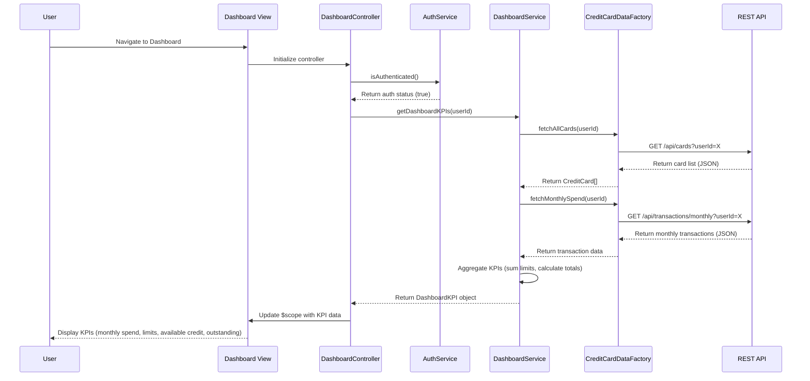

# Low-Level Design: QE-7697 - Dashboard KPIs and Credit Card Overview

## a. Architecture Mapping

**HLD Component → AngularJS Artifact Mapping:**
- User Interface - Dashboard → AngularJS Module (`dashboardModule`) + Controller (`DashboardController`) + HTML5 View
- Dashboard Service → AngularJS Service (`DashboardService`) for KPI calculation and aggregation logic
- Credit Card Data Repository → AngularJS Factory (`CreditCardDataFactory`) for REST API integration
- User Authentication Service → AngularJS Service (`AuthService`) for session and token management
- API Gateway → REST API endpoints consumed by factories

**Recommended Folder Structure:**
```
app/
├── modules/
│   └── dashboard/
│       ├── controllers/
│       │   └── dashboard.controller.js
│       ├── services/
│       │   ├── dashboard.service.js
│       │   └── auth.service.js
│       ├── factories/
│       │   └── credit-card-data.factory.js
│       ├── views/
│       │   └── dashboard.html
│       └── dashboard.module.js
├── shared/
│   └── services/
└── assets/
    ├── css/
    └── js/
```

## b. Component Specifications

| Component Name | Artifact Type | Responsibility | Key Dependencies |
|----------------|---------------|----------------|------------------|
| `dashboardModule` | Module | Root module for dashboard feature, registers all controllers/services/factories | `ngRoute`, `ui.bootstrap` |
| `DashboardController` | Controller | Manages dashboard view state, binds KPI data to UI, handles user interactions | `DashboardService`, `CreditCardDataFactory`, `AuthService`, `$scope` |
| `DashboardService` | Service | Aggregates credit card data, calculates monthly spend, total credit limit, available credit, outstanding amount | `CreditCardDataFactory` |
| `CreditCardDataFactory` | Factory | Fetches credit card details and transaction data from REST API | `$http`, `$q`, API endpoint configuration |
| `AuthService` | Service | Manages user authentication state, provides session tokens for API calls | `$http`, `$window` (localStorage) |

## c. Data Model

**CreditCard Model:**
```javascript
class CreditCard {
  cardId: String          // Unique card identifier
  cardNumber: String      // Masked card number (e.g., **** **** **** 1234)
  cardType: String        // Visa, MasterCard, Amex, etc.
  creditLimit: Number     // Total credit limit
  availableCredit: Number // Available credit
  outstandingAmount: Number // Current outstanding balance
  expiryDate: String      // MM/YY format
}
```

**DashboardKPI Model:**
```javascript
class DashboardKPI {
  monthlySpend: Number    // Total spend for current month across all cards
  totalCreditLimit: Number // Sum of credit limits across all cards
  totalAvailableCredit: Number // Sum of available credit across all cards
  totalOutstanding: Number // Sum of outstanding amounts across all cards
  cardCount: Number       // Total number of cards
  cards: Array<CreditCard> // List of all credit cards
}
```

## d. Data Flow

User accesses the Dashboard view, triggering `DashboardController` initialization. The controller first verifies authentication via `AuthService.isAuthenticated()`. Upon successful authentication, the controller calls `DashboardService.getDashboardKPIs(userId)`, which invokes `CreditCardDataFactory.fetchAllCards(userId)` to retrieve credit card data via REST API (`GET /api/cards`). The factory returns an array of `CreditCard` objects. `DashboardService` aggregates the data to compute monthly spend (by fetching current month transactions via `GET /api/transactions/monthly`), total credit limit, available credit, and outstanding amounts across all cards. The aggregated `DashboardKPI` object is returned to the controller, which updates `$scope` variables bound to the dashboard view. The view renders KPI cards using Bootstrap grid layout with responsive design, displaying the financial metrics. Any data refresh is triggered by user action or periodic polling, repeating the data flow.

## e. Primary Sequence Diagram



## f. Implementation Notes

- Use AngularJS 1.x MVC architecture with controller-as syntax and ES6 classes for services/factories to improve code organization.
- Implement dependency injection for all components; use `$http` service for REST API calls with promise-based error handling.
- Apply Bootstrap responsive grid (col-xs, col-sm, col-md, col-lg) for KPI card layout to ensure mobile and desktop compatibility.
- Use CSS3 transitions for smooth loading states and AngularJS `ng-show`/`ng-hide` for conditional rendering.
- Implement caching strategy in `CreditCardDataFactory` to minimize redundant API calls and meet 2-second load time NFR.

## g. Error Handling

Use HTTP interceptor to catch API errors globally; display user-friendly error messages via Bootstrap alerts or modals with retry options.

## h. Security Notes

Requires token-based auth via existing SSO; secure session tokens stored in localStorage; API calls include Authorization header with bearer token.