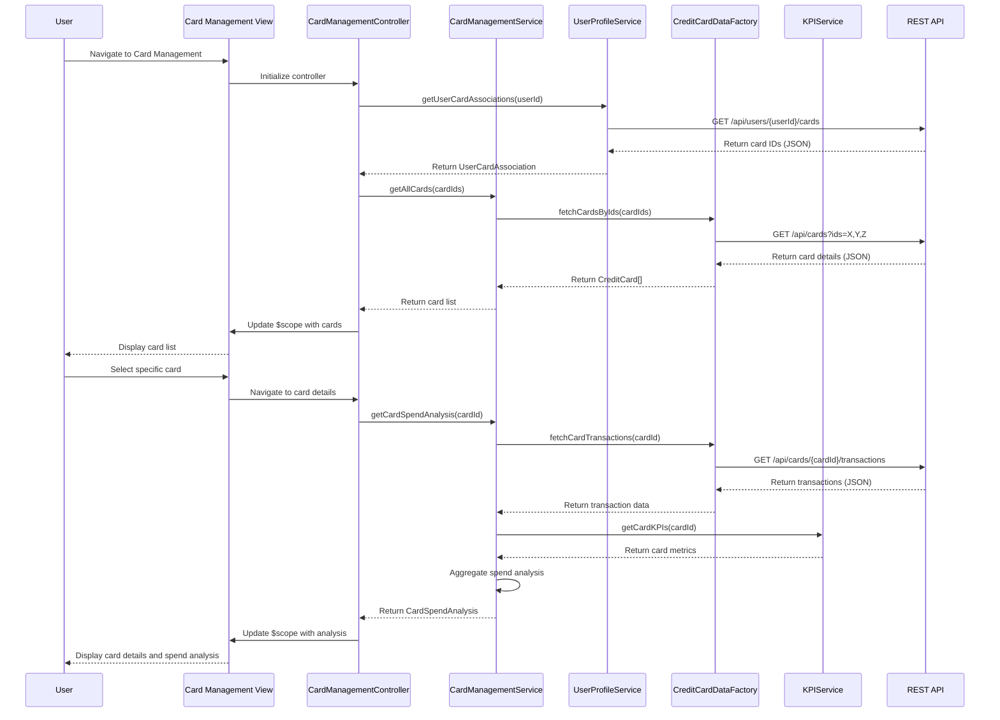

# Low-Level Design: QE-7698 - Credit Card Management and Tracking

## a. Architecture Mapping

**HLD Component → AngularJS Artifact Mapping:**
- User Interface - Card Management → AngularJS Module (`cardManagementModule`) + Controller (`CardManagementController`) + HTML5 View
- Card Management Service → AngularJS Service (`CardManagementService`) for card operations and spend analysis logic
- Credit Card Data Repository → AngularJS Factory (`CreditCardDataFactory`) for REST API calls
- User Profile Service → AngularJS Service (`UserProfileService`) for user-card associations
- Dashboard KPI Service → AngularJS Service (`KPIService`) for card-specific metrics

**Recommended Folder Structure:**
```
app/
├── modules/
│   └── card-management/
│       ├── controllers/
│       │   └── card-management.controller.js
│       ├── services/
│       │   ├── card-management.service.js
│       │   ├── user-profile.service.js
│       │   └── kpi.service.js
│       ├── factories/
│       │   └── credit-card-data.factory.js
│       ├── views/
│       │   ├── card-list.html
│       │   └── card-details.html
│       └── card-management.module.js
├── shared/
│   └── services/
└── assets/
    ├── css/
    └── js/
```

## b. Component Specifications

| Component Name | Artifact Type | Responsibility | Key Dependencies |
|----------------|---------------|----------------|------------------|
| `cardManagementModule` | Module | Root module for card management feature, registers all controllers/services/factories | `ngRoute`, `ui.bootstrap` |
| `CardManagementController` | Controller | Manages card listing and detail views, handles user interactions for card selection and analysis | `CardManagementService`, `CreditCardDataFactory`, `UserProfileService`, `$scope`, `$routeParams` |
| `CardManagementService` | Service | Orchestrates card operations, performs card-wise spend analysis, retrieves card-specific metrics | `CreditCardDataFactory`, `KPIService` |
| `CreditCardDataFactory` | Factory | Fetches credit card details and transaction history from REST API | `$http`, `$q`, API endpoint configuration |
| `UserProfileService` | Service | Retrieves user profile and user-card associations, manages user context | `$http`, API endpoint configuration |
| `KPIService` | Service | Provides card-specific KPI metrics (spend, limits, utilization) | `$http`, API endpoint configuration |

## c. Data Model

**CreditCard Model:**
```javascript
class CreditCard {
  cardId: String          // Unique card identifier
  cardNumber: String      // Masked card number (e.g., **** **** **** 1234)
  cardType: String        // Visa, MasterCard, Amex, etc.
  bankName: String        // Issuing bank name
  creditLimit: Number     // Total credit limit
  availableCredit: Number // Available credit
  outstandingAmount: Number // Current outstanding balance
  expiryDate: String      // MM/YY format
  status: String          // active, blocked, expired
}
```

**CardSpendAnalysis Model:**
```javascript
class CardSpendAnalysis {
  cardId: String          // Associated card ID
  monthlySpend: Number    // Total spend for current month
  yearlySpend: Number     // Total spend for current year
  categoryBreakdown: Array<{category: String, amount: Number}> // Spending by category
  transactionCount: Number // Number of transactions
  utilizationRate: Number // Credit utilization percentage
}
```

**UserCardAssociation Model:**
```javascript
class UserCardAssociation {
  userId: String          // User identifier
  cardIds: Array<String>  // List of associated card IDs
  primaryCardId: String   // Default/primary card ID
}
```

## d. Data Flow

User navigates to the Card Management view, triggering `CardManagementController` initialization. The controller calls `UserProfileService.getUserCardAssociations(userId)` to retrieve the list of card IDs associated with the user via REST API (`GET /api/users/{userId}/cards`). The controller then invokes `CardManagementService.getAllCards(cardIds)`, which uses `CreditCardDataFactory.fetchCardsByIds(cardIds)` to retrieve detailed card information via REST API (`GET /api/cards?ids=X,Y,Z`). The factory returns an array of `CreditCard` objects. For card-wise spend analysis, the controller calls `CardManagementService.getCardSpendAnalysis(cardId)`, which fetches card-specific metrics from `KPIService` and transaction data from `CreditCardDataFactory` via REST API (`GET /api/cards/{cardId}/transactions`). The aggregated `CardSpendAnalysis` object is returned to the controller, which updates `$scope` variables bound to the view. The view renders the card list and detailed card information using Bootstrap cards and responsive layout. User selection of a specific card triggers navigation to the card details view, repeating the data flow for that card.

## e. Primary Sequence Diagram



## f. Implementation Notes

- Use AngularJS 1.x MVC pattern with controller-as syntax and ES6 classes for services/factories to ensure clean code structure.
- Implement dependency injection for all components; use `$http` service with promise-based API calls and error handling via `.catch()`.
- Apply Bootstrap card components for card listing with responsive grid layout (col-md-4, col-sm-6) to support 20+ cards per user.
- Use AngularJS routing (`$routeProvider`) for navigation between card list and card details views with `$routeParams` for card ID passing.
- Implement pagination or virtual scrolling for card list if user has many cards to maintain performance and meet 1-second retrieval NFR.

## g. Error Handling

Use HTTP interceptor for global API error handling; wrap service calls in try/catch blocks and display user-friendly error messages via Bootstrap modals.

## h. Security Notes

Requires token-based auth via existing SSO; validate user ownership of cards on API level; mask sensitive card data (full card number, CVV) in all views.