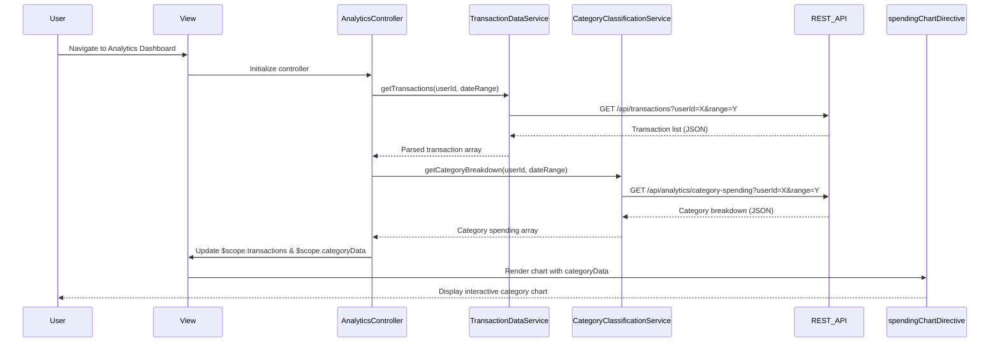

# Low-Level Design: Transaction and Category-wise Spending Analytics
**Epic ID:** QE-7699  
**Application Stack:** AngularJS 1.x, JavaScript ES6, HTML5, CSS3, Bootstrap, REST APIs, MVC Architecture

---

## a. Architecture Mapping

**HLD Component → AngularJS Artifact:**
- User Interface → Module: `transactionAnalyticsModule` + View templates (HTML5/Bootstrap)
- Transaction Viewer → Controller: `TransactionListController`
- Transaction Data Feed → Service: `TransactionDataService` (REST API integration)
- Category Classification Engine → Service: `CategoryClassificationService` (REST API integration)
- Analytics & Visualization Module → Directive: `spendingChartDirective` + Controller: `AnalyticsController`

**Recommended Folder Structure:**
```
app/
├── modules/
│   └── transaction-analytics/
│       ├── controllers/
│       │   ├── transaction-list.controller.js
│       │   └── analytics.controller.js
│       ├── services/
│       │   ├── transaction-data.service.js
│       │   └── category-classification.service.js
│       ├── directives/
│       │   └── spending-chart.directive.js
│       ├── views/
│       │   ├── transaction-list.html
│       │   └── analytics-dashboard.html
│       └── transaction-analytics.module.js
```

---

## b. Component Specifications

| Component Name | Artifact Type | Responsibility | Key Dependencies |
|---|---|---|---|
| `transactionAnalyticsModule` | Module | Root module for transaction and analytics features | `ngRoute`, `chart.js` or `angular-chart` |
| `TransactionListController` | Controller | Manages transaction list display, pagination, filtering | `TransactionDataService`, `$scope` |
| `AnalyticsController` | Controller | Manages category-wise spending analytics and visualization state | `CategoryClassificationService`, `TransactionDataService`, `$scope` |
| `TransactionDataService` | Service/Factory | Fetches transaction data from REST API, handles caching and pagination | `$http`, `$q` |
| `CategoryClassificationService` | Service/Factory | Retrieves category-wise spending breakdown from classification engine API | `$http`, `$q` |
| `spendingChartDirective` | Directive | Renders interactive category-wise spending charts (bar/pie) | `AnalyticsController`, Chart library (e.g., Chart.js) |

---

## c. Data Model

**Transaction Model:**
```javascript
{
  transactionId: String,
  cardId: String,
  merchantName: String,
  amount: Number,
  currency: String,
  transactionDate: Date,
  category: String, // One of 9 predefined categories
  description: String
}
```

**Category Spending Model:**
```javascript
{
  category: String, // e.g., "Food & Dining", "Fuel", etc.
  totalSpent: Number,
  transactionCount: Number,
  percentage: Number // % of total spending
}
```

**Analytics Summary Model:**
```javascript
{
  userId: String,
  totalTransactions: Number,
  categoryBreakdown: Array<CategorySpending>,
  dateRange: { startDate: Date, endDate: Date }
}
```

---

## d. Data Flow

User navigates to the transaction analytics view, triggering `AnalyticsController` to invoke `TransactionDataService.getTransactions()` and `CategoryClassificationService.getCategoryBreakdown()` via REST API calls. The services return paginated transaction data and pre-classified category spending summaries. `AnalyticsController` updates `$scope` models, which Angular's two-way binding reflects in the view. The `spendingChartDirective` watches the category data and renders an interactive chart (using Chart.js). User interactions (filtering, date range selection) trigger controller methods that re-fetch data and update the UI reactively.

---

## e. Primary Sequence Diagram



---

## f. Implementation Notes

- Use AngularJS module pattern with dependency injection for all controllers and services.
- Implement lazy loading and pagination in `TransactionDataService` to handle up to 10,000 transactions efficiently.
- Use `$http` interceptors for centralized API error handling and loading state management.
- Leverage ES6 classes for service definitions and arrow functions for cleaner callback handling.
- Integrate Chart.js via `angular-chart.js` wrapper for declarative chart rendering in directives.

---

## g. Error Handling

HTTP interceptor-based error handling with user-friendly toast notifications for API failures and try/catch blocks in service methods.

---

## h. Security Notes

Requires token-based authentication via existing SSO; all API calls include Authorization header with JWT token.