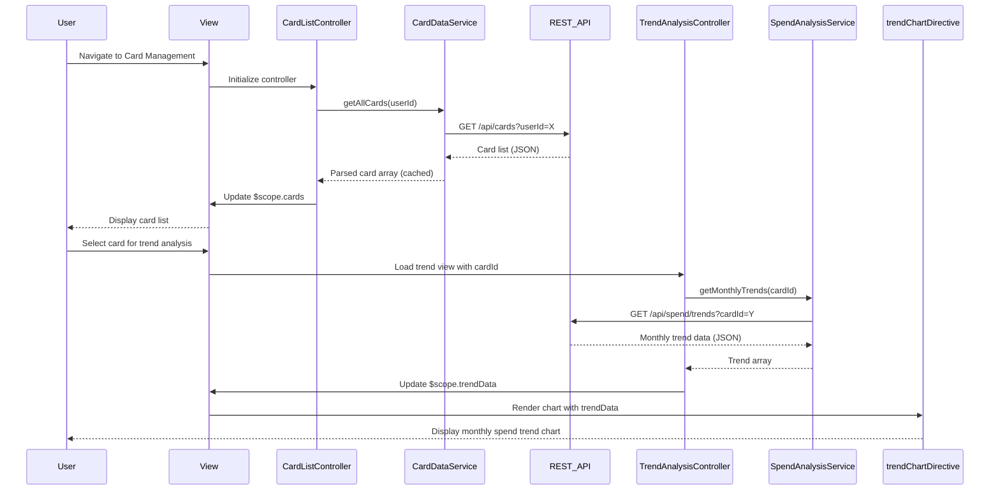

# Low-Level Design: Multi-Card Management and Spend Analysis
**Epic ID:** QE-7700  
**Application Stack:** AngularJS 1.x, JavaScript ES6, HTML5, CSS3, Bootstrap, REST APIs, MVC Architecture

---

## a. Architecture Mapping

**HLD Component → AngularJS Artifact:**
- User Interface → Module: `cardManagementModule` + View templates (HTML5/Bootstrap)
- Card Management Module → Controller: `CardListController`
- Credit Card Data Aggregation Service → Service: `CardDataService` (REST API integration)
- Spend Analysis Engine → Service: `SpendAnalysisService` (REST API integration)
- Trend Visualization Component → Directive: `trendChartDirective` + Controller: `TrendAnalysisController`

**Recommended Folder Structure:**
```
app/
├── modules/
│   └── card-management/
│       ├── controllers/
│       │   ├── card-list.controller.js
│       │   └── trend-analysis.controller.js
│       ├── services/
│       │   ├── card-data.service.js
│       │   └── spend-analysis.service.js
│       ├── directives/
│       │   └── trend-chart.directive.js
│       ├── views/
│       │   ├── card-list.html
│       │   └── trend-analysis.html
│       └── card-management.module.js
```

---

## b. Component Specifications

| Component Name | Artifact Type | Responsibility | Key Dependencies |
|---|---|---|---|
| `cardManagementModule` | Module | Root module for multi-card management and spend analysis | `ngRoute`, `chart.js` or `angular-chart` |
| `CardListController` | Controller | Manages display of multiple credit cards, handles card selection | `CardDataService`, `$scope` |
| `TrendAnalysisController` | Controller | Manages monthly spend trend visualization and card-wise comparison | `SpendAnalysisService`, `$scope` |
| `CardDataService` | Service/Factory | Fetches credit card details from aggregation API, caches card data | `$http`, `$q`, `$cacheFactory` |
| `SpendAnalysisService` | Service/Factory | Retrieves monthly spend trends and card-wise spending data from API | `$http`, `$q` |
| `trendChartDirective` | Directive | Renders monthly spend trend charts (line/bar) for selected cards | `TrendAnalysisController`, Chart library |

---

## c. Data Model

**Credit Card Model:**
```javascript
{
  cardId: String,
  cardNumber: String, // Masked (e.g., "****1234")
  cardType: String, // e.g., "Visa", "MasterCard"
  cardHolderName: String,
  creditLimit: Number,
  availableCredit: Number,
  outstandingAmount: Number,
  expiryDate: String,
  isActive: Boolean
}
```

**Monthly Spend Trend Model:**
```javascript
{
  month: String, // e.g., "2024-01"
  totalSpent: Number,
  cardId: String
}
```

**Card-wise Spend Summary Model:**
```javascript
{
  cardId: String,
  cardNickname: String,
  monthlyTrends: Array<MonthlySpendTrend>,
  totalSpendLast12Months: Number,
  averageMonthlySpend: Number
}
```

---

## d. Data Flow

User navigates to the card management view, triggering `CardListController` to call `CardDataService.getAllCards()`, which fetches card details via REST API and caches the response. The controller populates `$scope.cards` and renders the card list in the view. When the user selects a card for trend analysis, `TrendAnalysisController` invokes `SpendAnalysisService.getMonthlyTrends(cardId)` to retrieve monthly spend data. The service returns trend data, which the controller binds to `$scope.trendData`. The `trendChartDirective` watches this data and renders an interactive line/bar chart. User can switch between cards, triggering re-fetch and chart update.

---

## e. Primary Sequence Diagram



---

## f. Implementation Notes

- Use AngularJS `$cacheFactory` in `CardDataService` to cache card list and reduce redundant API calls.
- Implement ES6 Promises (`$q`) for asynchronous API calls with proper error propagation.
- Use AngularJS dependency injection to inject services into controllers for testability.
- Leverage Bootstrap grid system for responsive card list layout across devices.
- Integrate Chart.js for trend visualization with responsive configuration for mobile devices.

---

## g. Error Handling

Centralized HTTP interceptor for API error handling with user notification via toast/alert; try/catch in service methods for data parsing errors.

---

## h. Security Notes

Requires token-based auth via existing SSO; card numbers are masked server-side; secure HTTPS transmission for all API calls.