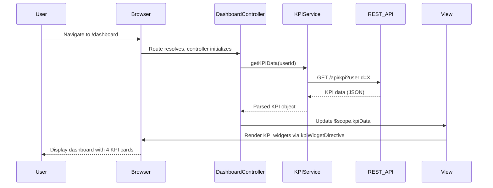

# Low-Level Design: Dashboard and KPI Management
**Epic ID:** QE-7701  
**Application Stack:** AngularJS 1.x, JavaScript ES6, HTML5, CSS3, Bootstrap, REST APIs, MVC Architecture

---

## a. Architecture Mapping

**HLD Component → AngularJS Artifact:**
- User Browser → Entry point: `index.html` + AngularJS app bootstrap
- Dashboard UI Layer → Module: `dashboardModule` + Controller: `DashboardController` + View: `dashboard.html`
- KPI Aggregation Service → Service: `KPIService` (REST API integration)
- Credit Card Data Source → External REST API (consumed by `KPIService`)
- Visualization Engine → Directive: `kpiWidgetDirective` for rendering KPI cards

**Recommended Folder Structure:**
```
app/
├── modules/
│   └── dashboard/
│       ├── controllers/
│       │   └── dashboard.controller.js
│       ├── services/
│       │   └── kpi.service.js
│       ├── directives/
│       │   └── kpi-widget.directive.js
│       ├── views/
│       │   └── dashboard.html
│       └── dashboard.module.js
```

---

## b. Component Specifications

| Component Name | Artifact Type | Responsibility | Key Dependencies |
|---|---|---|---|
| `dashboardModule` | Module | Root module for dashboard feature, defines routing and dependencies | `ngRoute` |
| `DashboardController` | Controller | Orchestrates KPI data fetching and binds data to view scope | `KPIService`, `$scope`, `$timeout` |
| `KPIService` | Service/Factory | Fetches aggregated KPI data (monthly spend, credit limit, available credit, outstanding) from REST API | `$http`, `$q` |
| `kpiWidgetDirective` | Directive | Reusable component to render individual KPI cards with icon, label, and value | None (isolated scope) |

---

## c. Data Model

**KPI Data Model:**
```javascript
{
  userId: String,
  monthlySpend: Number,
  totalCreditLimit: Number,
  availableCredit: Number,
  outstandingAmount: Number,
  lastUpdated: Date
}
```

**KPI Widget Model (for directive):**
```javascript
{
  label: String,      // e.g., "Monthly Spend"
  value: Number,      // e.g., 15000
  icon: String,       // CSS class or icon name
  unit: String        // e.g., "USD"
}
```

---

## d. Data Flow

User accesses the dashboard URL, triggering AngularJS routing to load `DashboardController` and `dashboard.html` view. The controller immediately invokes `KPIService.getKPIData(userId)`, which makes a REST API call to fetch aggregated KPI metrics. The API returns JSON data containing monthly spend, total credit limit, available credit, and outstanding amount. `KPIService` parses and returns this data as a promise. `DashboardController` resolves the promise, updates `$scope.kpiData`, and Angular's two-way data binding reflects the KPIs in the view. The `kpiWidgetDirective` is used four times in the view template to render each KPI as a responsive Bootstrap card.

---

## e. Primary Sequence Diagram



---

## f. Implementation Notes

- Use AngularJS module pattern with dependency injection for `DashboardController` and `KPIService`.
- Implement `KPIService` as a factory returning a singleton with caching to avoid redundant API calls on page refresh.
- Use `$http` service for REST API calls with promise-based error handling.
- Leverage Bootstrap grid (col-md-3) for responsive 4-column KPI card layout on desktop, stacking on mobile.
- Use `kpiWidgetDirective` with isolated scope (`scope: { label: '@', value: '=', icon: '@', unit: '@' }`) for reusability.

---

## g. Error Handling

HTTP interceptor for centralized API error handling; user-friendly error messages displayed via Bootstrap alerts or toast notifications.

---

## h. Security Notes

Requires token-based authentication via existing SSO; all API requests include Authorization header with JWT token.