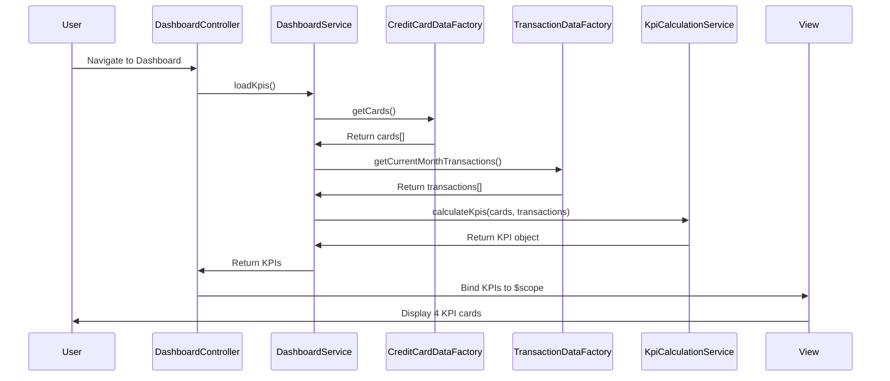

# Low-Level Design: QE-7702 - Dashboard KPIs and Financial Overview

## a. Architecture Mapping

- **Dashboard UI Component** → AngularJS Module: `cc.dashboard` with Controller: `DashboardController`
- **Dashboard Service** → AngularJS Service: `DashboardService` (handles KPI aggregation logic)
- **Credit Card Data Service** → AngularJS Factory: `CreditCardDataFactory` (REST API integration for card data)
- **Transaction Data Service** → AngularJS Factory: `TransactionDataFactory` (REST API integration for transactions)
- **KPI Calculation Engine** → AngularJS Service: `KpiCalculationService` (business logic for metrics)
- **Real-time Data Sync** → AngularJS Service: `DataSyncService` with `$interval` for periodic refresh

**Recommended Folder Structure:**
```
app/
├── modules/dashboard/
│   ├── dashboard.module.js
│   ├── dashboard.controller.js
│   ├── dashboard.html
│   └── dashboard.css
├── services/
│   ├── dashboard.service.js
│   ├── kpi-calculation.service.js
│   └── data-sync.service.js
├── factories/
│   ├── credit-card-data.factory.js
│   └── transaction-data.factory.js
└── common/
    └── constants.js
```

## b. Component Specifications

| Name | Artifact Type | Responsibility | Key Dependencies |
|------|---------------|----------------|------------------|
| DashboardController | Controller | Manages dashboard view state, initiates data load, binds KPIs to view | DashboardService, $scope, $interval |
| DashboardService | Service | Orchestrates data retrieval and KPI calculation workflow | KpiCalculationService, CreditCardDataFactory, TransactionDataFactory |
| KpiCalculationService | Service | Aggregates credit limits, balances, monthly spend; calculates available credit | None (pure calculation logic) |
| CreditCardDataFactory | Factory | Fetches all user credit cards via REST API (GET /api/cards) | $http, API_ENDPOINTS |
| TransactionDataFactory | Factory | Fetches current month transactions via REST API (GET /api/transactions?month=current) | $http, API_ENDPOINTS |
| DataSyncService | Service | Periodically refreshes KPI data every 2-5 minutes using $interval | $interval, DashboardService |
| dashboard.html | View Template | Displays 4 KPI cards (Monthly Spend, Total Limit, Available Credit, Outstanding) with responsive Bootstrap grid | Bootstrap CSS, AngularJS directives |

## c. Data Model

**CreditCard Model:**
```javascript
{
  cardId: String,
  cardNumber: String,
  cardName: String,
  creditLimit: Number,
  outstandingBalance: Number,
  availableCredit: Number
}
```

**Transaction Model:**
```javascript
{
  transactionId: String,
  cardId: String,
  amount: Number,
  transactionDate: Date,
  category: String,
  merchantName: String
}
```

**KPI Model:**
```javascript
{
  monthlySpend: Number,
  totalCreditLimit: Number,
  totalAvailableCredit: Number,
  totalOutstanding: Number
}
```

## d. Data Flow

User navigates to dashboard → DashboardController calls DashboardService.loadKpis() → DashboardService makes parallel calls to CreditCardDataFactory.getCards() and TransactionDataFactory.getCurrentMonthTransactions() → API responses return card array and transaction array → KpiCalculationService aggregates totalCreditLimit (sum of all card limits), totalOutstanding (sum of all balances), totalAvailableCredit (totalCreditLimit - totalOutstanding), and monthlySpend (sum of current month transaction amounts) → Calculated KPI object is returned to controller → Controller binds KPIs to $scope → View renders 4 KPI cards with Bootstrap responsive layout → DataSyncService triggers refresh every 3 minutes to update KPIs in background.

## e. Primary Sequence Diagram



## f. Implementation Notes

- Use AngularJS dependency injection to inject all services and factories into controllers/services
- Implement REST API calls using $http service with promise-based error handling (.then/.catch)
- Use $interval service for periodic data refresh (3-minute intervals) and ensure proper cleanup on $scope.$destroy
- Apply Bootstrap responsive grid (col-xs-12, col-sm-6, col-md-3) for 4 KPI cards to ensure mobile/tablet/desktop responsiveness
- Cache API responses in DashboardService for 2 minutes to minimize redundant API calls during refresh cycles

## g. Error Handling

HTTP interceptor captures API errors; user-friendly notifications displayed via toastr/alert service; failed KPI loads show "Data unavailable" placeholder.

## h. Security Notes

Requires token-based authentication via existing SSO; API calls include Authorization header with bearer token.