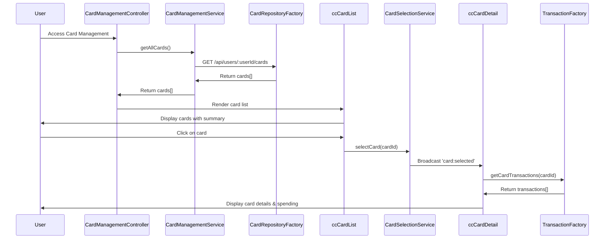

# Low-Level Design: QE-7703 - Multiple Credit Card Management

## a. Architecture Mapping

- **Card Management UI** → AngularJS Module: `cc.cardManagement` with Controller: `CardManagementController`
- **Card Management Service** → AngularJS Service: `CardManagementService` (orchestrates card operations)
- **Credit Card Data Repository** → AngularJS Factory: `CardRepositoryFactory` (REST API for card CRUD)
- **Transaction Service** → AngularJS Factory: `TransactionFactory` (REST API for card-wise transactions)
- **Card Selection Controller** → AngularJS Service: `CardSelectionService` (manages active card state)
- **Card List Directive** → AngularJS Directive: `ccCardList` (renders card list with selection)
- **Card Detail Directive** → AngularJS Directive: `ccCardDetail` (displays selected card details)

**Recommended Folder Structure:**
```
app/
├── modules/card-management/
│   ├── card-management.module.js
│   ├── card-management.controller.js
│   ├── card-management.html
│   └── card-management.css
├── directives/
│   ├── cc-card-list.directive.js
│   ├── cc-card-detail.directive.js
│   └── templates/
│       ├── card-list.html
│       └── card-detail.html
├── services/
│   ├── card-management.service.js
│   └── card-selection.service.js
├── factories/
│   ├── card-repository.factory.js
│   └── transaction.factory.js
└── models/
    └── card.model.js
```

## b. Component Specifications

| Name | Artifact Type | Responsibility | Key Dependencies |
|------|---------------|----------------|------------------|
| CardManagementController | Controller | Manages card list view, handles card selection events, coordinates data loading | CardManagementService, CardSelectionService, $scope |
| CardManagementService | Service | Retrieves all user cards, fetches card-specific spending analysis | CardRepositoryFactory, TransactionFactory |
| CardSelectionService | Service | Maintains active card state, broadcasts card selection changes via $rootScope.$broadcast | $rootScope |
| CardRepositoryFactory | Factory | Fetches user cards via REST API (GET /api/users/:userId/cards), supports up to 10 cards | $http, API_ENDPOINTS |
| TransactionFactory | Factory | Fetches card-specific transactions via REST API (GET /api/cards/:cardId/transactions) | $http, API_ENDPOINTS |
| ccCardList | Directive | Renders list of cards with summary (name, last 4 digits, balance), handles click to select | CardSelectionService |
| ccCardDetail | Directive | Displays detailed view of selected card (limit, outstanding, available credit, spending chart) | CardSelectionService, TransactionFactory |

## c. Data Model

**Card Model:**
```javascript
{
  cardId: String,
  userId: String,
  cardNumber: String,
  cardName: String,
  cardType: String,
  creditLimit: Number,
  outstandingBalance: Number,
  availableCredit: Number,
  lastFourDigits: String,
  expiryDate: String,
  isActive: Boolean
}
```

**CardSpendingSummary Model:**
```javascript
{
  cardId: String,
  totalSpend: Number,
  monthlySpend: Number,
  transactionCount: Number,
  topCategory: String
}
```

**CardList Model (UI State):**
```javascript
{
  cards: Array<Card>,
  selectedCardId: String,
  loadingState: String
}
```

## d. Data Flow

User accesses card management page → CardManagementController calls CardManagementService.getAllCards() → CardRepositoryFactory makes GET /api/users/:userId/cards → API returns array of up to 10 cards → Controller binds cards to $scope and renders ccCardList directive → User clicks on a card in the list → ccCardList emits selection event to CardSelectionService → CardSelectionService updates active card state and broadcasts 'card:selected' event → ccCardDetail directive listens for event and calls TransactionFactory.getCardTransactions(cardId) → API returns card-specific transactions → ccCardDetail displays card details (limit, balance, available credit) and spending summary → User can switch to another card, repeating the selection flow.

## e. Primary Sequence Diagram



## f. Implementation Notes

- Use AngularJS $rootScope.$broadcast for card selection events to decouple card list and detail directives
- Implement CardSelectionService as singleton service to maintain selected card state across view changes
- Apply ng-repeat with track by cardId in ccCardList directive for optimal rendering performance with 10 cards
- Use $http promise chaining for sequential API calls (cards first, then selected card transactions)
- Implement card detail lazy loading: only fetch transaction data when card is selected, not on initial load

## g. Error Handling

HTTP interceptor-based error handling with try/catch blocks in service methods; display user-friendly error messages via notification service on API failures.

## h. Security Notes

Requires token-based auth via existing SSO; all API calls include Authorization header; card numbers masked except last 4 digits in UI.