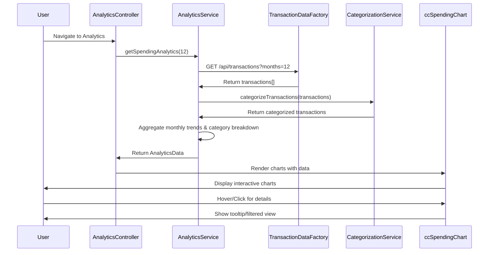

# Low-Level Design: QE-7704 - Spending Analytics and Insights

## a. Architecture Mapping

- **Analytics Dashboard UI** → AngularJS Module: `cc.analytics` with Controller: `AnalyticsController`
- **Analytics Service** → AngularJS Service: `AnalyticsService` (orchestrates data aggregation and chart preparation)
- **Transaction Data Service** → AngularJS Factory: `TransactionDataFactory` (REST API for transaction history)
- **Transaction Categorization Engine** → AngularJS Service: `CategorizationService` (assigns/validates transaction categories)
- **Visualization Library Integration** → AngularJS Directive: `ccSpendingChart` (wraps Chart.js for rendering)
- **Category Filter Component** → AngularJS Directive: `ccCategoryFilter` (allows category selection/filtering)

**Recommended Folder Structure:**
```
app/
├── modules/analytics/
│   ├── analytics.module.js
│   ├── analytics.controller.js
│   ├── analytics.html
│   └── analytics.css
├── services/
│   ├── analytics.service.js
│   └── categorization.service.js
├── factories/
│   └── transaction-data.factory.js
├── directives/
│   ├── cc-spending-chart.directive.js
│   ├── cc-category-filter.directive.js
│   └── templates/
│       ├── spending-chart.html
│       └── category-filter.html
└── constants/
    └── spending-categories.constant.js
```

## b. Component Specifications

| Name | Artifact Type | Responsibility | Key Dependencies |
|------|---------------|----------------|------------------|
| AnalyticsController | Controller | Manages analytics view, triggers data load for 12 months, handles user interactions | AnalyticsService, $scope, $filter |
| AnalyticsService | Service | Retrieves transaction history, aggregates monthly trends and category breakdowns | TransactionDataFactory, CategorizationService |
| CategorizationService | Service | Validates/assigns 9 predefined categories to transactions using rule-based logic | SPENDING_CATEGORIES constant |
| TransactionDataFactory | Factory | Fetches 12-month transaction history via REST API (GET /api/transactions?months=12) | $http, API_ENDPOINTS |
| ccSpendingChart | Directive | Renders interactive Chart.js visualizations (line chart for trends, pie/bar for categories) | Chart.js library, $timeout |
| ccCategoryFilter | Directive | Provides UI for selecting/filtering by spending categories | SPENDING_CATEGORIES constant |
| SPENDING_CATEGORIES | Constant | Defines 9 categories: Food & Dining, Fuel, Shopping, Travel, Entertainment, Utilities, Healthcare, Education, Miscellaneous | None |

## c. Data Model

**Transaction Model:**
```javascript
{
  transactionId: String,
  cardId: String,
  amount: Number,
  transactionDate: Date,
  category: String,
  merchantName: String,
  description: String
}
```

**MonthlySpendTrend Model:**
```javascript
{
  month: String,
  year: Number,
  totalSpend: Number,
  transactionCount: Number
}
```

**CategorySpending Model:**
```javascript
{
  category: String,
  totalAmount: Number,
  percentage: Number,
  transactionCount: Number
}
```

**AnalyticsData Model:**
```javascript
{
  monthlyTrends: Array<MonthlySpendTrend>,
  categoryBreakdown: Array<CategorySpending>,
  totalSpend: Number,
  dateRange: { startDate: Date, endDate: Date }
}
```

## d. Data Flow

User navigates to analytics dashboard → AnalyticsController calls AnalyticsService.getSpendingAnalytics(12) → TransactionDataFactory fetches 12 months of transactions via GET /api/transactions?months=12 → CategorizationService validates/assigns categories to each transaction using merchant codes and keywords → AnalyticsService aggregates data into monthly trends (group by month, sum amounts) and category breakdowns (group by category, calculate percentages) → Aggregated data returned to controller → Controller binds data to $scope → ccSpendingChart directive renders line chart for monthly trends and pie chart for category breakdown using Chart.js → User interacts with charts (hover for details, click category to filter) → ccCategoryFilter allows drilling down into specific category spending.

## e. Primary Sequence Diagram



## f. Implementation Notes

- Integrate Chart.js via CDN or npm; wrap in AngularJS directive using $timeout for DOM-ready rendering
- Use AngularJS $filter service to format currency and dates in chart labels and tooltips
- Implement CategorizationService with rule-based logic: map merchant codes/keywords to 9 predefined categories using switch/case or lookup object
- Cache 12-month transaction data in AnalyticsService for 5 minutes to avoid redundant API calls on view refresh
- Use ng-if in template to show loading spinner while data is being fetched and processed (target <2s render time)

## g. Error Handling

HTTP interceptor captures API errors; display user notification on failure; show empty state with "No data available" message if transaction fetch fails.

## h. Security Notes

Requires token-based auth via existing SSO; API calls include Authorization header; transaction data filtered by authenticated user ID on backend.