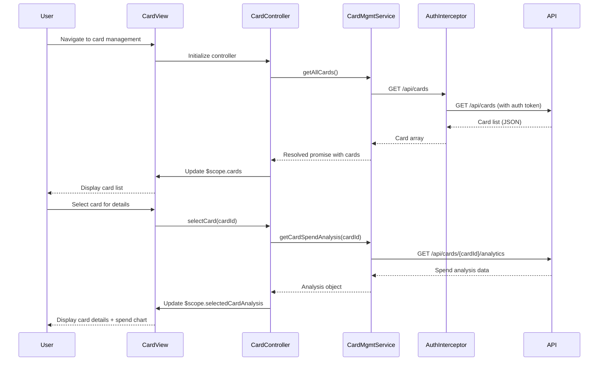

# Low-Level Design: Multi-Card Management and Tracking
**Epic ID:** QE-7705

## a. Architecture Mapping

- **Multi-Card Management Service** → AngularJS Service (cardManagementService)
- **User Authentication Service** → AngularJS Factory (authFactory) + HTTP Interceptor
- **Credit Card Data Repository** → REST API integration via AngularJS $http service
- **Card-Wise Analytics Engine** → AngularJS Service (cardAnalyticsService)
- **Card Management UI** → AngularJS Controller (cardManagementController) + View Template + Directives

**Folder Structure:**
```
/app
  /modules
    /card-management
      /controllers (cardManagementController.js)
      /services (cardManagementService.js, cardAnalyticsService.js)
      /directives (cardListDirective.js, cardDetailDirective.js)
      /views (card-list.html, card-detail.html)
  /shared
    /factories (authFactory.js)
    /interceptors (authInterceptor.js)
```

## b. Component Specifications

| Name | Artifact Type | Responsibility | Key Dependencies |
|------|---------------|----------------|------------------|
| cardManagementController | Controller | Manages card list display, filtering, selection state | cardManagementService, cardAnalyticsService, $scope |
| cardManagementService | Service | Fetches card data from repository, handles CRUD operations | $http, authFactory |
| cardAnalyticsService | Service | Retrieves and computes card-wise spending metrics | $http, cardManagementService |
| authFactory | Factory | Provides authentication token and user identity | $window (localStorage) |
| authInterceptor | HTTP Interceptor | Injects auth token into API requests, handles 401 errors | authFactory, $q |
| cardListDirective | Directive | Renders card list with filtering UI | cardManagementController |
| cardDetailDirective | Directive | Displays individual card details with masked PAN | cardManagementController |

## c. Data Model

**CreditCard Object:**
```javascript
{
  cardId: String,
  userId: String,
  cardNumber: String,        // Masked (e.g., "****1234")
  cardType: String,          // e.g., "Visa", "MasterCard"
  creditLimit: Number,
  currentBalance: Number,
  availableCredit: Number,
  issuerName: String,
  expiryDate: String,        // ISO date
  lastSyncTimestamp: Date
}
```

**CardSpendAnalysis Object:**
```javascript
{
  cardId: String,
  monthlySpend: Number,
  categoryBreakdown: Array   // [{category: String, amount: Number}]
}
```

## d. Data Flow

User navigates to card management view → cardManagementController initializes and calls cardManagementService.getAllCards() → Service makes authenticated GET request to /api/cards via authInterceptor → API returns card array → Controller binds cards to $scope → View renders card list using cardListDirective with filtering options → User selects a card → Controller invokes cardAnalyticsService.getCardSpendAnalysis(cardId) → Service fetches spend data from /api/cards/{cardId}/analytics → Controller updates $scope with analysis data → cardDetailDirective displays card details and spend visualization.

## e. Primary Sequence Diagram



## f. Implementation Notes

- Use AngularJS 1.x module pattern with dependency injection for all services and controllers
- Implement HTTP interceptor for centralized auth token injection and error handling
- Apply ng-repeat with track by cardId for card list rendering to optimize digest cycles
- Use $http service with promise-based API calls; handle errors via .catch() with user notification
- Mask card numbers client-side using filter (e.g., cardMaskFilter) before display

## g. Error Handling

HTTP interceptor captures API errors; 401 triggers re-authentication, other errors show toast notification via shared notificationService.

## h. Security Notes

Requires token-based auth via existing SSO; card numbers masked per PCI-DSS; data isolation enforced via userId validation in API layer.