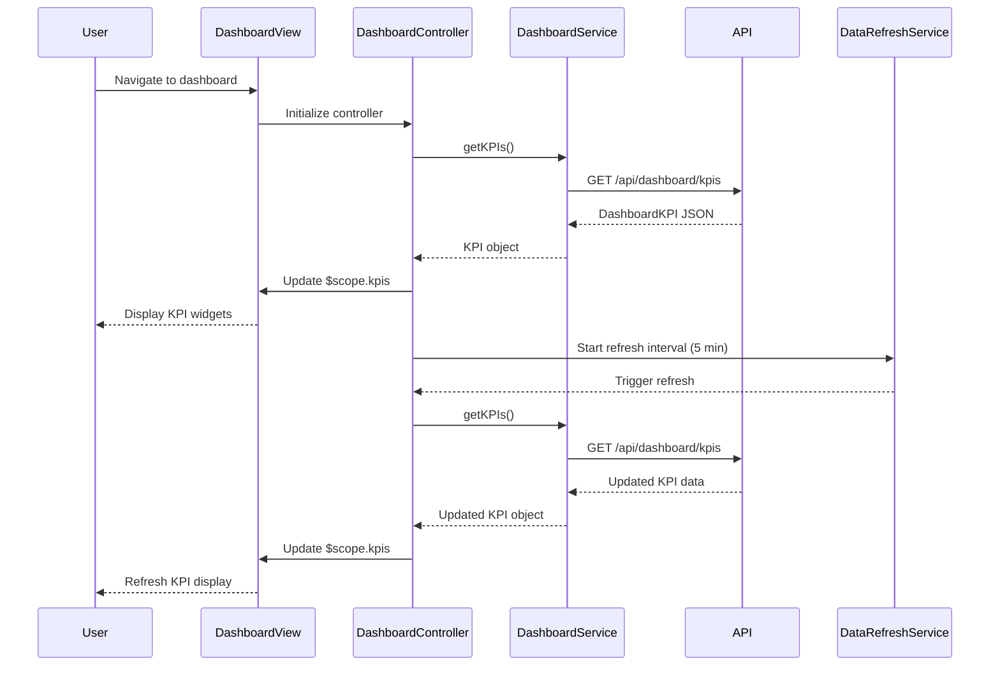

# Low-Level Design: Dashboard and KPI Management
**Epic ID:** QE-7706

## a. Architecture Mapping

- **Dashboard Service** → AngularJS Service (dashboardService)
- **KPI Aggregation Engine** → Backend API endpoint consumed by dashboardService
- **Credit Card Data Service** → REST API integration via $http
- **Transaction Processing Service** → REST API integration via $http
- **Dashboard UI** → AngularJS Controller (dashboardController) + View Template + KPI Directives

**Folder Structure:**
```
/app
  /modules
    /dashboard
      /controllers (dashboardController.js)
      /services (dashboardService.js)
      /directives (kpiWidgetDirective.js, kpiCardDirective.js)
      /views (dashboard.html)
  /shared
    /services (dataRefreshService.js)
```

## b. Component Specifications

| Name | Artifact Type | Responsibility | Key Dependencies |
|------|---------------|----------------|------------------|
| dashboardController | Controller | Orchestrates KPI data loading and refresh logic | dashboardService, dataRefreshService, $scope, $interval |
| dashboardService | Service | Fetches aggregated KPI data from backend API | $http, $q |
| dataRefreshService | Service | Manages periodic data refresh intervals | $interval |
| kpiWidgetDirective | Directive | Renders individual KPI metric (e.g., monthly spend) | None |
| kpiCardDirective | Directive | Displays KPI in card layout with icon and value | None |

## c. Data Model

**DashboardKPI Object:**
```javascript
{
  userId: String,
  monthlySpend: Number,
  totalCreditLimit: Number,
  availableCredit: Number,
  outstandingAmount: Number,
  lastUpdated: Date
}
```

## d. Data Flow

User navigates to dashboard → dashboardController initializes and calls dashboardService.getKPIs() → Service makes GET request to /api/dashboard/kpis → API aggregates data from Credit Card Data Service and Transaction Processing Service → API returns DashboardKPI object → Controller binds KPI data to $scope → View renders KPI widgets using kpiWidgetDirective and kpiCardDirective → dataRefreshService triggers $interval every 5 minutes → Controller re-invokes dashboardService.getKPIs() → Updated KPI data refreshes UI widgets.

## e. Primary Sequence Diagram



## f. Implementation Notes

- Use AngularJS $interval service for periodic data refresh; cancel interval on $scope.$destroy to prevent memory leaks
- Implement caching in dashboardService with 2-second TTL to meet load time NFR
- Use Bootstrap grid system (col-md-3, col-sm-6) for responsive KPI card layout
- Apply ng-if for conditional rendering of KPI widgets based on data availability
- Use $q.all() if multiple API calls needed for KPI aggregation client-side

## g. Error Handling

Service-level try/catch with promise rejection; controller displays error message in dashboard view via $scope.errorMessage.

## h. Security Notes

Requires token-based auth via existing SSO; userId derived from auth token to ensure data isolation.