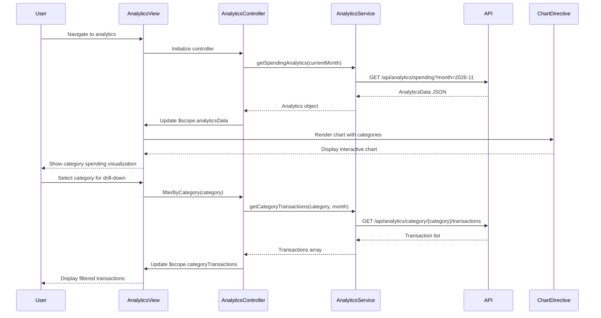

# Low-Level Design: Spending Analytics and Category Insights
**Epic ID:** QE-7707

## a. Architecture Mapping

- **Analytics Processing Service** → AngularJS Service (analyticsService)
- **Transaction Data Service** → REST API integration via $http
- **Categorization Engine** → Backend API endpoint consumed by analyticsService
- **Visualization Renderer** → AngularJS Directive (spendingChartDirective) using Chart.js or D3.js
- **Analytics Dashboard UI** → AngularJS Controller (analyticsController) + View Template

**Folder Structure:**
```
/app
  /modules
    /analytics
      /controllers (analyticsController.js)
      /services (analyticsService.js)
      /directives (spendingChartDirective.js, categoryBreakdownDirective.js)
      /views (analytics-dashboard.html)
  /shared
    /libraries (chart.js or d3.js)
```

## b. Component Specifications

| Name | Artifact Type | Responsibility | Key Dependencies |
|------|---------------|----------------|------------------|
| analyticsController | Controller | Manages analytics view state, date range selection, category filtering | analyticsService, $scope, $filter |
| analyticsService | Service | Fetches categorized transaction data and monthly trends from API | $http |
| spendingChartDirective | Directive | Renders interactive category-wise spending chart using Chart.js | Chart.js library |
| categoryBreakdownDirective | Directive | Displays category spending breakdown in table/list format | $filter (currency) |

## c. Data Model

**CategorySpending Object:**
```javascript
{
  category: String,          // One of 9 predefined categories
  totalAmount: Number,
  transactionCount: Number,
  percentageOfTotal: Number
}
```

**MonthlyTrend Object:**
```javascript
{
  month: String,             // e.g., "2026-11"
  totalSpend: Number,
  categoryBreakdown: Array   // Array of CategorySpending objects
}
```

**AnalyticsData Object:**
```javascript
{
  userId: String,
  currentMonth: MonthlyTrend,
  previousMonths: Array,     // Array of MonthlyTrend objects
  categories: Array          // Array of CategorySpending for current month
}
```

## d. Data Flow

User navigates to analytics dashboard → analyticsController initializes and calls analyticsService.getSpendingAnalytics(month) → Service makes GET request to /api/analytics/spending?month=YYYY-MM → API retrieves transactions from Transaction Data Service, categorizes via Categorization Engine, aggregates by category → API returns AnalyticsData object → Controller binds data to $scope → spendingChartDirective renders interactive pie/bar chart showing category breakdown → categoryBreakdownDirective displays tabular category list → User selects different month or category filter → Controller updates $scope and re-renders visualizations.

## e. Primary Sequence Diagram



## f. Implementation Notes

- Use Chart.js library integrated via AngularJS directive for responsive, interactive charts
- Implement spendingChartDirective with isolated scope and two-way binding for chart data
- Use $filter('currency') for formatting monetary values in category breakdown
- Apply ng-options for month selection dropdown with ng-change to trigger data reload
- Cache analytics data in analyticsService with 3-second TTL to meet rendering NFR

## g. Error Handling

Service-level promise rejection with .catch(); controller displays error banner in analytics view using $scope.error.

## h. Security Notes

Requires token-based auth via existing SSO; userId validated server-side to ensure transaction data isolation.