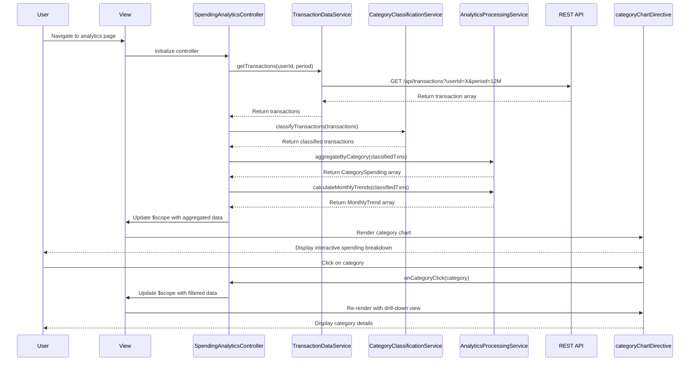

# Low-Level Design: QE-7708 - Spending Analytics and Category Insights

## a. Architecture Mapping

**AngularJS Artifacts:**
- **Module:** `spendingAnalyticsModule` - Root module for analytics feature
- **Controller:** `SpendingAnalyticsController` - Manages analytics view state and user interactions
- **Service:** `TransactionDataService` - Retrieves transaction records via REST API
- **Service:** `CategoryClassificationService` - Categorizes transactions into 9 predefined categories
- **Service:** `AnalyticsProcessingService` - Aggregates spending data by category and time period
- **Directive:** `categoryChartDirective` - Renders interactive category-wise spending charts
- **Directive:** `trendChartDirective` - Renders monthly spend trend visualizations
- **Factory:** `ChartConfigFactory` - Provides chart configuration objects for visualization library

**Folder Structure:**
```
app/
├── modules/
│   └── spending-analytics/
│       ├── controllers/
│       │   └── spending-analytics.controller.js
│       ├── services/
│       │   ├── transaction-data.service.js
│       │   ├── category-classification.service.js
│       │   └── analytics-processing.service.js
│       ├── directives/
│       │   ├── category-chart.directive.js
│       │   └── trend-chart.directive.js
│       ├── factories/
│       │   └── chart-config.factory.js
│       ├── views/
│       │   └── spending-analytics.html
│       └── spending-analytics.module.js
```

## b. Component Specifications

| Component Name | Artifact Type | Responsibility | Key Dependencies |
|----------------|---------------|----------------|------------------|
| spendingAnalyticsModule | Module | Registers all analytics components and configures routing | angular, ngRoute, chart.js |
| SpendingAnalyticsController | Controller | Manages view state, handles user interactions, coordinates data retrieval and chart rendering | TransactionDataService, CategoryClassificationService, AnalyticsProcessingService, ChartConfigFactory |
| TransactionDataService | Service | Fetches historical transaction data from REST API endpoint `/api/transactions` | $http, $q |
| CategoryClassificationService | Service | Maps transactions to 9 predefined categories using classification rules | None |
| AnalyticsProcessingService | Service | Aggregates spending by category and time period, calculates trends | None |
| categoryChartDirective | Directive | Renders interactive pie/bar chart for category-wise spending breakdown | ChartConfigFactory, Chart.js |
| trendChartDirective | Directive | Renders line chart for monthly spend trends over time | ChartConfigFactory, Chart.js |
| ChartConfigFactory | Factory | Provides reusable chart configuration objects (colors, labels, options) | None |

## c. Data Model

**Transaction Model:**
```javascript
{
  transactionId: String,
  userId: String,
  cardId: String,
  amount: Number,
  currency: String,
  merchant: String,
  category: String, // One of: Food & Dining, Fuel, Shopping, Travel, Entertainment, Utilities, Healthcare, Education, Miscellaneous
  transactionDate: Date,
  description: String
}
```

**CategorySpending Model:**
```javascript
{
  category: String,
  totalAmount: Number,
  transactionCount: Number,
  percentage: Number
}
```

**MonthlyTrend Model:**
```javascript
{
  month: String, // YYYY-MM format
  totalSpend: Number,
  categoryBreakdown: Array<CategorySpending>
}
```

## d. Data Flow

User navigates to spending analytics view → SpendingAnalyticsController initializes and calls TransactionDataService to fetch historical transactions via GET `/api/transactions?userId={userId}&period={period}` → Retrieved transactions are passed to CategoryClassificationService which assigns each transaction to one of 9 predefined categories → Classified data is sent to AnalyticsProcessingService which aggregates spending by category and calculates monthly trends → Aggregated data (CategorySpending and MonthlyTrend arrays) is bound to scope → categoryChartDirective and trendChartDirective watch scope data and render interactive charts using Chart.js → User interacts with charts (hover, click) to drill down into specific categories or time periods, triggering controller methods that update scope and re-render visualizations.

## e. Primary Sequence Diagram



## f. Implementation Notes

- Use AngularJS dependency injection to inject services into controller; register all components in spendingAnalyticsModule
- Leverage ES6 arrow functions and const/let for cleaner service implementations; use Promises ($q) for async operations
- Integrate Chart.js library via directive link function; bind chart updates to $scope.$watch for reactive rendering
- Implement REST API calls using $http service with interceptor for auth token injection and error handling
- Use AngularJS filters for date formatting and currency display in views; leverage ng-repeat for rendering category lists

## g. Error Handling

HTTP interceptor captures API errors and displays user-friendly notifications via toastr; controller wraps service calls in try/catch with fallback to cached data when available.

## h. Security Notes

Requires token-based authentication via existing SSO; userId is validated server-side and never exposed in client-side logic beyond API calls.