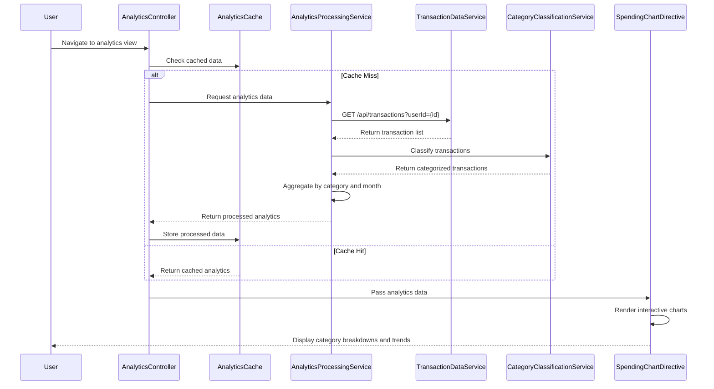

# Low-Level Design: QE-7708 - Spending Analytics and Category Insights

## a. Architecture Mapping

- **AngularJS Module**: `spendingAnalyticsModule` - Main module for analytics features
- **Controller**: `AnalyticsController` - Manages analytics view state and user interactions
- **Service**: `TransactionDataService` - Fetches transaction history via REST API
- **Service**: `CategoryClassificationService` - Maps transactions to 9 predefined categories
- **Service**: `AnalyticsProcessingService` - Aggregates spending by category and time period
- **Directive**: `spendingChart` - Renders interactive charts using visualization library
- **Factory**: `AnalyticsCache` - Caches processed analytics data for performance

**Folder Structure:**
```
/app
  /modules
    /analytics
      /controllers
        - analytics.controller.js
      /services
        - transaction-data.service.js
        - category-classification.service.js
        - analytics-processing.service.js
      /directives
        - spending-chart.directive.js
      /factories
        - analytics-cache.factory.js
      /views
        - analytics.html
      - analytics.module.js
```

## b. Component Specifications

| Name | Artifact Type | Responsibility | Key Dependencies |
|------|---------------|----------------|------------------|
| spendingAnalyticsModule | Module | Registers all analytics components and configures routing | angular, ui.router |
| AnalyticsController | Controller | Manages analytics view state, handles user interactions, orchestrates data flow | AnalyticsProcessingService, AnalyticsCache, $scope |
| TransactionDataService | Service | Fetches transaction history from REST API endpoint | $http, $q |
| CategoryClassificationService | Service | Maps transactions to 9 categories using merchant codes and descriptions | None |
| AnalyticsProcessingService | Service | Aggregates spending by category/time, calculates trends | TransactionDataService, CategoryClassificationService |
| spendingChart | Directive | Renders interactive charts (bar, pie, line) using Chart.js or D3 | Visualization library (Chart.js/D3) |
| AnalyticsCache | Factory | Caches processed analytics data with TTL for performance | $cacheFactory |

## c. Data Model

**Transaction Object:**
```javascript
{
  id: String,
  userId: String,
  cardId: String,
  amount: Number,
  currency: String,
  merchantName: String,
  merchantCode: String,
  description: String,
  category: String, // One of 9 predefined categories
  transactionDate: Date,
  timestamp: Number
}
```

**CategorySpending Object:**
```javascript
{
  category: String, // Food & Dining, Fuel, Shopping, Travel, Entertainment, Utilities, Healthcare, Education, Miscellaneous
  totalAmount: Number,
  transactionCount: Number,
  percentage: Number
}
```

**MonthlyTrend Object:**
```javascript
{
  month: String, // YYYY-MM
  totalSpending: Number,
  categoryBreakdown: Array<CategorySpending>
}
```

## d. Data Flow

User navigates to analytics view → AnalyticsController initializes and checks AnalyticsCache → If cache miss, controller calls AnalyticsProcessingService → Service fetches transactions via TransactionDataService REST API call → CategoryClassificationService categorizes each transaction into one of 9 categories → AnalyticsProcessingService aggregates spending by category and month, calculates trends → Processed data is cached in AnalyticsCache and returned to controller → Controller updates $scope with category breakdowns and monthly trends → spendingChart directive renders interactive visualizations → User interacts with charts to explore spending patterns.

## e. Primary Sequence Diagram



## f. Implementation Notes

- Use AngularJS dependency injection to inject services into controllers and directives for testability
- Implement TransactionDataService using $http with promise-based API calls; handle pagination for large transaction sets
- CategoryClassificationService uses rule-based mapping (merchant code → category) with fallback to keyword matching in descriptions
- AnalyticsProcessingService uses ES6 array methods (map, filter, reduce) for efficient aggregation
- spendingChart directive isolates scope and uses two-way binding for interactive chart updates

## g. Error Handling

HTTP interceptor captures API errors; controller displays user-friendly error messages via toast notifications; try/catch blocks wrap aggregation logic.

## h. Security Notes

Requires token-based auth via existing SSO; API endpoints validate user ownership of transaction data before returning results.