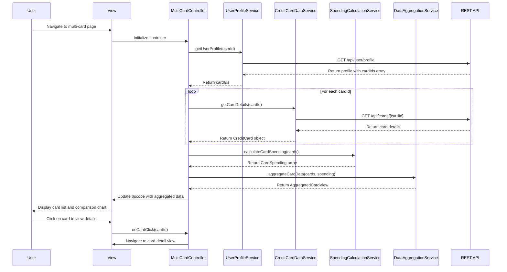

# Low-Level Design: QE-7709 - Multi-Card Management and Monitoring

## a. Architecture Mapping

**AngularJS Artifacts:**
- **Module:** `multiCardModule` - Root module for multi-card management feature
- **Controller:** `MultiCardController` - Manages card list view state and user interactions
- **Service:** `UserProfileService` - Retrieves user profile and associated card list
- **Service:** `CreditCardDataService` - Fetches card details (type, limit, balance, utilization) via REST API
- **Service:** `SpendingCalculationService` - Computes card-wise spending analysis and comparisons
- **Service:** `DataAggregationService` - Consolidates multi-card data for unified view
- **Directive:** `cardListDirective` - Renders list of credit cards with details
- **Directive:** `cardComparisonDirective` - Displays card-wise spending comparison charts
- **Filter:** `cardMaskFilter` - Masks sensitive card numbers (shows last 4 digits only)

**Folder Structure:**
```
app/
├── modules/
│   └── multi-card/
│       ├── controllers/
│       │   └── multi-card.controller.js
│       ├── services/
│       │   ├── user-profile.service.js
│       │   ├── credit-card-data.service.js
│       │   ├── spending-calculation.service.js
│       │   └── data-aggregation.service.js
│       ├── directives/
│       │   ├── card-list.directive.js
│       │   └── card-comparison.directive.js
│       ├── filters/
│       │   └── card-mask.filter.js
│       ├── views/
│       │   └── multi-card.html
│       └── multi-card.module.js
```

## b. Component Specifications

| Component Name | Artifact Type | Responsibility | Key Dependencies |
|----------------|---------------|----------------|------------------|
| multiCardModule | Module | Registers all multi-card components and configures routing | angular, ngRoute |
| MultiCardController | Controller | Manages card list state, handles add/organize actions, coordinates data retrieval | UserProfileService, CreditCardDataService, SpendingCalculationService, DataAggregationService |
| UserProfileService | Service | Fetches user profile and associated card IDs from `/api/user/profile` | $http, $q |
| CreditCardDataService | Service | Retrieves card details (type, limit, balance, utilization) from `/api/cards/{cardId}` | $http, $q |
| SpendingCalculationService | Service | Computes card-wise spending totals and comparison metrics | None |
| DataAggregationService | Service | Consolidates data from multiple cards into unified view model | None |
| cardListDirective | Directive | Renders scrollable list of cards with type, limit, balance, utilization | cardMaskFilter |
| cardComparisonDirective | Directive | Displays bar chart comparing spending across cards | Chart.js |
| cardMaskFilter | Filter | Masks card numbers to show only last 4 digits (e.g., **** **** **** 1234) | None |

## c. Data Model

**CreditCard Model:**
```javascript
{
  cardId: String,
  userId: String,
  cardType: String, // e.g., Visa, Mastercard, Amex
  cardNumber: String, // Masked: **** **** **** 1234
  cardholderName: String,
  creditLimit: Number,
  currentBalance: Number,
  availableCredit: Number,
  utilizationPercentage: Number,
  expiryDate: String, // MM/YY
  status: String // Active, Inactive
}
```

**CardSpending Model:**
```javascript
{
  cardId: String,
  cardType: String,
  monthlySpend: Number,
  yearlySpend: Number,
  lastTransactionDate: Date
}
```

**AggregatedCardView Model:**
```javascript
{
  totalCards: Number,
  totalCreditLimit: Number,
  totalAvailableCredit: Number,
  totalUtilization: Number,
  cards: Array<CreditCard>,
  spendingComparison: Array<CardSpending>
}
```

## d. Data Flow

User navigates to multi-card management view → MultiCardController initializes and calls UserProfileService to fetch user profile via GET `/api/user/profile` → Service returns list of associated cardIds → Controller iterates through cardIds and calls CreditCardDataService for each card via GET `/api/cards/{cardId}` → Retrieved card details are passed to SpendingCalculationService which computes card-wise spending metrics → All card data is sent to DataAggregationService which consolidates into AggregatedCardView model → Aggregated data is bound to $scope → cardListDirective renders card list with masked card numbers using cardMaskFilter → cardComparisonDirective renders spending comparison chart → User can click on individual cards to view details, organize cards via drag-and-drop, or add new cards triggering controller methods that update scope and persist changes via POST `/api/cards`.

## e. Primary Sequence Diagram



## f. Implementation Notes

- Use AngularJS dependency injection for all services; register components in multiCardModule with proper lifecycle management
- Implement parallel API calls using $q.all() to fetch multiple card details simultaneously for performance
- Apply cardMaskFilter in view templates using pipe syntax: {{card.cardNumber | cardMask}}
- Use ng-repeat with track by cardId for efficient card list rendering; implement drag-and-drop using angular-ui-sortable
- Store card organization preferences in localStorage and sync with backend via PUT `/api/user/preferences`

## g. Error Handling

HTTP interceptor handles API errors with retry logic for transient failures; controller displays error notifications using toastr and falls back to cached card data when available.

## h. Security Notes

Requires token-based auth via existing SSO; card numbers are masked client-side and never stored in full; all API calls use HTTPS with encrypted payloads.