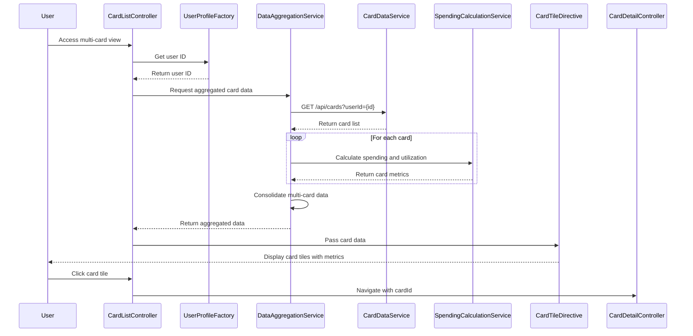

# Low-Level Design: QE-7709 - Multi-Card Management and Monitoring

## a. Architecture Mapping

- **AngularJS Module**: `cardManagementModule` - Main module for multi-card features
- **Controller**: `CardListController` - Manages card list view and user interactions
- **Controller**: `CardDetailController` - Manages individual card detail view
- **Service**: `CardDataService` - Fetches card information via REST API
- **Service**: `SpendingCalculationService` - Computes card-wise spending and utilization
- **Service**: `DataAggregationService` - Consolidates multi-card data
- **Directive**: `cardTile` - Renders individual card tile with key metrics
- **Factory**: `UserProfileFactory` - Manages user profile and card associations

**Folder Structure:**
```
/app
  /modules
    /card-management
      /controllers
        - card-list.controller.js
        - card-detail.controller.js
      /services
        - card-data.service.js
        - spending-calculation.service.js
        - data-aggregation.service.js
      /directives
        - card-tile.directive.js
      /factories
        - user-profile.factory.js
      /views
        - card-list.html
        - card-detail.html
      - card-management.module.js
```

## b. Component Specifications

| Name | Artifact Type | Responsibility | Key Dependencies |
|------|---------------|----------------|------------------|
| cardManagementModule | Module | Registers all card management components and routing | angular, ui.router |
| CardListController | Controller | Manages card list view, orchestrates multi-card data display | DataAggregationService, UserProfileFactory, $scope |
| CardDetailController | Controller | Manages individual card detail view with spending analysis | CardDataService, SpendingCalculationService, $stateParams |
| CardDataService | Service | Fetches card details from REST API endpoint | $http, $q |
| SpendingCalculationService | Service | Computes card-wise spending, utilization percentage, trends | CardDataService |
| DataAggregationService | Service | Consolidates data from multiple cards for comparison views | CardDataService, SpendingCalculationService |
| cardTile | Directive | Renders card tile with type, limit, balance, utilization | None |
| UserProfileFactory | Factory | Manages user profile data and card-user associations | $http |

## c. Data Model

**CreditCard Object:**
```javascript
{
  cardId: String,
  userId: String,
  cardType: String, // Visa, MasterCard, Amex, etc.
  cardNumber: String, // Masked (e.g., ****1234)
  issuer: String,
  creditLimit: Number,
  currentBalance: Number,
  availableCredit: Number,
  utilizationPercentage: Number,
  status: String, // Active, Inactive, Blocked
  expiryDate: String
}
```

**CardSpending Object:**
```javascript
{
  cardId: String,
  monthlySpend: Number,
  yearlySpend: Number,
  lastTransactionDate: Date,
  transactionCount: Number
}
```

**CardComparison Object:**
```javascript
{
  cards: Array<CreditCard>,
  totalCreditLimit: Number,
  totalAvailableCredit: Number,
  totalOutstanding: Number,
  averageUtilization: Number
}
```

## d. Data Flow

User accesses multi-card view → CardListController initializes and calls UserProfileFactory to get user ID → Controller invokes DataAggregationService → Service calls CardDataService to fetch all cards via REST API → For each card, SpendingCalculationService computes spending and utilization percentage (currentBalance / creditLimit * 100) → DataAggregationService consolidates multi-card data into comparison view → Controller updates $scope with card list and aggregated metrics → cardTile directive renders each card with type, limit, balance, utilization → User clicks card tile to navigate to CardDetailController for detailed analysis.

## e. Primary Sequence Diagram



## f. Implementation Notes

- Use AngularJS $http service with interceptors for authentication token injection on all API calls
- SpendingCalculationService caches utilization calculations to avoid redundant computation
- cardTile directive uses isolate scope with two-way binding for card data; emits events for user interactions
- DataAggregationService uses ES6 Promise.all for parallel card data fetching to meet 1.5-second NFR
- Implement card number masking in CardDataService before exposing to UI layer

## g. Error Handling

HTTP interceptor handles API failures; controller displays error messages via modal dialogs; retry logic for transient network errors.

## h. Security Notes

Requires token-based auth via existing SSO; card numbers are masked server-side before transmission; sensitive data encrypted in transit (HTTPS).