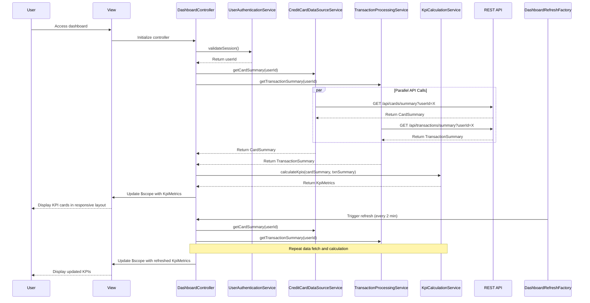

# Low-Level Design: QE-7710 - Credit Card Dashboard and KPI Management

## a. Architecture Mapping

**AngularJS Artifacts:**
- **Module:** `dashboardModule` - Root module for dashboard feature
- **Controller:** `DashboardController` - Manages dashboard state and KPI data binding
- **Service:** `UserAuthenticationService` - Handles user authentication and session management
- **Service:** `CreditCardDataSourceService` - Retrieves card details and balances from backend
- **Service:** `TransactionProcessingService` - Fetches monthly spend and outstanding amounts
- **Service:** `KpiCalculationService` - Computes aggregated KPI metrics across all cards
- **Directive:** `kpiCardDirective` - Renders individual KPI metric cards (Monthly Spend, Credit Limit, etc.)
- **Directive:** `responsiveDashboardDirective` - Manages responsive layout across devices
- **Factory:** `DashboardRefreshFactory` - Provides auto-refresh mechanism for real-time data updates

**Folder Structure:**
```
app/
├── modules/
│   └── dashboard/
│       ├── controllers/
│       │   └── dashboard.controller.js
│       ├── services/
│       │   ├── user-authentication.service.js
│       │   ├── credit-card-data-source.service.js
│       │   ├── transaction-processing.service.js
│       │   └── kpi-calculation.service.js
│       ├── directives/
│       │   ├── kpi-card.directive.js
│       │   └── responsive-dashboard.directive.js
│       ├── factories/
│       │   └── dashboard-refresh.factory.js
│       ├── views/
│       │   └── dashboard.html
│       └── dashboard.module.js
```

## b. Component Specifications

| Component Name | Artifact Type | Responsibility | Key Dependencies |
|----------------|---------------|----------------|------------------|
| dashboardModule | Module | Registers all dashboard components and configures routing | angular, ngRoute |
| DashboardController | Controller | Manages dashboard state, coordinates KPI data retrieval and real-time refresh | UserAuthenticationService, CreditCardDataSourceService, TransactionProcessingService, KpiCalculationService, DashboardRefreshFactory |
| UserAuthenticationService | Service | Validates user session and retrieves authenticated userId | $http, $q, $window |
| CreditCardDataSourceService | Service | Fetches card details and credit limits from `/api/cards/summary` | $http, $q |
| TransactionProcessingService | Service | Retrieves monthly spend and outstanding amounts from `/api/transactions/summary` | $http, $q |
| KpiCalculationService | Service | Aggregates card data to compute Monthly Spend, Total Credit Limit, Available Credit, Outstanding Amount | None |
| kpiCardDirective | Directive | Renders individual KPI metric with icon, label, value, and trend indicator | None |
| responsiveDashboardDirective | Directive | Applies responsive grid layout based on viewport size (mobile/tablet/desktop) | None |
| DashboardRefreshFactory | Factory | Provides $interval-based auto-refresh mechanism with configurable interval (default 2 minutes) | $interval |

## c. Data Model

**KpiMetrics Model:**
```javascript
{
  monthlySpend: Number,
  totalCreditLimit: Number,
  availableCredit: Number,
  outstandingAmount: Number,
  lastUpdated: Date
}
```

**CardSummary Model:**
```javascript
{
  userId: String,
  totalCards: Number,
  cards: Array<{
    cardId: String,
    creditLimit: Number,
    currentBalance: Number,
    availableCredit: Number
  }>
}
```

**TransactionSummary Model:**
```javascript
{
  userId: String,
  currentMonthSpend: Number,
  totalOutstanding: Number,
  billingCycleStart: Date,
  billingCycleEnd: Date
}
```

## d. Data Flow

User accesses dashboard → UserAuthenticationService validates session and retrieves userId → DashboardController initializes and calls CreditCardDataSourceService to fetch card summary via GET `/api/cards/summary?userId={userId}` → Simultaneously calls TransactionProcessingService to fetch transaction summary via GET `/api/transactions/summary?userId={userId}` → Both responses are passed to KpiCalculationService which computes aggregated KPI metrics (Monthly Spend = currentMonthSpend, Total Credit Limit = sum of all card limits, Available Credit = sum of all available credit, Outstanding Amount = totalOutstanding) → Computed KpiMetrics object is bound to $scope → kpiCardDirective instances render each KPI with formatted values → DashboardRefreshFactory triggers periodic refresh every 2 minutes, repeating the data fetch and calculation cycle → User views real-time updated KPIs in responsive layout optimized for their device.

## e. Primary Sequence Diagram



## f. Implementation Notes

- Use AngularJS dependency injection to inject services into DashboardController; register all components in dashboardModule
- Implement parallel API calls using $q.all() to fetch card and transaction summaries simultaneously for sub-2-second load time
- Use responsiveDashboardDirective with CSS media queries and Bootstrap grid classes (col-xs-12, col-md-6, col-lg-3) for responsive layout
- Leverage DashboardRefreshFactory with $interval service for auto-refresh; cancel interval on $scope.$destroy to prevent memory leaks
- Apply AngularJS filters (currency, number) in kpiCardDirective template for formatted KPI display

## g. Error Handling

HTTP interceptor captures API errors and displays user-friendly notifications; controller implements fallback to last known KPI values cached in localStorage when API calls fail.

## h. Security Notes

Requires token-based authentication via existing SSO; userId is validated server-side and session tokens are stored securely in httpOnly cookies.