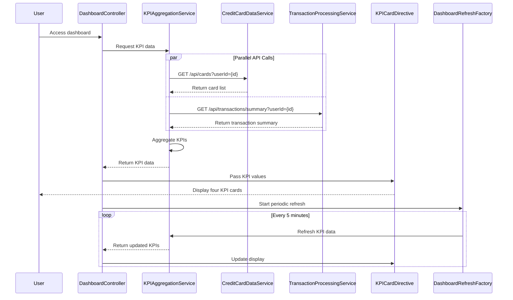

# Low-Level Design: QE-7710 - Credit Card Dashboard and KPI Management

## a. Architecture Mapping

- **AngularJS Module**: `dashboardModule` - Main module for dashboard features
- **Controller**: `DashboardController` - Manages dashboard state and KPI display
- **Service**: `CreditCardDataService` - Fetches card details and balances via REST API
- **Service**: `TransactionProcessingService` - Calculates monthly spend and outstanding amounts
- **Service**: `KPIAggregationService` - Aggregates KPIs across all cards
- **Directive**: `kpiCard` - Renders individual KPI card with value and trend
- **Factory**: `DashboardRefreshFactory` - Manages real-time data refresh logic

**Folder Structure:**
```
/app
  /modules
    /dashboard
      /controllers
        - dashboard.controller.js
      /services
        - credit-card-data.service.js
        - transaction-processing.service.js
        - kpi-aggregation.service.js
      /directives
        - kpi-card.directive.js
      /factories
        - dashboard-refresh.factory.js
      /views
        - dashboard.html
      - dashboard.module.js
```

## b. Component Specifications

| Name | Artifact Type | Responsibility | Key Dependencies |
|------|---------------|----------------|------------------|
| dashboardModule | Module | Registers dashboard components and configures responsive layout | angular, ui.router, ngMaterial |
| DashboardController | Controller | Manages dashboard state, orchestrates KPI data flow, handles refresh | KPIAggregationService, DashboardRefreshFactory, $scope, $interval |
| CreditCardDataService | Service | Fetches card details, limits, balances from REST API | $http, $q |
| TransactionProcessingService | Service | Calculates monthly spend and outstanding amounts via API | $http |
| KPIAggregationService | Service | Aggregates four KPIs across all user cards | CreditCardDataService, TransactionProcessingService |
| kpiCard | Directive | Renders responsive KPI card with icon, label, value, trend indicator | None |
| DashboardRefreshFactory | Factory | Manages periodic data refresh using $interval | $interval |

## c. Data Model

**KPIData Object:**
```javascript
{
  monthlySpend: Number,
  totalCreditLimit: Number,
  availableCredit: Number,
  outstandingAmount: Number,
  lastUpdated: Date
}
```

**CardSummary Object:**
```javascript
{
  cardId: String,
  creditLimit: Number,
  availableCredit: Number,
  currentBalance: Number
}
```

**TransactionSummary Object:**
```javascript
{
  userId: String,
  currentMonthSpend: Number,
  totalOutstanding: Number,
  lastTransactionDate: Date
}
```

## d. Data Flow

User accesses dashboard from any device → DashboardController initializes and calls KPIAggregationService → Service fetches card data via CreditCardDataService REST API call (GET /api/cards) → Service fetches transaction summary via TransactionProcessingService REST API call (GET /api/transactions/summary) → KPIAggregationService aggregates four KPIs: sums credit limits and available credit across cards, retrieves monthly spend and outstanding from transaction summary → Controller updates $scope with KPI data → kpiCard directive renders four responsive KPI cards → DashboardRefreshFactory triggers periodic refresh using $interval → Updated KPIs are displayed in real-time.

## e. Primary Sequence Diagram



## f. Implementation Notes

- Use AngularJS $http service with Promise.all for parallel API calls to meet 2-second load time NFR
- KPIAggregationService implements server-side caching with short TTL to reduce backend load
- kpiCard directive uses responsive CSS (Bootstrap grid) for mobile, tablet, desktop layouts
- DashboardRefreshFactory uses $interval with configurable refresh rate (default 5 minutes); cancels interval on scope destroy
- Implement loading spinner during initial data fetch using ng-show directive

## g. Error Handling

HTTP interceptor captures API errors; controller displays error banner with retry button; graceful degradation if partial data available.

## h. Security Notes

Requires token-based auth via existing SSO; API endpoints validate user session before returning financial data.