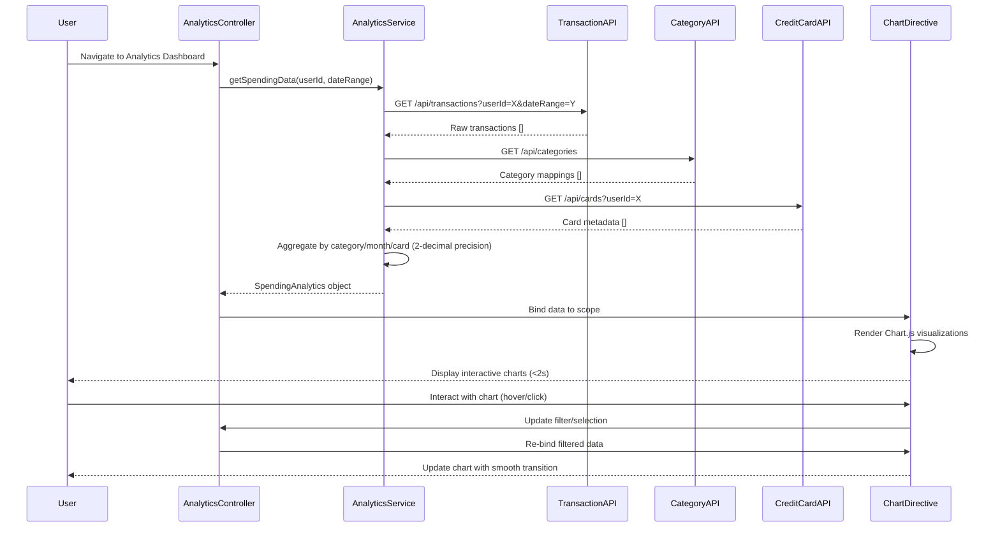

# Low-Level Design: QE-7711 - Spending Analytics and Insights

## a. Architecture Mapping

- **Analytics UI** → AngularJS Module (`app.analytics`) + Controller (`AnalyticsController`) + Directives (`spendingChart`, `categoryBreakdown`)
- **Analytics Engine** → AngularJS Service (`AnalyticsService`) for data aggregation and computation logic
- **Transaction Processing Service** → AngularJS Factory (`TransactionAPI`) for REST API calls to retrieve raw transaction data
- **Category Classification Service** → AngularJS Factory (`CategoryAPI`) for fetching category mappings
- **Credit Card Data Service** → AngularJS Factory (`CreditCardAPI`) for card metadata retrieval
- **Visualization Renderer** → AngularJS Directive (`chartRenderer`) wrapping Chart.js or D3.js for interactive visualizations

**Recommended Folder Structure:**
```
/app
  /analytics
    analytics.module.js
    analytics.controller.js
    analytics.service.js
    /directives
      spending-chart.directive.js
      category-breakdown.directive.js
      chart-renderer.directive.js
    /factories
      transaction-api.factory.js
      category-api.factory.js
      creditcard-api.factory.js
  /shared
    /services
    /filters
  /assets
    /css
    /js
```

## b. Component Specifications

| Name | Artifact Type | Responsibility | Key Dependencies |
|------|---------------|----------------|------------------|
| AnalyticsModule | Module | Registers analytics feature components and routing | angular, ui.router, chart.js |
| AnalyticsController | Controller | Manages analytics view state, user interactions, and data binding | AnalyticsService, $scope, $filter |
| AnalyticsService | Service | Aggregates transaction data by category/month/card with 2-decimal precision | TransactionAPI, CategoryAPI, CreditCardAPI |
| TransactionAPI | Factory | Fetches raw transaction data via REST endpoints | $http, $q |
| CategoryAPI | Factory | Retrieves category mappings for 9 predefined categories | $http, $q |
| CreditCardAPI | Factory | Provides card metadata for card-wise analysis | $http, $q |
| spendingChart | Directive | Renders monthly trend line/bar charts with user interaction support | chartRenderer, AnalyticsService |
| categoryBreakdown | Directive | Displays category-wise spending as pie/donut charts | chartRenderer, AnalyticsService |
| chartRenderer | Directive | Wraps Chart.js/D3.js for responsive, accessible chart rendering | Chart.js or D3.js library |

## c. Data Model

**SpendingAnalytics (JS Object):**
```javascript
{
  userId: String,
  period: String, // 'YYYY-MM' format
  categoryBreakdown: [
    {
      category: String, // One of 9: Food & Dining, Fuel, Shopping, Travel, Entertainment, Utilities, Healthcare, Education, Miscellaneous
      amount: Number, // 2 decimal precision
      transactionCount: Number
    }
  ],
  cardWiseSpend: [
    {
      cardId: String,
      cardName: String,
      totalSpend: Number, // 2 decimal precision
      categoryBreakdown: Array // Same structure as above
    }
  ],
  monthlyTrend: [
    {
      month: String, // 'YYYY-MM'
      totalSpend: Number, // 2 decimal precision
      categoryBreakdown: Array
    }
  ]
}
```

**Transaction (JS Object):**
```javascript
{
  transactionId: String,
  cardId: String,
  amount: Number,
  category: String,
  date: Date,
  description: String
}
```

## d. Data Flow

User navigates to analytics dashboard → AnalyticsController initializes and calls AnalyticsService.getSpendingData() → Service invokes TransactionAPI.getTransactions() to fetch raw transactions, CategoryAPI.getCategories() for mappings, and CreditCardAPI.getCards() for metadata → Service aggregates data by category, month, and card with 2-decimal precision using ES6 reduce/map functions → Aggregated SpendingAnalytics object is returned to Controller → Controller binds data to $scope → spendingChart and categoryBreakdown directives watch scope changes and trigger chartRenderer → chartRenderer generates interactive Chart.js visualizations within 2 seconds → User interacts with charts (hover, click, filter) → Directives handle events and update scope → UI re-renders dynamically with smooth transitions.

## e. Primary Sequence Diagram



## f. Implementation Notes

- Use AngularJS DI to inject AnalyticsService, API factories, and $http into controllers/services for testability and modularity.
- Implement ES6 Promises ($q) in all API factories for asynchronous REST calls with proper error handling.
- Use ES6 array methods (map, reduce, filter) in AnalyticsService for efficient data aggregation with 2-decimal precision (toFixed(2)).
- Wrap Chart.js in a reusable AngularJS directive (chartRenderer) with two-way data binding and responsive configuration.
- Apply AngularJS filters for date formatting ('YYYY-MM') and currency display in templates.

## g. Error Handling

HTTP interceptor-based error handling for API failures with user-friendly toast notifications and fallback to cached data when available.

## h. Security Notes

Requires token-based auth via existing SSO; all API calls include Authorization header with JWT token for user-specific data access.