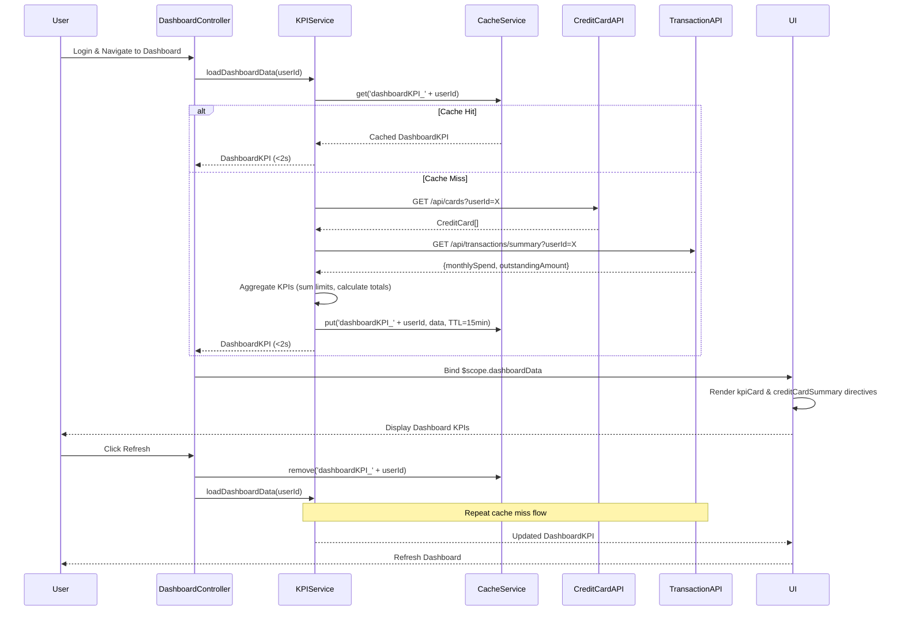

# Low-Level Design: QE-7712 - Dashboard KPIs and Credit Card Overview

## a. Architecture Mapping

- **User Interface Dashboard** → AngularJS Module (`app.dashboard`) + Controller (`DashboardController`) + Directives (`kpiCard`, `creditCardSummary`)
- **KPI Aggregation Engine** → AngularJS Service (`KPIService`) for aggregating and calculating KPIs from multiple data sources
- **Credit Card Data Service** → AngularJS Factory (`CreditCardAPI`) for REST API calls to retrieve card limits, balances, and available credit
- **Transaction Processing Service** → AngularJS Factory (`TransactionAPI`) for fetching monthly spend and outstanding amounts
- **User Authentication Service** → AngularJS Service (`AuthService`) for session management and user authentication state
- **Data Cache Layer** → AngularJS Service (`CacheService`) using $cacheFactory for sub-2-second load times

**Recommended Folder Structure:**
```
/app
  /dashboard
    dashboard.module.js
    dashboard.controller.js
    kpi.service.js
    cache.service.js
    /directives
      kpi-card.directive.js
      creditcard-summary.directive.js
    /factories
      creditcard-api.factory.js
      transaction-api.factory.js
  /auth
    auth.service.js
  /shared
    /filters
    /constants
  /assets
    /css
    /js
```

## b. Component Specifications

| Name | Artifact Type | Responsibility | Key Dependencies |
|------|---------------|----------------|------------------|
| DashboardModule | Module | Registers dashboard components, routing, and dependencies | angular, ui.router, ngAnimate |
| DashboardController | Controller | Manages dashboard state, triggers KPI loading, handles user interactions | KPIService, AuthService, $scope |
| KPIService | Service | Aggregates data from CreditCardAPI and TransactionAPI, calculates KPIs | CreditCardAPI, TransactionAPI, CacheService, $q |
| CreditCardAPI | Factory | Fetches card information, limits, balances via REST endpoints | $http, $q |
| TransactionAPI | Factory | Retrieves monthly spend and outstanding amounts via REST endpoints | $http, $q |
| AuthService | Service | Manages user authentication state and session tokens | $http, $window, $q |
| CacheService | Service | Implements caching strategy using $cacheFactory for KPI data | $cacheFactory |
| kpiCard | Directive | Renders individual KPI metric cards (monthly spend, credit limit, etc.) | None |
| creditCardSummary | Directive | Displays multi-card overview with aggregated and individual card details | None |

## c. Data Model

**DashboardKPI (JS Object):**
```javascript
{
  userId: String,
  timestamp: Date,
  monthlySpend: Number, // 2 decimal precision
  totalCreditLimit: Number,
  availableCredit: Number,
  outstandingAmount: Number,
  cards: [
    {
      cardId: String,
      cardName: String,
      cardNumber: String, // Masked (e.g., ****1234)
      creditLimit: Number,
      availableCredit: Number,
      outstandingAmount: Number,
      monthlySpend: Number
    }
  ]
}
```

**CreditCard (JS Object):**
```javascript
{
  cardId: String,
  userId: String,
  cardName: String,
  cardNumber: String, // Masked
  creditLimit: Number,
  currentBalance: Number,
  availableCredit: Number
}
```

## d. Data Flow

User logs in via AuthService → DashboardController initializes and calls KPIService.loadDashboardData(userId) → KPIService checks CacheService for cached data (TTL 15 min) → If cache miss, KPIService invokes CreditCardAPI.getCards(userId) to fetch card limits/balances and TransactionAPI.getMonthlySpend(userId) for spend/outstanding amounts → API responses are aggregated: totalCreditLimit = sum of all card limits, availableCredit = sum of all available credits, monthlySpend and outstandingAmount from TransactionAPI → Aggregated DashboardKPI object is stored in CacheService and returned to Controller within 2 seconds → Controller binds data to $scope → kpiCard and creditCardSummary directives render KPIs and card details → User views aggregated metrics and individual card breakdowns → Data refreshes every 15 minutes or on user-triggered refresh.

## e. Primary Sequence Diagram



## f. Implementation Notes

- Use AngularJS $cacheFactory in CacheService with 15-minute TTL to ensure sub-2-second dashboard load times on repeat visits.
- Implement AngularJS DI for all services/factories; inject $http and $q for promise-based async API calls.
- Use ES6 array reduce() in KPIService to aggregate totalCreditLimit and availableCredit across multiple cards.
- Apply Bootstrap grid system and CSS3 media queries in dashboard.html for responsive mobile/desktop layouts.
- Ensure WCAG 2.1 compliance by adding ARIA labels to kpiCard and creditCardSummary directives and supporting keyboard navigation.

## g. Error Handling

HTTP interceptor captures API errors, displays user-friendly error messages via toast notifications, and falls back to stale cached data if available.

## h. Security Notes

Requires token-based auth via existing SSO; all API requests include Authorization header with JWT token validated by backend services.