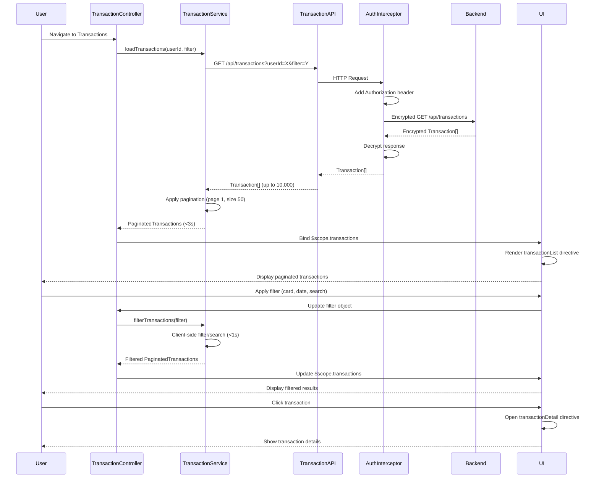

# Low-Level Design: QE-7713 - Transaction Management and Viewing

## a. Architecture Mapping

- **User Interface** → AngularJS Module (`app.transactions`) + Controller (`TransactionController`) + Directives (`transactionList`, `transactionDetail`, `transactionFilter`)
- **Transaction Management Module** → AngularJS Service (`TransactionService`) for business logic, filtering, and search operations
- **Transaction Processing Service** → AngularJS Factory (`TransactionAPI`) for REST API calls to retrieve transaction data
- **Credit Card Data Service** → AngularJS Factory (`CreditCardAPI`) for card-specific metadata and filtering
- **Data Storage Service** → Backend REST API (accessed via TransactionAPI)
- **Security Layer** → AngularJS HTTP Interceptor (`AuthInterceptor`) for adding auth tokens and handling encryption

**Recommended Folder Structure:**
```
/app
  /transactions
    transactions.module.js
    transaction.controller.js
    transaction.service.js
    /directives
      transaction-list.directive.js
      transaction-detail.directive.js
      transaction-filter.directive.js
    /factories
      transaction-api.factory.js
      creditcard-api.factory.js
  /shared
    /interceptors
      auth.interceptor.js
    /filters
      date-format.filter.js
      currency-format.filter.js
  /assets
    /css
    /js
```

## b. Component Specifications

| Name | Artifact Type | Responsibility | Key Dependencies |
|------|---------------|----------------|------------------|
| TransactionsModule | Module | Registers transaction components, routing, and HTTP interceptors | angular, ui.router, AuthInterceptor |
| TransactionController | Controller | Manages transaction view state, pagination, search/filter inputs | TransactionService, $scope, $filter |
| TransactionService | Service | Implements client-side filtering, search logic, and pagination for up to 10,000 transactions | TransactionAPI, CreditCardAPI, $q |
| TransactionAPI | Factory | Fetches transaction data via REST endpoints with query parameters for filtering | $http, $q |
| CreditCardAPI | Factory | Retrieves card metadata for card-wise transaction filtering | $http, $q |
| AuthInterceptor | Factory | Adds Authorization header to all HTTP requests and handles encryption/decryption | $window, $q |
| transactionList | Directive | Renders paginated transaction list with sorting and selection support | TransactionService |
| transactionDetail | Directive | Displays detailed view of a single transaction in modal or side panel | None |
| transactionFilter | Directive | Provides UI controls for filtering by card, date range, amount, and search text | TransactionService |

## c. Data Model

**Transaction (JS Object):**
```javascript
{
  transactionId: String,
  cardId: String,
  cardName: String,
  amount: Number, // 2 decimal precision
  currency: String, // e.g., 'USD'
  category: String,
  merchantName: String,
  transactionDate: Date,
  postingDate: Date,
  description: String,
  status: String // 'Posted', 'Pending'
}
```

**TransactionFilter (JS Object):**
```javascript
{
  cardId: String, // null for all cards
  startDate: Date,
  endDate: Date,
  minAmount: Number,
  maxAmount: Number,
  searchText: String, // Searches merchantName and description
  category: String
}
```

**PaginatedTransactions (JS Object):**
```javascript
{
  transactions: Array, // Current page transactions
  totalCount: Number,
  currentPage: Number,
  pageSize: Number,
  totalPages: Number
}
```

## d. Data Flow

User authenticates and navigates to transaction interface → TransactionController initializes and calls TransactionService.loadTransactions(userId, filter) → Service invokes TransactionAPI.getTransactions(userId, filter) with query parameters → AuthInterceptor adds Authorization header and encrypts request → Backend Data Storage Service returns encrypted transaction data → AuthInterceptor decrypts response → TransactionAPI returns transaction array to Service → Service applies client-side pagination (pageSize=50) and returns PaginatedTransactions to Controller within 3 seconds → Controller binds data to $scope → transactionList directive renders paginated list → User applies filters via transactionFilter directive → Controller updates filter object and calls TransactionService.filterTransactions(filter) → Service performs client-side filtering/search within 1 second using ES6 filter() and includes() → Filtered PaginatedTransactions is returned → UI updates with filtered results → User clicks transaction → transactionDetail directive displays detailed view.

## e. Primary Sequence Diagram



## f. Implementation Notes

- Use AngularJS HTTP interceptor (AuthInterceptor) to centrally manage JWT token injection and request/response encryption for all API calls.
- Implement client-side pagination in TransactionService using ES6 slice() to handle up to 10,000 transactions efficiently without re-fetching.
- Use ES6 filter() and includes() methods in TransactionService for sub-1-second search/filter operations on merchantName and description fields.
- Apply AngularJS two-way data binding between transactionFilter directive and TransactionController for reactive filter updates.
- Use AngularJS $filter service for date and currency formatting in transactionList directive templates.

## g. Error Handling

HTTP interceptor-based error handling with try/catch in service methods; displays user-friendly error notifications via toast messages on API failures.

## h. Security Notes

Requires token-based auth via existing SSO; AuthInterceptor adds JWT token to all requests and handles encryption/decryption of sensitive transaction data.